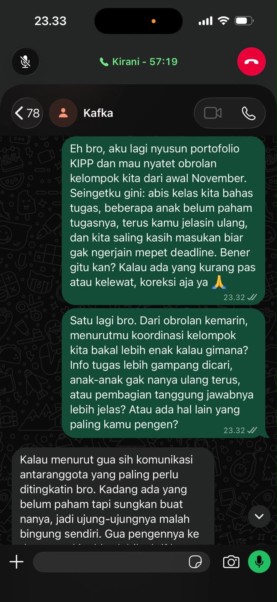
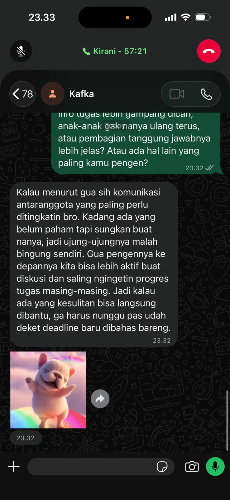
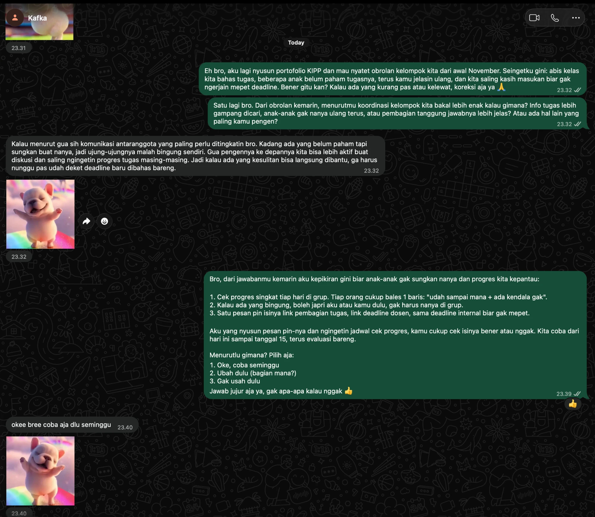
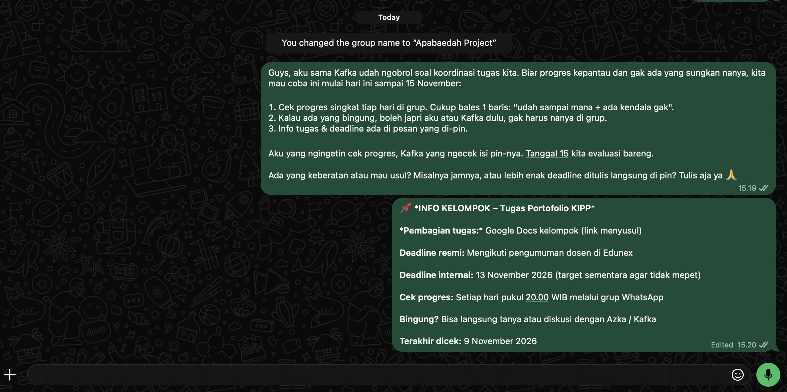

## Kompetensi target

Kompetensi yang ingin saya kembangkan adalah kemampuan memilih target komunikasi yang tepat, menyampaikan suatu permasalahan berdasarkan evidence, serta membangun perhatian target terhadap masalah tersebut.

Melalui kegiatan ini, saya juga berlatih memahami karakter lawan bicara, menyesuaikan pendekatan komunikasi berdasarkan respons yang diberikan, dan menghasilkan kesepakatan yang dapat ditindaklanjuti.

## Konteks performance

**Tanggal dan setting:** 5 November 2026, komunikasi dengan konteks diskusi kelompok mahasiswa.

**Persons dan relationship:**

Dalam kegiatan ini, saya berperan sebagai anggota kelompok mahasiswa yang ingin meningkatkan efektivitas koordinasi kelompok. Target komunikasi saya adalah ketua kelompok yang bertanggung jawab dalam mengoordinasikan pembagian tugas, jadwal diskusi, dan penyampaian informasi kepada anggota.

Hubungan antara saya dan target bersifat setara sebagai sesama mahasiswa. Namun, ketua kelompok memiliki kewenangan untuk mengatur mekanisme koordinasi internal.

**Permasalahan:**

Dalam kegiatan perkuliahan, koordinasi kelompok sering dilakukan melalui aplikasi pesan seperti WhatsApp. Informasi mengenai jadwal diskusi, pembagian tugas, dan deadline terkadang tersebar dalam banyak percakapan.

Kondisi tersebut berpotensi menyebabkan informasi penting terlewat, munculnya kesalahpahaman, dan anggota kelompok harus menanyakan kembali informasi yang sebenarnya sudah disampaikan.

Permasalahan utama yang ingin saya angkat bukanlah kurangnya tanggung jawab anggota, melainkan belum adanya mekanisme penyampaian informasi yang mudah ditemukan dan diperiksa kembali.

**Objective:**

Tujuan awal komunikasi adalah membuat ketua kelompok menyadari bahwa penyebaran informasi yang kurang terstruktur dapat menghambat koordinasi.

Tujuan berikutnya adalah memperoleh kesediaan ketua kelompok untuk mencoba mekanisme sederhana berupa satu pesan rangkuman yang diperbarui dan disematkan (*pinned message*) dalam grup.

**Initial state:**

Pada awal simulasi, target berada pada kondisi **Problem Aware**, yaitu memahami bahwa beberapa anggota terkadang mengalami kebingungan mengenai informasi kelompok, tetapi belum menganggapnya sebagai permasalahan yang membutuhkan perubahan cara koordinasi.

Target cenderung beranggapan bahwa setiap anggota memiliki tanggung jawab untuk membaca kembali seluruh percakapan grup.

## Target Map

| Person | Relevance | Authority | Current State |
|---|---|---|---|
| Ketua kelompok | Bertanggung jawab terhadap koordinasi dan penyampaian informasi | Dapat menyetujui perubahan mekanisme komunikasi | Problem Aware |
| Anggota kelompok | Mengalami langsung dampak informasi yang tidak terstruktur | Dapat memberikan feedback dan mengikuti mekanisme baru | Problem Aware |
| Dosen pengampu | Menentukan ketentuan dan deadline tugas | Memiliki otoritas akademik, tetapi tidak mengatur komunikasi internal | Netral |
| Koordinator kelas | Menyampaikan informasi perkuliahan kepada mahasiswa | Dapat membantu klarifikasi informasi kelas | Belum dilibatkan |

### Alasan pemilihan target

Saya memilih **ketua kelompok** sebagai target utama karena memiliki tingkat relevance dan authority yang sesuai dengan permasalahan.

Ketua kelompok terlibat langsung dalam koordinasi sehingga dapat memahami kendala yang dialami anggota. Selain itu, ketua kelompok dapat mengambil keputusan untuk mencoba mekanisme komunikasi baru tanpa memerlukan persetujuan dari pihak di luar kelompok.

Saya tidak memilih dosen sebagai target awal karena permasalahan yang ingin diselesaikan berada pada tingkat koordinasi internal mahasiswa, bukan kebijakan akademik.

Pemilihan target ini bertujuan agar komunikasi dapat menghasilkan tindakan nyata yang sesuai dengan kewenangan lawan bicara.

## Problem/Opportunity dan Attention Pitch

### Evidence awal

Permasalahan diidentifikasi melalui beberapa kondisi yang dapat diamati:

1. Informasi jadwal diskusi dapat tertimbun oleh percakapan lain dalam grup.
2. Perubahan jadwal terkadang disampaikan dalam pesan terpisah sehingga informasi sebelumnya masih berpotensi dianggap berlaku.
3. Anggota perlu mencari kembali pesan lama atau meminta konfirmasi mengenai informasi tertentu.

Ketiga kondisi tersebut digunakan sebagai dasar penyusunan masalah, bukan sebagai hasil survei atau data statistik nyata.

Saya juga membedakan antara **evidence** dan **inference**.

- **Evidence:** Informasi penting dapat tersebar di beberapa pesan percakapan.
- **Inference:** Penyebaran informasi tersebut berpotensi menyebabkan kesalahpahaman dan menurunkan efektivitas koordinasi.

Dengan demikian, saya tidak langsung menyimpulkan bahwa seluruh keterlambatan pekerjaan kelompok disebabkan oleh komunikasi yang kurang baik.

### Attention Pitch

Berikut merupakan pitch yang saya siapkan untuk disampaikan kepada ketua kelompok:

> "Menurut saya, ada satu hal yang bisa kita perbaiki dari koordinasi kelompok. Informasi jadwal dan deadline biasanya disampaikan melalui chat, tetapi terkadang tertimbun oleh percakapan lain. Akibatnya, anggota harus mencari ulang atau bertanya kembali. Saya belum bisa memastikan seberapa sering masalah ini terjadi, tetapi mungkin kita bisa mencoba satu pesan rangkuman yang selalu diperbarui dan di-pin. Bagaimana kalau kita coba selama satu minggu untuk melihat apakah cara ini membantu?"

### Strategi komunikasi

Pitch tersebut menggunakan tiga pendekatan utama:

1. **Relevance:** Mengangkat permasalahan yang berkaitan langsung dengan tanggung jawab ketua kelompok.
2. **Evidence-based communication:** Menyampaikan kondisi yang mungkin diamati tanpa membuat klaim statistik yang tidak tersedia.
3. **Low-risk proposal:** Menawarkan percobaan sederhana selama satu minggu, bukan perubahan sistem secara permanen.

Saya sengaja menggunakan bahasa yang tidak menyalahkan anggota maupun ketua kelompok. Hal ini bertujuan agar target lebih terbuka dalam mempertimbangkan permasalahan yang disampaikan.

## Response dan State Assessment

### Skenario respons awal

Dalam role-play, target memberikan respons berikut:

> **Ketua kelompok:** "Sebenarnya masalah itu memang kadang terjadi, tetapi menurut saya setiap anggota harusnya bisa membaca chat sendiri. Kalau harus membuat rangkuman terus, takutnya malah menambah pekerjaan."

Respons tersebut menunjukkan bahwa target mengakui keberadaan masalah, tetapi masih mempertanyakan manfaat solusi dibandingkan usaha yang diperlukan.

### State Assessment

| Tahap | State | Evidence |
|---|---|---|
| Sebelum pitch | Problem Aware | Target memahami adanya kebingungan informasi, tetapi belum memprioritaskan perubahan |
| Setelah pitch | Attention with Reservation | Target mengakui masalah, tetapi khawatir terhadap tambahan pekerjaan |
| Setelah adaptation | Interest (target simulasi) | Target mulai mempertimbangkan percobaan terbatas setelah beban kerja diperkecil |

Berdasarkan respons awal, saya menilai bahwa target telah memberikan perhatian terhadap masalah, tetapi belum sepenuhnya tertarik menjalankan solusi.

Oleh karena itu, saya tidak langsung meminta target menyetujui penerapan mekanisme baru secara permanen.

## Response dan Adaptation

### Adaptation terhadap keberatan target

Setelah memahami kekhawatiran target mengenai tambahan pekerjaan, saya mengubah pendekatan dengan menekankan bahwa solusi tidak harus menambah beban ketua kelompok.

> **Saya:** "Iya, saya setuju kalau setiap anggota juga punya tanggung jawab untuk membaca informasi. Saya juga tidak ingin membuat pekerjaan ketua kelompok bertambah. Bagaimana kalau saya yang membantu membuat rangkumannya? Kita cukup mencantumkan jadwal, deadline, dan pembagian tugas yang sudah disepakati. Kita coba satu minggu saja, lalu evaluasi apakah memang membantu."

Dalam respons tersebut, saya melakukan beberapa penyesuaian:

- Mengakui sudut pandang target tanpa memperdebatkannya.
- Menunjukkan bahwa tanggung jawab anggota tetap penting.
- Mengubah usulan menjadi percobaan dengan durasi terbatas.
- Menawarkan kontribusi pribadi untuk mengurangi beban target.
- Mengusulkan evaluasi sebelum solusi diterapkan lebih lanjut.

### Skenario respons setelah adaptation

> **Ketua kelompok:** "Kalau cuma satu minggu dan kamu bisa bantu membuat rangkumannya, menurut saya boleh dicoba. Nanti kita lihat apakah anggota lain merasa terbantu."

Respons ini menggambarkan pergeseran target dari sekadar memperhatikan masalah menuju ketertarikan untuk mencoba solusi.

Perubahan tersebut terjadi karena komunikasi tidak lagi berfokus pada kelemahan sistem koordinasi sebelumnya, tetapi pada langkah perbaikan yang sederhana dan realistis.

## Agreement, Action, dan Relationship Outcome

### Agreement

Berdasarkan skenario role-play, kesepakatan yang ingin dicapai adalah:

1. Kelompok mencoba penggunaan satu pesan rangkuman informasi selama satu minggu.
2. Saya bertanggung jawab membantu menyusun dan memperbarui rangkuman berdasarkan informasi yang sudah disepakati.
3. Ketua kelompok membantu memeriksa kebenaran informasi sebelum disampaikan.
4. Informasi resmi mengenai tugas dan deadline tetap mengacu pada pengumuman dosen atau platform perkuliahan.
5. Setelah satu minggu, kelompok mengevaluasi apakah mekanisme tersebut mempermudah pencarian informasi.

Kesepakatan ini bersifat terbatas dan tidak memaksakan penggunaan mekanisme baru secara permanen.

### Action Plan

| Action | Penanggung Jawab | Waktu | Indikator |
|---|---|---|---|
| Menyiapkan format rangkuman | Saya | Hari pertama | Format tersedia |
| Memeriksa informasi | Ketua kelompok | Sebelum publikasi | Informasi sesuai kesepakatan |
| Menyematkan rangkuman | Ketua kelompok | Hari pertama | Pesan mudah ditemukan |
| Memperbarui informasi | Saya | Ketika ada perubahan | Rangkuman tetap relevan |
| Mengumpulkan feedback | Saya dan ketua kelompok | Akhir minggu | Masukan anggota terkumpul |

### Indikator keberhasilan

Untuk mengevaluasi percobaan tersebut, saya menetapkan beberapa indikator:

- Anggota dapat menemukan informasi jadwal dan deadline dengan lebih mudah.
- Jumlah pertanyaan berulang terkait informasi yang sudah disampaikan dapat dibandingkan secara sederhana.
- Anggota memberikan feedback mengenai manfaat dan kemudahan mekanisme tersebut.
- Mekanisme tidak menimbulkan beban koordinasi yang berlebihan.

Indikator tersebut belum dinyatakan tercapai karena memerlukan pengamatan setelah percobaan dilaksanakan.

### Relationship Outcome

Pendekatan komunikasi yang digunakan bertujuan mempertahankan hubungan kerja sama yang positif.

Saya tidak menempatkan diri sebagai pihak yang lebih memahami masalah dibandingkan ketua kelompok, tetapi sebagai anggota yang ingin membantu memperbaiki proses bersama.

Dengan menawarkan bantuan dan tetap menghargai kewenangan ketua kelompok, saya berusaha membangun kepercayaan serta menunjukkan tanggung jawab terhadap solusi yang diusulkan.

## Evidence

::: {.evidence-block}

**Evidence 1 — Target Map**

Tabel target map pada bagian sebelumnya menunjukkan proses identifikasi pihak yang relevan, kewenangan masing-masing pihak, serta alasan memilih ketua kelompok sebagai target awal.

**Kontribusi saya:** Mengidentifikasi target, membandingkan tingkat relevance dan authority, serta menentukan prioritas komunikasi.

**Evidence 2 — Attention Pitch**

Naskah pitch menunjukkan pendekatan komunikasi yang dimulai dari permasalahan, keterbatasan evidence, dan usulan tindakan sederhana.

**Kontribusi saya:** Menentukan isu, menyusun argumen, dan memilih gaya bahasa yang sesuai dengan karakter target.

**Evidence 3 — Transcript Role-Play**

Skenario percakapan dalam bagian Response dan Adaptation menunjukkan bagaimana keberatan target dapat dijawab melalui perubahan pendekatan komunikasi.

**Kontribusi saya:** Menyusun respons yang mengakui keberatan target serta mengubah usulan agar lebih realistis.

**Evidence 4 — Agreement dan Action Plan**

Tabel action plan menunjukkan pembagian tanggung jawab, waktu pelaksanaan, dan indikator keberhasilan yang dapat digunakan untuk mengevaluasi solusi.

**Kontribusi saya:** Merancang langkah tindak lanjut yang terukur dan sesuai dengan kewenangan target.
:::

## Analisis Komunikasi

| Elemen | Evidence dan Analisis |
|---|---|
| **Person & Character** | Target utama adalah ketua kelompok karena memahami permasalahan dan memiliki kewenangan mengubah mekanisme koordinasi internal. Pendekatan disesuaikan dengan karakter target yang praktis dan memperhatikan beban pekerjaan. |
| **Objective & State** | Tujuan awal adalah membangun perhatian terhadap masalah. State awal Problem Aware, berkembang menjadi Attention with Reservation setelah pitch, dan ditargetkan mencapai Interest setelah adaptation. Perubahan state tidak disamakan dengan persetujuan penerapan permanen. |
| **Repertoire & Language** | Pitch menggunakan bahasa sederhana, tidak menyalahkan pihak tertentu, dan menjelaskan keterbatasan evidence. Saya menggunakan pertanyaan terbuka serta usulan percobaan terbatas untuk mengurangi resistensi. AI membantu meninjau struktur penyampaian. |
| **Response & Adaptation** | Keberatan target mengenai tambahan pekerjaan dijadikan dasar untuk mengubah pendekatan. Saya menawarkan bantuan langsung, memperkecil cakupan solusi, dan menambahkan evaluasi setelah satu minggu. |
| **Agreement/Action** | Kesepakatan mencakup percobaan satu minggu, pembagian tanggung jawab, mekanisme pemeriksaan informasi, dan indikator keberhasilan. |
| **Relationship Outcome** | Komunikasi mengutamakan kerja sama, menghargai kewenangan ketua kelompok, dan menghindari kesan menyalahkan. Tujuannya adalah membangun hubungan yang mendukung penyelesaian masalah bersama. |

## Penggunaan AI

Dalam penyusunan tugas ini, saya menggunakan **ChatGPT** sebagai alat bantu untuk mengembangkan skenario komunikasi, memperbaiki struktur pitch, serta mengevaluasi kesesuaian antara objective, response, dan adaptation.

### Peran AI

AI digunakan untuk:

1. Membantu menyusun target map dan mengidentifikasi target berdasarkan relevance serta authority.
2. Memberikan alternatif penyampaian attention pitch yang singkat dan jelas.
3. Membantu menyusun contoh keberatan target dan strategi adaptation.
4. Mengevaluasi kelengkapan analisis berdasarkan dimensi penilaian.

### Prompt penting

> "Bantu saya menyusun simulasi Target–Attention Challenge mengenai masalah koordinasi informasi dalam kelompok mahasiswa. Buat target map, attention pitch, kemungkinan keberatan target, strategi adaptation, dan action plan. Gunakan bahasa yang natural, jangan membuat data observasi nyata, serta bedakan antara evidence dan asumsi."

### Penggunaan dan evaluasi output AI

Output AI digunakan sebagai referensi dalam menyusun struktur komunikasi dan contoh dialog.

Saya menyesuaikan pilihan kata agar lebih mudah disampaikan dalam percakapan antar mahasiswa dan mempertahankan solusi yang sederhana serta dapat dilaksanakan.

Saya juga tidak menggunakan klaim angka atau hasil observasi yang tidak memiliki sumber nyata.

### Accuracy, Privacy, dan Authority

**Accuracy:** Saya membedakan antara skenario simulasi, kemungkinan dampak, dan hasil yang benar-benar perlu dibuktikan melalui observasi.

**Privacy:** Identitas pribadi, percakapan privat, dan informasi sensitif anggota kelompok tidak diperlukan dalam penyusunan simulasi.

**Authority:** Usulan hanya mencakup koordinasi internal kelompok. Perubahan deadline akademik tetap menjadi kewenangan dosen atau pihak terkait.

### Pembelajaran pribadi

Saya memahami bahwa AI dapat membantu memperbaiki struktur komunikasi, tetapi tidak dapat menggantikan kemampuan memahami respons seseorang secara langsung.

Keberhasilan komunikasi tetap bergantung pada kemampuan saya mendengarkan, menilai perubahan state, dan menyesuaikan pendekatan berdasarkan situasi nyata.

## Feedback dan Tindak Lanjut

### Feedback yang diterima

**Feedback dari latihan role-play (bukan dari target nyata):**

> "Permasalahan yang disampaikan cukup relevan dengan kondisi kelompok. Solusinya juga sederhana, tetapi pada awalnya belum jelas siapa yang akan bertanggung jawab memperbarui informasi."

Feedback latihan tersebut menunjukkan bahwa kekuatan komunikasi terletak pada relevansi masalah dan kesederhanaan solusi, sedangkan kelemahannya adalah kurangnya kejelasan pembagian tanggung jawab pada pitch awal.

**Feedback dari target nyata (8 November 2026):** Jawaban ketua kelompok justru mengoreksi framing masalah saya. Ia tidak menekankan informasi yang tertimbun di chat, tetapi anggota yang *sungkan bertanya* dan pembahasan yang menumpuk menjelang deadline. Rincian dan screenshot-nya ada di bagian *Bukti Pelaksanaan Nyata*.

### Adaptation/Replay

Pada pitch awal, saya lebih banyak menjelaskan masalah dan langsung menawarkan penggunaan pesan rangkuman.

Setelah mempertimbangkan keberatan target, saya melakukan replay dengan tiga perubahan:

1. Mengakui bahwa setiap anggota tetap bertanggung jawab membaca informasi.
2. Menawarkan diri untuk membantu menyusun rangkuman.
3. Membatasi penerapan selama satu minggu dengan evaluasi bersama.

Perubahan ini membuat usulan tidak lagi terlihat sebagai tambahan kewajiban bagi ketua kelompok, tetapi sebagai bentuk kerja sama untuk meningkatkan efektivitas koordinasi.

Respons target berubah dari keberatan terhadap tambahan pekerjaan menjadi kesediaan mempertimbangkan percobaan terbatas.

### Next Practice

Pada latihan berikutnya, saya akan berfokus pada kemampuan **menyampaikan attention pitch dalam waktu maksimal 30 detik**, dengan tetap mencakup:

- Masalah yang relevan dengan target.
- Evidence yang mendukung beserta keterbatasannya.
- Dampak yang mungkin ditimbulkan.
- Satu ajakan tindakan yang jelas dan realistis.

Saya juga akan berlatih mengajukan pertanyaan terbuka setelah pitch agar dapat memahami perspektif target sebelum menawarkan solusi lebih lanjut.

## Bukti Pelaksanaan Nyata

::: {.callout-important title="Status"}
Bagian-bagian sebelumnya adalah rancangan dan dialog latihan yang saya susun pada 5 November 2026. Bagian ini mencatat apa yang benar-benar terjadi setelahnya, apa adanya. Bila berbeda dengan skenario, yang dipakai sebagai dasar penilaian adalah bagian ini.
:::

### Percakapan setelah kelas (awal November 2026)

::: {.callout-note title="Catatan percakapan langsung (rekonstruksi dari ingatan, tidak direkam)"}
**Waktu dan tempat:** Awal November 2026, ketika kelompok mulai membahas tugas ini. Obrolan dilakukan langsung di kelas setelah perkuliahan. Tanggal pastinya tidak saya catat.

**Yang terlibat:** Saya, ketua kelompok, dan beberapa anggota kelompok lain.

**Yang terjadi:** Beberapa anggota menyampaikan bahwa mereka belum terlalu paham tugasnya, lalu ketua menjelaskannya ulang. Setelah itu kami saling memberi masukan, salah satunya agar tidak mengerjakan bagian masing-masing terlalu mepet deadline.
:::

**Kaitan dengan minggu ini:** Ini adalah *evidence* nyata bahwa masalah koordinasi memang terjadi, dan bahwa ketua sudah berada di state **Problem Aware**: ia sendiri yang harus menjelaskan ulang tugas kepada anggota.

### Membangun attention: pertanyaan ke ketua (8 November 2026, 23.32)

Saya tidak menyampaikan attention pitch persis seperti naskah di atas. Saya mengirim catatan percakapan setelah kelas untuk dikoreksi, lalu bertanya kondisi koordinasi seperti apa yang ia harapkan. Ketua membalas pada menit yang sama.

::: {layout-ncol=2}

:::

**Balasan ketua (dikutip apa adanya):**

> "Kalau menurut gua sih komunikasi antaranggota yang paling perlu ditingkatin bro. Kadang ada yang belum paham tapi sungkan buat nanya, jadi ujung-ujungnya malah bingung sendiri. Gua pengennya ke depannya kita bisa lebih aktif buat diskusi dan saling ngingetin progres tugas masing-masing. Jadi kalau ada yang kesulitan bisa langsung dibantu, ga harus nunggu pas udah deket deadline baru dibahas bareng."

Ketua tidak mengoreksi catatan saya, tetapi juga tidak menulis "benar" secara eksplisit. Karena itu saya menyebutnya **tidak dikoreksi**, bukan **dikonfirmasi penuh**.

### Agreement (8 November 2026, 23.39–23.40)

Berdasarkan jawaban tersebut, saya mengubah usulan dari sekadar pesan pin menjadi tiga hal: cek progres singkat harian di grup, boleh bertanya lewat japri ke saya atau ketua, dan satu pesan pin berisi info tugas dan deadline. Ketua menjawab "okee bree coba aja dlu seminggu" dan memberi reaksi 👍.

### Pengumuman ke grup (9 November 2026, 15.19–15.20)

Usulan yang disetujui ketua saya sampaikan ke grup kelompok, disertai pesan info kelompok dan ajakan bagi anggota untuk menyampaikan keberatan atau usul.

Pada saat screenshot diambil belum ada tanggapan anggota, penanda pin belum terlihat, dan tautan pembagian tugas masih "menyusul".

### State assessment berdasarkan bukti nyata

| Tahap | State | Evidence nyata |
|---|---|---|
| Setelah kelas, awal November | Problem Aware | Ketua menjelaskan ulang tugas kepada anggota yang belum paham |
| Setelah pertanyaan 8 November | Attention | Ketua merumuskan sendiri masalahnya (anggota sungkan bertanya) dan kondisi yang ia inginkan |
| Setelah usulan 8 November | Setuju uji coba satu minggu | "okee bree coba aja dlu seminggu" + reaksi 👍 |
| 9 November | Uji coba diumumkan ke grup | Screenshot pengumuman; tanggapan anggota belum ada |

### Perbedaan antara skenario dan kenyataan

| Aspek | Skenario (5 November) | Kenyataan (8–9 November) |
|---|---|---|
| Cara membangun attention | Attention pitch berisi masalah dan usulan | Pertanyaan terbuka tentang kondisi yang diharapkan ketua |
| Inti masalah | Informasi tertimbun di chat | Anggota sungkan bertanya dan progres baru dibahas menjelang deadline |
| Keberatan target | Takut menambah pekerjaan ketua | Tidak ada keberatan; ketua langsung setuju mencoba |
| Solusi | Satu pesan rangkuman yang di-pin | Cek progres harian, jalur japri, dan pesan pin |

**Pelajaran utama:** Dugaan saya tentang masalahnya hanya benar sebagian. Bertanya lebih dulu sebelum mengajukan solusi membuat target menyebutkan masalah dengan kata-katanya sendiri, dan solusi yang dihasilkan lebih sesuai dengan kebutuhannya.

### Yang belum ada

- Screenshot penanda pesan yang disematkan dan konfirmasi ketua sudah memeriksa isinya.
- Tanggapan anggota lain terhadap pengumuman di grup.
- Hasil evaluasi uji coba pada 15 November 2026.

## Self-Assessment

Penilaian berikut didasarkan pada rancangan komunikasi dan bukti nyata yang sudah terkumpul (percakapan setelah kelas, balasan ketua dan agreement 8 November, serta pengumuman ke grup 9 November). Hasil evaluasi uji coba belum tersedia.

| Dimensi | Skor 1–4 | Evidence Singkat |
|---|---:|---|
| Person & Character | 4 | Target map mempertimbangkan relevance, authority, initial state, dan karakter target dalam menentukan pendekatan komunikasi. |
| Objective & State | 4 | Objective jelas serta terdapat identifikasi state awal, respons target, dan kemungkinan perubahan state setelah adaptation. |
| Repertoire, Language & AI | 4 | Pitch menggunakan bahasa relevan, mengakui keterbatasan evidence, dan penggunaan AI dijelaskan secara transparan. |
| Response & Adaptation | 4 | Keberatan target dianalisis dan direspons melalui perubahan cakupan solusi, pembagian tanggung jawab, serta evaluasi. |
| Agreement, Action & Relationship | 3 | Ketua setuju tertulis mencoba uji coba satu minggu (8 November) dan usulan sudah diumumkan ke grup (9 November), tetapi tanggapan anggota dan hasil evaluasi belum ada. |

### Refleksi Akhir

Melalui penyusunan simulasi Target–Attention Challenge ini, saya memahami bahwa komunikasi yang efektif tidak hanya berkaitan dengan kemampuan menjelaskan sebuah masalah, tetapi juga kemampuan memilih orang yang tepat untuk diajak berdiskusi.

Saya belajar bahwa suatu solusi yang terlihat sederhana belum tentu langsung diterima karena setiap orang memiliki pertimbangan dan tanggung jawab yang berbeda.

Oleh karena itu, kemampuan mendengarkan respons dan menyesuaikan pendekatan menjadi hal penting dalam membangun perhatian serta ketertarikan target.

Hal yang paling ingin saya tingkatkan adalah kemampuan menyampaikan masalah secara singkat, menggunakan evidence yang dapat dipertanggungjawabkan, dan menghasilkan kesepakatan yang realistis tanpa memaksakan pendapat pribadi.

**Total:** 19/20 

::: {.assessor-only}

### Assessment Dosen
**Skor:** — / 20
**Evidence yang mendukung:** —
**Prioritas perbaikan:** —
**Keputusan:** Belum dinilai / Perlu revisi / Tercapai
:::
