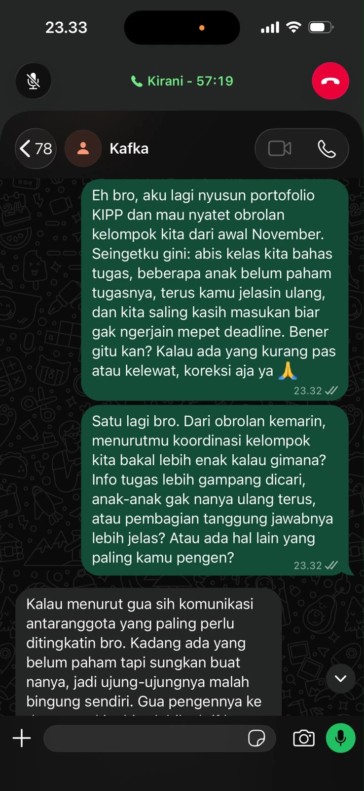
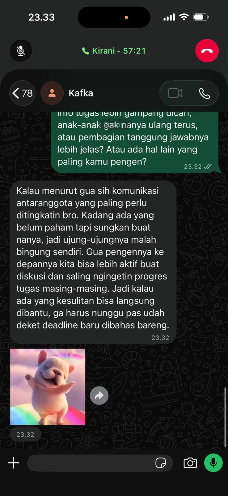
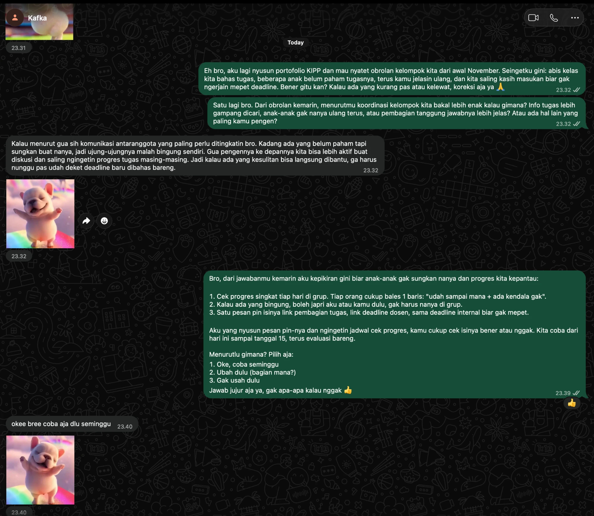

## Kompetensi Target

Kompetensi yang ingin saya kembangkan adalah kemampuan menghubungkan suatu permasalahan dengan solusi yang relevan, menjelaskan manfaat solusi kepada target, serta membangun ketertarikan melalui pendekatan komunikasi yang tepat.

Saya juga berlatih memahami kekhawatiran yang belum disampaikan secara langsung oleh target (*hidden concern*) dan menyesuaikan solusi berdasarkan respons yang diberikan.

## Konteks Performance

**Tanggal dan setting:** 5 November 2026, penyusunan dan pengembangan skenario simulasi komunikasi dengan konteks diskusi kelompok mahasiswa.

**Persons dan relationship:**

Saya berperan sebagai anggota kelompok mahasiswa yang ingin meningkatkan efektivitas komunikasi dan koordinasi kelompok. Target komunikasi adalah ketua kelompok yang memiliki tanggung jawab dalam mengatur pembagian tugas, jadwal diskusi, dan penyampaian informasi.

Hubungan antara saya dan target bersifat setara sebagai sesama mahasiswa. Namun, ketua kelompok memiliki kewenangan dalam menentukan mekanisme koordinasi yang digunakan oleh anggota.

### Objective dan Initial State

Pada Week 6, saya telah mengidentifikasi permasalahan berupa informasi kelompok yang tersebar dalam percakapan WhatsApp, khususnya mengenai jadwal, deadline, dan pembagian tugas.

Melalui attention pitch, saya menyusun pendekatan untuk menunjukkan bahwa permasalahan tersebut relevan terhadap efektivitas koordinasi kelompok.

Pada Week 7, fokus komunikasi berkembang dari menjelaskan permasalahan menjadi menunjukkan bagaimana solusi sederhana dapat membantu menyelesaikannya.

**Objective:**

Membangun ketertarikan ketua kelompok terhadap penggunaan format rangkuman informasi terpusat yang dapat diperbarui dan disematkan pada grup WhatsApp.

Target diharapkan memahami manfaat solusi, mencoba demonstrasi yang disiapkan, memberikan feedback, dan mempertimbangkan percobaan terbatas selama satu minggu.

**Initial State:**

State awal yang digunakan dalam skenario adalah **Attention with Reservation**.

Target telah memahami bahwa informasi yang tersebar dapat menimbulkan kebingungan, tetapi masih mempertanyakan apakah penggunaan rangkuman akan menambah pekerjaan dan benar-benar memberikan manfaat.

Oleh karena itu, pendekatan pada Week 7 tidak lagi berfokus pada meyakinkan target bahwa masalah tersebut ada, melainkan menunjukkan bahwa solusi yang ditawarkan sederhana, realistis, dan sesuai dengan kebutuhan kelompok.

## Attention Evidence dan Solution Hypothesis

### Attention Evidence

Berdasarkan identifikasi permasalahan pada Week 6, terdapat tiga kondisi yang menjadi dasar pengembangan solusi:

1. Informasi jadwal dan deadline dapat tertimbun oleh percakapan lain dalam grup.
2. Perubahan jadwal yang disampaikan melalui pesan terpisah dapat menyebabkan kebingungan mengenai informasi terbaru.
3. Anggota terkadang perlu mencari kembali informasi lama atau meminta konfirmasi kepada anggota lainnya.

Ketiga kondisi tersebut merupakan dasar analisis dalam skenario dan belum digunakan sebagai klaim hasil pengukuran kuantitatif.

Saya tidak menyimpulkan bahwa seluruh keterlambatan pekerjaan kelompok disebabkan oleh komunikasi yang kurang efektif. Namun, kondisi tersebut menunjukkan adanya peluang untuk meningkatkan kemudahan akses informasi.

### Solution Hypothesis

**Solusi yang diusulkan:**

Penggunaan satu pesan rangkuman informasi kelompok yang diperbarui secara berkala dan disematkan (*pinned message*) pada grup WhatsApp.

Rangkuman tersebut memuat jadwal diskusi, deadline, pembagian tugas, dan informasi penting lainnya yang sudah dikonfirmasi.

**Hipotesis solusi:**

Jika informasi utama kelompok tersedia dalam satu rangkuman yang mudah ditemukan, maka anggota dapat memperoleh informasi dengan lebih cepat tanpa harus mencari melalui seluruh riwayat percakapan.

Solusi ini tidak membutuhkan aplikasi tambahan dan dapat dijalankan menggunakan fasilitas yang sudah tersedia pada WhatsApp.

### Problem–Solution Link

| Problem | Solution Mechanism | Expected Benefit | Value bagi Target |
|---|---|---|---|
| Informasi tertimbun percakapan | Satu pesan rangkuman yang disematkan | Informasi lebih mudah ditemukan | Mengurangi kebutuhan menjawab pertanyaan berulang |
| Perubahan jadwal tidak terpusat | Rangkuman diperbarui berdasarkan kesepakatan terbaru | Mengurangi potensi kesalahpahaman | Koordinasi menjadi lebih terstruktur |
| Pembagian tugas kurang mudah dipantau | Daftar tugas dan penanggung jawab dalam rangkuman | Setiap anggota dapat mengetahui tanggung jawabnya | Mempermudah pemantauan progres |
| Kekhawatiran tambahan pekerjaan | Anggota membantu menyusun rangkuman | Beban pembaruan tidak hanya ditanggung ketua | Solusi lebih realistis dijalankan |

### Alasan Memilih Solusi

Saya memilih mekanisme ini karena sederhana, tidak memerlukan biaya tambahan, dan dapat diterapkan menggunakan platform komunikasi yang sudah digunakan oleh kelompok.

Selain itu, perubahan dapat dicoba dalam waktu singkat tanpa harus mengganti kebiasaan komunikasi seluruh anggota.

Solusi ini juga dapat dihentikan atau diperbaiki apabila hasil evaluasi menunjukkan bahwa manfaatnya belum sesuai dengan harapan.

## Interest Pitch dan Demonstration

### Interest Pitch

Berikut merupakan pitch yang saya susun untuk membangun ketertarikan target terhadap solusi.

> "Dari pembahasan sebelumnya, saya melihat bahwa masalah koordinasi kelompok bukan hanya soal anggota yang kurang memperhatikan chat, tetapi juga karena informasi penting kadang sulit ditemukan. Saya sudah menyiapkan contoh rangkuman yang berisi jadwal, deadline, dan pembagian tugas dalam satu pesan. Jadi, anggota cukup membuka pesan yang di-pin untuk melihat informasi utama. Saya juga bisa membantu memperbaruinya supaya tidak menambah pekerjaan ketua kelompok. Bagaimana kalau kita lihat contohnya dulu dan mencoba selama satu minggu?"

Pitch tersebut sengaja difokuskan pada manfaat yang relevan dengan ketua kelompok, yaitu kemudahan koordinasi dan pengurangan pertanyaan berulang.

Saya tidak menjanjikan bahwa solusi akan menghilangkan seluruh masalah komunikasi. Sebaliknya, saya menawarkan kesempatan untuk menguji manfaatnya melalui percobaan sederhana.

### Demonstration: Prototype Versi 1

Sebagai bentuk demonstrasi, saya menyusun contoh pesan rangkuman informasi kelompok.

**Prototype awal:**

::: {.callout-note title="Prototype V1 — Rangkuman Informasi Kelompok"}

**INFORMASI KELOMPOK**

**Jadwal Diskusi**
- Hari: Jumat
- Waktu: 19.00 WIB
- Tempat: Online

**Pembagian Tugas**
- Anggota A: Pengumpulan referensi
- Anggota B: Penyusunan materi
- Anggota C: Pembuatan presentasi
- Anggota D: Pemeriksaan akhir

**Deadline Internal**
- Pengumpulan materi: Sabtu
- Review bersama: Minggu

**Catatan:**
Informasi akan diperbarui apabila terdapat perubahan.

:::

Prototype ini dibuat untuk menunjukkan bentuk solusi secara langsung, bukan hanya melalui penjelasan verbal.

Dengan adanya contoh tersebut, target dapat melihat bagaimana informasi disusun dan mempertimbangkan apakah formatnya sesuai dengan kebutuhan kelompok.

### Strategi Demonstrasi

Demonstrasi dirancang berlangsung sekitar 60–90 detik dengan urutan:

1. Menunjukkan contoh rangkuman informasi.
2. Menjelaskan cara anggota menemukan informasi melalui pinned message.
3. Memperlihatkan bagian yang dapat diperbarui ketika terjadi perubahan.
4. Meminta target memberikan pendapat mengenai kemudahan penggunaan dan kemungkinan kendalanya.

Saya memilih demonstrasi singkat agar tidak menghabiskan terlalu banyak waktu target dan tetap memberikan kesempatan untuk berdiskusi.

## Response, State Assessment, dan Hidden Concern

### Skenario Respons Target

Setelah demonstrasi prototype pertama, berikut respons yang digunakan dalam skenario role-play:

> **Ketua kelompok:** "Menurut saya formatnya sudah cukup jelas dan memang lebih gampang dibaca. Tapi bagaimana kalau ada perubahan deadline dari dosen dan rangkumannya belum diperbarui? Takutnya anggota malah mengikuti informasi yang salah."

Respons tersebut menunjukkan bahwa target mulai melihat manfaat solusi, tetapi memiliki kekhawatiran mengenai keakuratan dan pembaruan informasi.

### Hidden Concern

Sebelumnya, saya menganggap kekhawatiran utama target adalah tambahan pekerjaan untuk membuat rangkuman.

Namun, respons dalam skenario menunjukkan kekhawatiran lain yang lebih penting, yaitu **keakuratan informasi dan kejelasan tanggung jawab pembaruan**.

Target tidak hanya mempertimbangkan kemudahan penggunaan, tetapi juga risiko apabila informasi yang disajikan tidak sesuai dengan pengumuman resmi.

Hal tersebut membuat saya memahami bahwa sebuah solusi tidak cukup hanya mudah digunakan, tetapi juga harus dapat dipercaya.

### State Assessment

| Tahap | State Target | Evidence atau Indikator |
|---|---|---|
| Sebelum interest pitch | Attention with Reservation | Target memahami masalah, tetapi masih mempertanyakan manfaat solusi |
| Setelah demonstrasi | Interest with Concern | Target menilai format lebih mudah dibaca, tetapi mempertanyakan keakuratan informasi |
| Setelah adaptation | Interest — target simulasi | Target bersedia mempertimbangkan uji coba apabila mekanisme verifikasi jelas |

Saya membedakan antara ketertarikan terhadap solusi dan persetujuan untuk menerapkannya.

Ketika target memberikan pertanyaan mengenai risiko penggunaan, hal tersebut dapat menjadi indikasi bahwa target mulai mengevaluasi solusi secara lebih serius.

Namun, pertanyaan tersebut belum dapat dianggap sebagai persetujuan implementasi.

## Response dan Adaptation

### Adaptation terhadap Hidden Concern

Untuk menanggapi kekhawatiran mengenai keakuratan informasi, saya mengubah mekanisme yang sebelumnya hanya berfokus pada pembaruan rangkuman menjadi sistem dengan proses verifikasi sederhana.

Berikut contoh respons yang disiapkan:

> **Saya:** "Iya, itu memang bisa jadi masalah kalau rangkumannya tidak langsung diperbarui. Menurut saya, kita perlu memastikan informasi yang dicantumkan sudah sesuai dengan pengumuman resmi. Jadi, saya bisa membantu menyiapkan rangkumannya, tetapi perubahan jadwal atau deadline harus dikonfirmasi terlebih dahulu. Kita juga bisa menambahkan waktu pembaruan terakhir supaya anggota tahu informasi itu terakhir diperiksa kapan."

Respons tersebut bertujuan menunjukkan bahwa saya memahami kekhawatiran target dan bersedia menyesuaikan solusi.

Saya tidak mempertahankan prototype awal sebagai solusi yang sudah sempurna.

### Prototype Versi 2

Setelah mempertimbangkan hidden concern, saya menyusun prototype yang lebih memperhatikan keakuratan informasi.

::: {.callout-tip title="Prototype V2 — Rangkuman Informasi Terverifikasi"}

**RANGKUMAN INFORMASI KELOMPOK**

**Terakhir diperbarui:** Kamis, 5 November 2026

**1. Jadwal Diskusi**
- Jumat, 19.00 WIB
- Media: Online
- Status: Sudah disepakati kelompok

**2. Pembagian Tugas**
- Anggota A: Pengumpulan referensi
- Anggota B: Penyusunan materi
- Anggota C: Pembuatan presentasi
- Anggota D: Pemeriksaan akhir

**3. Deadline**
- Deadline internal: Sabtu
- Review kelompok: Minggu
- Deadline resmi: Mengikuti pengumuman dosen

**4. Informasi dan Verifikasi**
- Rangkuman disusun oleh anggota yang ditunjuk.
- Perubahan informasi diperiksa bersama ketua kelompok.
- Pengumuman dosen tetap menjadi sumber utama informasi akademik.
- Setiap pembaruan disertai waktu terakhir diperbarui.

:::

### Perbandingan Prototype

| Aspek | Prototype V1 | Prototype V2 |
|---|---|---|
| Jadwal dan deadline | Ditampilkan dalam satu pesan | Ditampilkan dengan status dan sumber informasi |
| Pembaruan | Dilakukan jika ada perubahan | Dilakukan setelah informasi diperiksa |
| Penanggung jawab | Belum dijelaskan | Anggota penyusun dan ketua kelompok |
| Keakuratan | Belum ada mekanisme verifikasi | Mengacu pada pengumuman resmi |
| Transparansi | Tidak ada waktu pembaruan | Memuat waktu pembaruan terakhir |

Perubahan tersebut menunjukkan bahwa adaptation tidak hanya dilakukan pada cara berbicara, tetapi juga pada mekanisme solusi yang ditawarkan.

### Skenario Response Setelah Adaptation

> **Ketua kelompok:** "Kalau ada waktu update dan informasinya dicek dulu, menurut saya lebih aman. Kita bisa coba dulu selama seminggu, nanti dilihat apakah memang membantu anggota."

Respons ini digunakan sebagai contoh *Interest signal* dalam role-play.

Kesediaan mempertimbangkan percobaan terbatas menunjukkan bahwa kekhawatiran utama target mulai terjawab.

Namun, keputusan penerapan tetap harus dibedakan dari hasil uji coba yang sudah terbukti berhasil.

## Agreement, Action, dan Relationship Outcome

### Agreement yang Dituju

Melalui komunikasi ini, kesepakatan yang ingin dicapai adalah melakukan percobaan penggunaan rangkuman informasi kelompok selama satu minggu.

Percobaan dilakukan dengan mekanisme berikut:

1. Saya membantu menyusun format rangkuman informasi.
2. Ketua kelompok memeriksa informasi sebelum diumumkan.
3. Pesan rangkuman disematkan pada grup WhatsApp.
4. Setiap perubahan penting harus diperiksa berdasarkan informasi resmi.
5. Kelompok melakukan evaluasi setelah masa percobaan selesai.

Rencana tersebut dirancang agar tanggung jawab pembaruan informasi tidak hanya dibebankan kepada ketua kelompok.

### Action Plan

| Action | PIC | Waktu | Indikator Keberhasilan |
|---|---|---|---|
| Menyiapkan format akhir | Saya | Hari pertama | Rangkuman tersedia |
| Memeriksa keakuratan informasi | Ketua kelompok | Sebelum dipublikasikan | Informasi sesuai sumber resmi |
| Menyematkan pesan | Ketua kelompok | Hari pertama | Pesan dapat diakses anggota |
| Memperbarui rangkuman | Saya | Ketika ada perubahan | Waktu pembaruan tercantum |
| Mengumpulkan feedback | Saya | Akhir minggu | Masukan anggota terdokumentasi |

### Indikator Evaluasi

Untuk mengetahui apakah solusi benar-benar bermanfaat, saya menetapkan beberapa indikator:

- Kemudahan anggota dalam menemukan informasi penting.
- Jumlah pertanyaan berulang mengenai jadwal dan deadline.
- Keakuratan informasi dalam rangkuman dibandingkan pengumuman resmi.
- Feedback anggota mengenai kemudahan penggunaan.
- Beban waktu yang diperlukan untuk memperbarui rangkuman.

Indikator tersebut digunakan untuk menilai manfaat solusi, bukan sebagai hasil yang sudah tercapai.

### Relationship Outcome

Dalam skenario komunikasi ini, saya berusaha menjaga hubungan yang positif dengan target melalui pendekatan kolaboratif.

Saya tidak memposisikan usulan sebagai kritik terhadap kemampuan ketua kelompok dalam mengoordinasikan anggota.

Sebaliknya, saya menunjukkan bahwa perbaikan koordinasi merupakan tanggung jawab bersama dan menawarkan kontribusi langsung dalam pelaksanaannya.

Saya juga memberikan ruang kepada target untuk menyampaikan kekhawatiran sehingga keputusan tidak hanya didasarkan pada sudut pandang saya.

## Evidence

::: {.callout-note title="Status Evidence"}
Evidence berikut mencakup artefak yang disusun untuk latihan dan skenario respons role-play. Respons target, feedback observer, serta agreement nyata perlu diverifikasi melalui pelaksanaan komunikasi.
:::

::: {.evidence-block}

**Evidence 1 — Attention Evidence**

Identifikasi permasalahan dari Week 6 mengenai informasi jadwal, deadline, dan pembagian tugas yang tersebar dalam percakapan kelompok.

**Kontribusi saya:** Menentukan permasalahan utama dan menghubungkannya dengan kebutuhan target.

**Evidence 2 — Problem–Solution Map**

Tabel Problem–Solution Link menunjukkan hubungan antara permasalahan, mekanisme solusi, manfaat yang diharapkan, dan value bagi ketua kelompok.

**Kontribusi saya:** Mengembangkan hipotesis solusi dan menjelaskan manfaatnya.

**Evidence 3 — Prototype V1 dan V2**

Dua contoh rangkuman informasi menunjukkan perbedaan antara rancangan awal dan rancangan yang telah memperhatikan risiko keakuratan informasi.

**Kontribusi saya:** Menyusun format, menentukan mekanisme verifikasi, dan merancang pembagian tanggung jawab.

**Evidence 4 — Interest Pitch dan Skenario Role-Play**

Naskah pitch dan dialog simulasi digunakan untuk melatih penyampaian solusi serta respons terhadap kekhawatiran target.

**Kontribusi saya:** Menentukan strategi komunikasi, menyiapkan respons, dan menyusun adaptation.

**Evidence 5 — Action Plan**

Tabel action plan menunjukkan tindak lanjut, penanggung jawab, waktu, dan indikator evaluasi.

**Kontribusi saya:** Mengembangkan rencana percobaan yang realistis dan dapat dievaluasi.

:::

## Analisis Komunikasi

| Elemen | Evidence dan Analisis |
|---|---|
| **Person & Character** | Target yang dipilih adalah ketua kelompok karena memiliki tanggung jawab dan kewenangan dalam koordinasi. Pendekatan mempertimbangkan kebutuhan target terhadap kemudahan pengelolaan informasi dan keakuratan data. |
| **Objective & State** | Objective bergeser dari membangun Attention menjadi membangun Interest terhadap solusi. State awal adalah Attention with Reservation, dengan target akhir berupa Interest yang ditunjukkan melalui kesediaan mempertimbangkan percobaan. |
| **Repertoire & Language** | Komunikasi menggunakan pendekatan problem–solution, demonstrasi prototype, pertanyaan terbuka, dan penawaran percobaan terbatas. Bahasa dibuat sederhana, relevan, dan tidak memaksakan solusi. |
| **Response & Adaptation** | Hidden concern mengenai keakuratan informasi menjadi dasar perubahan prototype. Adaptation dilakukan melalui penambahan mekanisme verifikasi, penanggung jawab, dan waktu pembaruan terakhir. |
| **Agreement/Action** | Rencana tindak lanjut mencakup percobaan selama satu minggu, pembagian tanggung jawab, pemeriksaan informasi, serta indikator evaluasi yang dapat diamati. |
| **Relationship Outcome** | Pendekatan kolaboratif digunakan dengan menghargai pertimbangan target, menawarkan bantuan, dan memberikan ruang bagi target untuk mengevaluasi solusi tanpa tekanan. |

## Penggunaan AI

Dalam penyusunan tugas ini, saya menggunakan **ChatGPT** sebagai alat bantu untuk mengembangkan rancangan solusi dan meningkatkan kualitas penyampaian interest pitch.

### Alat dan Peran AI

AI digunakan untuk:

1. Membantu menghubungkan permasalahan dengan mekanisme solusi yang relevan.
2. Memberikan alternatif struktur interest pitch.
3. Mengidentifikasi kemungkinan kekhawatiran target terhadap solusi yang ditawarkan.
4. Membantu mengevaluasi rancangan prototype berdasarkan kemungkinan risiko.
5. Memperbaiki struktur analisis komunikasi agar lebih sistematis.

### Prompt Penting

> "Bantu saya mengembangkan interest pitch dari permasalahan koordinasi informasi dalam kelompok mahasiswa. Hubungkan masalah dengan solusi, manfaat, dan value bagi ketua kelompok. Buat contoh prototype, identifikasi kemungkinan hidden concern, dan berikan strategi adaptation yang realistis tanpa mengarang data hasil observasi."

### Penggunaan, Perubahan, dan Penolakan Output AI

Saya menggunakan AI sebagai referensi dalam mengembangkan mekanisme solusi dan menyiapkan alternatif respons komunikasi.

Saya mempertahankan solusi yang sederhana berupa rangkuman pesan WhatsApp karena lebih sesuai dengan kebutuhan kelompok dibandingkan membuat aplikasi baru.

Saya juga menggunakan saran mengenai verifikasi informasi untuk memperbaiki rancangan prototype.

Usulan yang membutuhkan sistem terlalu kompleks atau memberikan klaim manfaat tanpa evidence tidak digunakan.

### Pemeriksaan Accuracy, Privacy, dan Authority

**Accuracy:**

Informasi mengenai jadwal dan deadline harus mengacu pada kesepakatan kelompok serta pengumuman resmi dosen.

AI tidak digunakan untuk menghasilkan data statistik atau menyatakan bahwa suatu dampak sudah terbukti.

**Privacy:**

Rancangan menggunakan identitas anggota secara umum tanpa menyertakan data pribadi atau isi percakapan privat.

**Authority:**

Ketua kelompok memiliki kewenangan terhadap mekanisme koordinasi internal, tetapi tidak memiliki kewenangan untuk mengubah deadline resmi perkuliahan.

Oleh karena itu, solusi hanya membantu mengelola penyampaian informasi dan tidak menggantikan sumber akademik resmi.

### Pembelajaran Pribadi

Saya memahami bahwa AI dapat membantu menemukan alternatif solusi dan mempersiapkan komunikasi, tetapi penilaian terhadap kebutuhan dan kekhawatiran seseorang tetap harus dilakukan melalui interaksi langsung.

Saya juga belajar bahwa solusi yang terlihat sederhana perlu mempertimbangkan risiko, tanggung jawab, dan kemudahan pelaksanaan agar benar-benar memiliki nilai bagi target.

## Feedback dan Tindak Lanjut

### Feedback yang Diterima

Contoh feedback yang menjadi fokus evaluasi dalam skenario ini adalah:

> "Format rangkumannya mudah dipahami dan bisa membantu koordinasi. Namun, mekanisme pembaruan harus jelas supaya informasi yang disampaikan tetap akurat."

Feedback tersebut mengarahkan perhatian pada aspek keakuratan informasi, bukan hanya tampilan dan kemudahan penggunaan.

Hal ini menunjukkan bahwa ketertarikan terhadap solusi dapat meningkat ketika target memahami manfaat sekaligus melihat bahwa risiko utama sudah dipertimbangkan.

### Adaptation/Replay

Pada rancangan awal, saya berfokus pada kemudahan menemukan informasi dan mengurangi pertanyaan berulang.

Setelah mempertimbangkan hidden concern, saya melakukan replay dengan menekankan tiga perubahan:

1. Menambahkan mekanisme verifikasi sebelum informasi diperbarui.
2. Menetapkan pihak yang bertanggung jawab atas penyusunan dan pemeriksaan.
3. Menampilkan waktu pembaruan terakhir agar informasi lebih transparan.

Saya juga memperbaiki cara penyampaian dari sekadar menjelaskan fitur menjadi menghubungkan setiap perubahan dengan kebutuhan target.

Dengan demikian, pendekatan komunikasi lebih menekankan manfaat yang dapat dirasakan daripada jumlah fitur yang dimiliki solusi.

### Next Practice

Pada latihan berikutnya, saya ingin meningkatkan kemampuan **mengidentifikasi hidden concern sebelum melakukan demonstrasi solusi**.

Perilaku spesifik yang akan saya latih adalah mengajukan pertanyaan terbuka seperti:

> "Menurut kamu, hal apa yang paling perlu diperhatikan supaya cara ini benar-benar bisa membantu koordinasi kelompok?"

Melalui pertanyaan tersebut, saya berharap dapat memahami prioritas target terlebih dahulu sehingga demonstrasi dan penjelasan solusi lebih relevan.

## Revisi atas Feedback

::: {.callout-warning title="Feedback tiket 1054 — Perlu revisi (total rubrik 19)"}
Map person, objective, dan state sudah baik dan adaptation terhadap hidden concern sudah terlihat, tetapi agreement dan action masih berupa rencana simulasi yang belum diverifikasi sebagai hasil nyata.
:::

::: {.callout-important title="Status revisi"}
Bagian sebelumnya berisi rancangan dan dialog latihan yang saya susun untuk menganalisis dan mengembangkan solusi. Diskusi nyata dengan kelompok berlangsung sejak awal November 2026 ketika kami mulai membahas tugas ini, dan saya catat terpisah di bawah ini apa adanya. Agreement dan action yang belum terkonfirmasi tetap saya tandai sebagai rencana, Bukti yang diminta feedback untuk minggu ini sudah terkumpul, sehingga halaman ini saya ajukan kembali untuk dinilai.
:::

### Percakapan Nyata yang Sudah Terjadi

::: {.callout-note title="Catatan percakapan langsung (rekonstruksi dari ingatan, tidak direkam)"}
**Waktu dan tempat:** Sejak awal November 2026, ketika kelompok mulai membahas tugas ini. Obrolan dilakukan langsung di kelas setelah perkuliahan. Tanggal pastinya tidak saya catat.

**Yang terlibat:** Saya, ketua kelompok, dan beberapa anggota kelompok lain.

**Yang terjadi:**

- Kami membicarakan tugas kelompok yang sedang dikerjakan.
- Beberapa anggota menyampaikan bahwa mereka belum terlalu paham tugasnya.
- Ketua kelompok menjelaskan ulang tugas tersebut dengan lebih jelas kepada anggota yang belum paham.
- Setelah itu, beberapa dari kami, termasuk saya, saling memberi masukan. Salah satu masukan yang muncul adalah agar setiap anggota tidak mengerjakan bagian tugasnya terlalu mepet dengan deadline.

**Yang tidak terjadi dalam percakapan ini:** Belum ada pembahasan atau persetujuan tentang pesan rangkuman yang disematkan, prototype, maupun uji coba satu minggu. Bagian tersebut tetap saya anggap rencana.
:::

**Kaitan dengan minggu ini:** Percakapan ini menunjukkan bahwa masalah yang saya angkat memang terjadi: ada anggota yang belum memahami tugas sehingga ketua perlu menjelaskan ulang. Ini sejalan dengan *problem–solution link* bahwa informasi tugas belum mudah dipahami dan ditemukan kembali, serta bahwa beban menjelaskan ulang jatuh ke ketua. Namun, percakapan ini belum membuktikan agreement uji coba, sehingga konfirmasi ketua tetap perlu saya kumpulkan.

### Balasan Ketua Kelompok (8 November 2026)

Pada 8 November 2026 pukul 23.32, saya mengirim dua pesan kepada ketua kelompok (Kafka) lewat WhatsApp: pesan konfirmasi catatan percakapan dan pertanyaan tentang kondisi koordinasi yang ia harapkan. Ketua membalas pada menit yang sama.

::: {layout-ncol=2}

:::

**Balasan ketua (dikutip apa adanya):**

> "Kalau menurut gua sih komunikasi antaranggota yang paling perlu ditingkatin bro. Kadang ada yang belum paham tapi sungkan buat nanya, jadi ujung-ujungnya malah bingung sendiri. Gua pengennya ke depannya kita bisa lebih aktif buat diskusi dan saling ngingetin progres tugas masing-masing. Jadi kalau ada yang kesulitan bisa langsung dibantu, ga harus nunggu pas udah deket deadline baru dibahas bareng."

**Yang bisa dan tidak bisa saya simpulkan:**

- Ketua tidak mengoreksi catatan percakapan yang saya kirim, dan jawabannya menyinggung hal yang sama: anggota yang belum paham dan pembahasan yang menumpuk menjelang deadline. Namun, ia tidak secara eksplisit menulis "benar". Karena itu saya menyebutnya **tidak dikoreksi**, bukan **dikonfirmasi penuh**.
- Belum ada persetujuan tentang pesan rangkuman yang disematkan, prototype, atau uji coba satu minggu.

**Kaitan dengan minggu ini:** Jawaban ketua menunjukkan *hidden concern* yang berbeda dari dugaan saya. Saya mengira masalah utamanya adalah informasi yang tertimbun di chat, sedangkan ketua menekankan anggota yang **sungkan bertanya**. Artinya, pesan rangkuman saja kemungkinan belum cukup. Solusi perlu memberi ruang yang aman untuk bertanya, dan ini harus saya bahas dengan ketua sebelum meminta agreement uji coba.

### Agreement dengan Ketua Kelompok (8 November 2026)

Setelah membaca jawaban ketua tentang anggota yang sungkan bertanya dan kebutuhan saling mengingatkan progres, saya mengubah usulan saya. Usulan yang saya kirim pukul 23.39 tidak lagi hanya berisi pesan pin, tetapi juga cek progres harian dan jalur bertanya lewat japri. Ketua menjawab pukul 23.40.

**Isi usulan yang disetujui:**

1. Cek progres singkat setiap hari di grup. Setiap anggota cukup membalas satu baris: "udah sampai mana + ada kendala gak".
2. Anggota yang bingung boleh bertanya lewat japri ke saya atau ketua, tidak harus di grup.
3. Satu pesan pin berisi tautan pembagian tugas, tautan deadline dosen, dan deadline internal.

**Pembagian tanggung jawab:** saya menyusun pesan pin dan mengingatkan jadwal cek progres; ketua memeriksa kebenaran isi pesan pin.

**Periode uji coba:** 8–15 November 2026, lalu dievaluasi bersama.

**Jawaban ketua (dikutip apa adanya):** "okee bree coba aja dlu seminggu", disertai reaksi 👍 pada pesan usulan.

**Catatan:** Tanggal uji coba yang benar-benar disepakati adalah **8–15 November 2026**. Tanggal pada action plan di bagian sebelumnya merupakan rencana awal dan digantikan oleh kesepakatan ini. Persetujuan ini baru dari ketua; anggota lain belum dimintai pendapat.

**Kaitan dengan minggu ini:** Inilah bukti agreement yang diminta feedback: target menyatakan setuju secara tertulis untuk mencoba solusi selama satu minggu. Agreement ini juga menunjukkan adaptation yang nyata, karena solusi berubah setelah mendengar *hidden concern* ketua, yaitu anggota yang sungkan bertanya.

### Perubahan yang Saya Lakukan

| Bagian yang dikritik | Perubahan | Status |
|---|---|---|
| Agreement uji coba satu minggu hanya ada di skenario | Saya menyampaikan usulan yang sudah disesuaikan langsung ke ketua kelompok dan meminta konfirmasi tertulis lewat chat | **Sudah dilaksanakan (8 November 2026)**: ketua setuju mencoba seminggu |
| Tidak ada artefak kesepakatan yang disetujui kedua pihak | Menambahkan bagian *Evidence Pelaksanaan Nyata* yang menautkan screenshot konfirmasi dan pesan yang disematkan di grup | Menunggu bukti |
| Respons target hanya berasal dari role-play | Respons asli ketua akan dicatat apa adanya, termasuk jika ia menolak atau meminta perubahan | Menunggu bukti |

### Pesan untuk Memperoleh Konfirmasi Target

Pesan berikut saya kirim apa adanya kepada target. Apa pun jawabannya, termasuk penolakan atau permintaan perubahan, akan saya catat sebagai evidence.

> "Halo, aku udah bikin contoh rangkuman info kelompok (jadwal, pembagian tugas, deadline + waktu update terakhir). Aku yang nyusun, kamu cukup cek isinya sebelum di-pin. Kalau kamu setuju, kita coba seminggu dulu terus evaluasi bareng. Boleh balas 'setuju dicoba seminggu' atau kasih masukan kalau ada yang perlu diubah?"

Untuk mengonfirmasi catatan percakapan setelah kelas, saya mengirim pesan berikut kepada ketua kelompok:

> "Aku lagi nyatet obrolan kita abis kelas dari awal ngerjain tugas ini buat portofolio: beberapa anggota belum paham tugasnya, kamu jelasin ulang, terus kita saling kasih masukan biar gak ngerjain mepet deadline. Bener gitu kan? Kalau ada yang kurang pas, koreksi aja ya."

### Evidence Pelaksanaan Nyata

| Artefak | Status | File |
|---|---|---|
| Catatan percakapan langsung setelah kelas (di atas) | Sudah ditulis dan dikirim ke ketua; tidak dikoreksi | Halaman ini |
| Screenshot balasan ketua atas catatan percakapan dan pertanyaan desired state | **Sudah dikumpulkan (8 November 2026).** Catatan tidak dikoreksi, belum dikonfirmasi eksplisit | `images/evidence/chat-ketua-2026-11-08-1.webp`, `-2.webp` |
| Screenshot chat konfirmasi ketua (setuju / menolak / minta revisi) | **Sudah dikumpulkan (8 November 2026)**: setuju | `images/evidence/chat-ketua-2026-11-08-agreement.webp` |
| Screenshot pesan rangkuman yang disematkan di grup | Belum dikumpulkan | `evidence/w07-pinned-message.png` |
| Catatan hasil evaluasi setelah satu minggu | Belum dikumpulkan | `evidence/w07-evaluasi.png` |

Setelah bukti terkumpul, file disimpan di folder `portfolio/images/evidence/` dan ditampilkan di bagian ini. Respons asli target akan menggantikan respons role-play sebagai dasar penilaian agreement dan action.

## Self-Assessment

Penilaian berikut merupakan target penilaian diri atas rancangan komunikasi. Hasil akhirnya perlu disesuaikan dengan bukti pelaksanaan role-play atau komunikasi nyata.

| Dimensi | Skor 1–4 | Evidence Singkat |
|---|---:|---|
| Person & Character | 4 | Target dipilih berdasarkan relevance, authority, dan kebutuhan. Solusi memperhatikan tanggung jawab serta kekhawatiran ketua kelompok. |
| Objective & State | 4 | Objective jelas, terdapat initial state dan state assessment, serta pembedaan antara Attention, Interest, dan persetujuan implementasi. |
| Repertoire, Language & AI | 4 | Pitch menggunakan problem–solution link, prototype, bahasa yang relevan, serta penggunaan AI yang dijelaskan secara transparan. |
| Response & Adaptation | 4 | Hidden concern mengenai keakuratan informasi mendorong perubahan mekanisme solusi dan pengembangan prototype V2. |
| Agreement, Action & Relationship | 3 | Rencana percobaan, pembagian tanggung jawab, dan indikator evaluasi sudah spesifik, tetapi pelaksanaan agreement belum dibuktikan. |

### Refleksi Akhir

Melalui pengembangan Problem–Solution Interest Pitch ini, saya memahami bahwa membangun ketertarikan seseorang terhadap sebuah solusi membutuhkan lebih dari sekadar menjelaskan manfaatnya.

Solusi harus benar-benar berkaitan dengan masalah yang dianggap penting oleh target serta mempertimbangkan hambatan yang mungkin muncul dalam penerapannya.

Hal penting yang saya pelajari adalah bahwa kritik atau pertanyaan dari target tidak selalu menunjukkan penolakan. Respons tersebut juga dapat menjadi kesempatan untuk memahami kebutuhan yang sebelumnya belum terlihat.

Dalam kasus ini, kekhawatiran mengenai keakuratan informasi membantu saya mengembangkan solusi yang lebih bertanggung jawab dan realistis.

Saya juga memahami bahwa kemampuan komunikasi yang baik tidak hanya terlihat dari seberapa meyakinkan seseorang berbicara, tetapi juga dari kemauannya mendengarkan, menyesuaikan pendekatan, dan membangun kesepakatan yang saling menguntungkan.

**Total:** 19/20

::: {.assessor-only}

### Assessment Dosen
**Skor:** — / 20
**Evidence yang mendukung:** —
**Prioritas perbaikan:** —
**Keputusan:** Belum dinilai / Perlu revisi / Tercapai
:::
