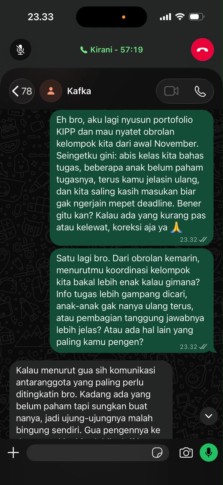
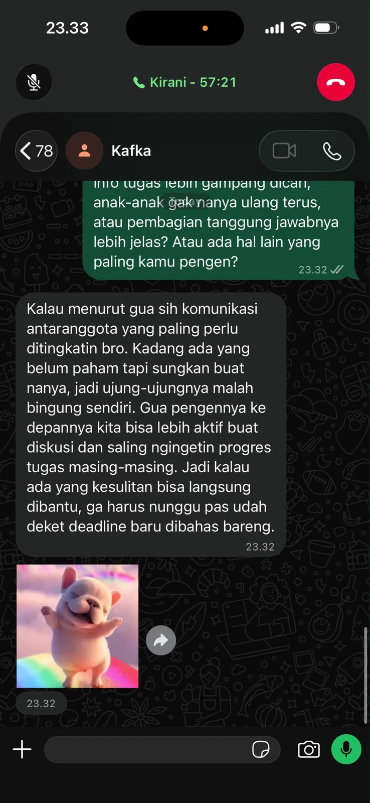
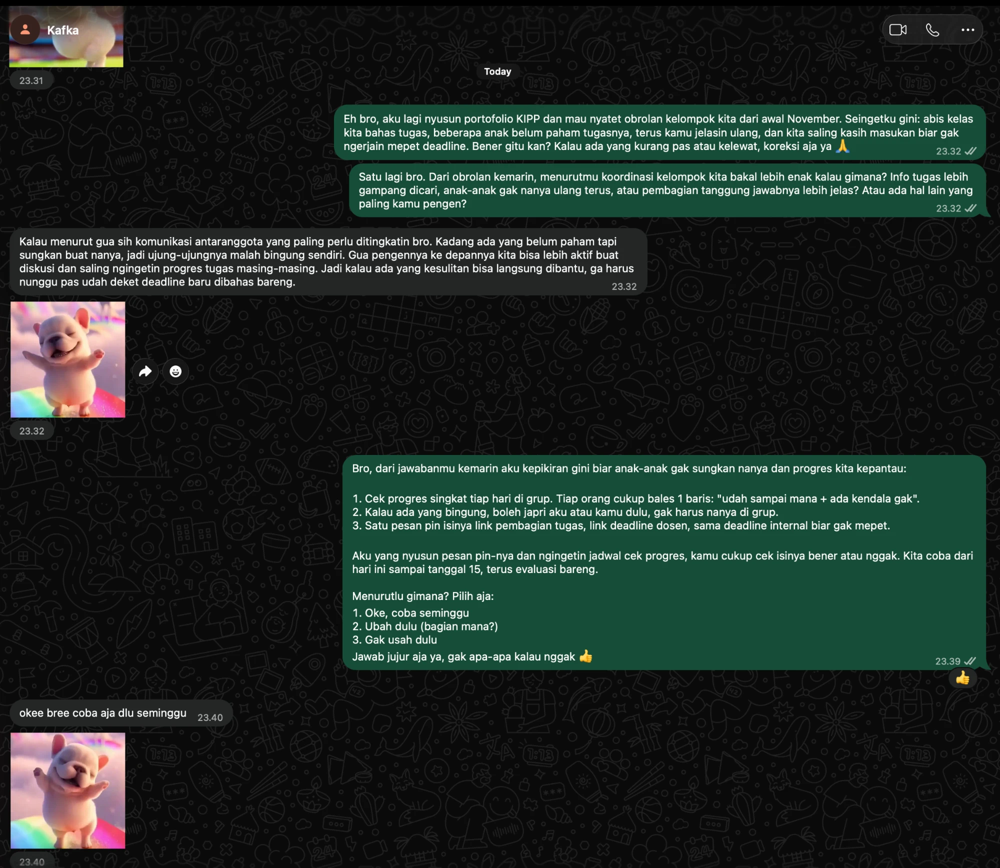
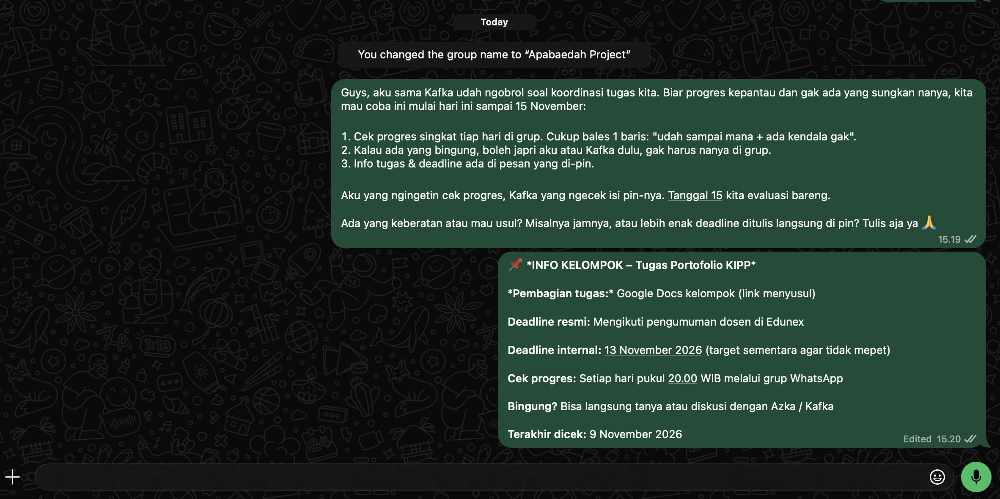
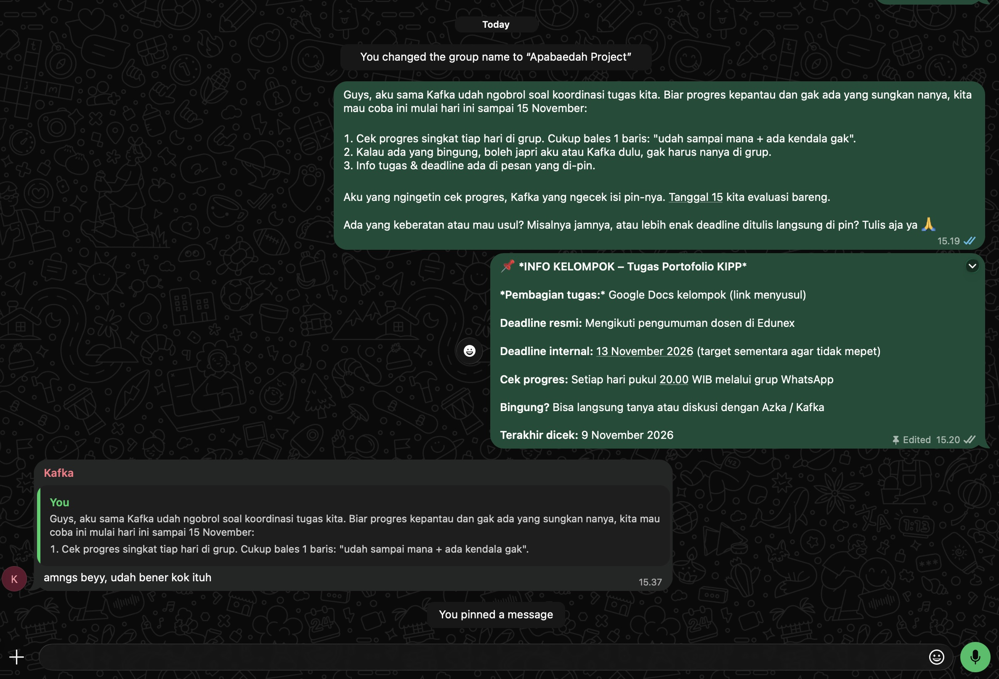
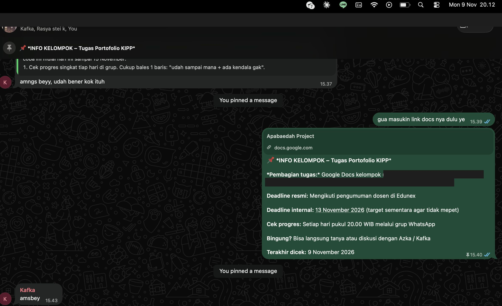
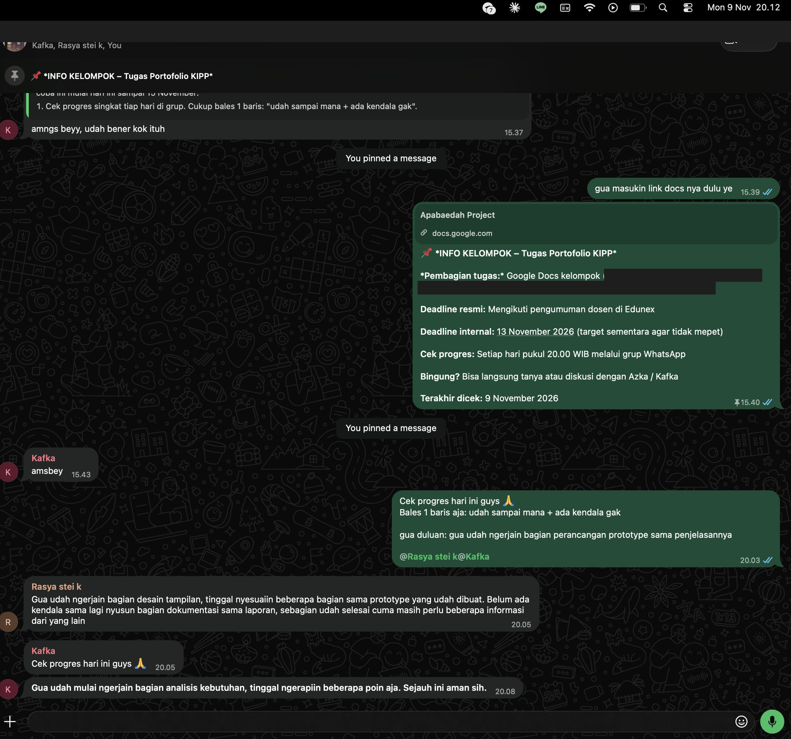
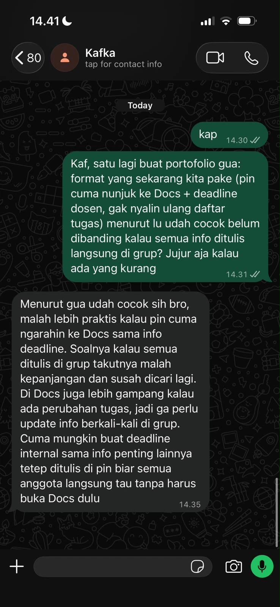

## Kompetensi Target

Kompetensi yang ingin saya kembangkan adalah kemampuan memahami kondisi yang benar-benar diinginkan oleh target (*desired state*) dan menghubungkannya dengan solusi yang relevan.

Saya juga berlatih menjelaskan hubungan antara fitur, manfaat, nilai, dan hasil yang diharapkan, serta mengidentifikasi risiko sebelum mengusulkan tindakan lebih lanjut.

Melalui kegiatan ini, saya ingin memahami bahwa keberhasilan komunikasi bukan hanya ketika target menyukai sebuah solusi, tetapi ketika target dapat melihat bagaimana solusi tersebut membantu mencapai kondisi yang diinginkannya.

## Konteks Performance

**Tanggal dan setting:** 5 November 2026, pengembangan skenario komunikasi Desire-State berdasarkan kasus koordinasi kelompok mahasiswa pada Week 6 dan Week 7.

**Persons dan relationship:**

Saya berperan sebagai anggota kelompok mahasiswa yang mengusulkan perbaikan mekanisme koordinasi informasi. Target komunikasi adalah ketua kelompok yang bertanggung jawab mengatur pembagian tugas, jadwal diskusi, dan penyampaian informasi kepada anggota lainnya.

Hubungan kami bersifat setara sebagai sesama mahasiswa. Namun, ketua kelompok memiliki tanggung jawab lebih besar dalam memastikan koordinasi berjalan dengan baik.

### Objective dan Initial State

Pada Week 6, saya mengangkat permasalahan mengenai informasi jadwal, deadline, dan pembagian tugas yang tersebar dalam percakapan WhatsApp.

Pada Week 7, saya mengembangkan solusi berupa rangkuman informasi yang disematkan dalam grup. Solusi tersebut dilengkapi mekanisme verifikasi dan waktu pembaruan setelah mempertimbangkan kekhawatiran mengenai keakuratan informasi.

Pada Week 9, saya ingin mengembangkan komunikasi menuju tahap **Desire**, yaitu membantu target menggambarkan kondisi ideal yang ingin dicapai dan memahami bagaimana solusi dapat memberikan nilai nyata.

**Objective:**

Membangun pemahaman bersama mengenai kondisi koordinasi kelompok yang diinginkan, menentukan indikator keberhasilan, dan menyesuaikan solusi agar dapat mencapai kondisi tersebut tanpa menambah beban kerja yang tidak diperlukan.

**Initial State:**

State awal dalam kelanjutan skenario adalah **Interest with Concern**.

Target telah menunjukkan ketertarikan terhadap penggunaan rangkuman informasi, tetapi masih mempertimbangkan risiko informasi yang tidak akurat dan pekerjaan tambahan untuk memperbaruinya.

Oleh karena itu, fokus komunikasi saya bukan lagi menjelaskan fitur solusi, melainkan memahami hasil akhir yang benar-benar dianggap penting oleh target.

## Current State dan Desired State

### Mengidentifikasi Current State

Dalam konteks permasalahan kelompok, kondisi awal yang ingin diperbaiki meliputi:

1. Informasi jadwal dan deadline disampaikan melalui beberapa pesan WhatsApp.
2. Anggota terkadang perlu mencari kembali pesan lama untuk memastikan informasi terbaru.
3. Ketua kelompok berpotensi menerima pertanyaan berulang mengenai informasi yang sebelumnya sudah disampaikan.
4. Perubahan jadwal dapat menimbulkan kebingungan apabila informasi sebelumnya tidak diperbarui.
5. Penggunaan rangkuman tambahan juga berisiko menciptakan dua sumber informasi yang harus dijaga konsistensinya.

Kondisi tersebut merupakan hasil identifikasi masalah dalam rancangan kasus, bukan hasil pengukuran statistik.

### Menggali Desired State

Untuk memahami kondisi yang diinginkan target, saya menyiapkan pertanyaan terbuka berikut:

> "Kalau nanti koordinasi kelompok kita berjalan lebih baik, menurut kamu perubahan apa yang paling terasa membantu? Apakah informasi lebih mudah ditemukan, pertanyaan berulang berkurang, atau justru pembagian tanggung jawabnya lebih jelas?"

Pertanyaan tersebut bertujuan agar saya tidak langsung menganggap bahwa solusi yang saya tawarkan sudah sesuai dengan kebutuhan target.

### Current–Desired State Map

Berikut merupakan rumusan desired state yang akan diuji dan divalidasi melalui percakapan dengan target.

| Elemen | Kondisi dan Tujuan |
|---|---|
| **Current State** | Informasi tersebar dalam beberapa pesan, perubahan jadwal tidak selalu mudah ditemukan, dan ketua kelompok berpotensi menerima pertanyaan berulang. |
| **Desired State** | Anggota dapat menemukan informasi terbaru dengan mudah, tanpa membuat ketua kelompok harus mengelola dua sumber informasi yang berbeda. |
| **Value bagi Target** | Koordinasi lebih terstruktur, waktu ketua kelompok tidak habis untuk mengulang informasi, dan risiko kesalahpahaman berkurang. |
| **Value bagi Anggota** | Informasi lebih mudah diakses, pembagian tugas lebih jelas, dan anggota dapat memastikan jadwal secara mandiri. |
| **Acceptable Risk** | Percobaan terbatas selama satu minggu, tidak mengubah sumber informasi resmi, dan dapat dihentikan apabila menimbulkan masalah. |
| **Evidence Threshold** | Informasi yang ditampilkan akurat, anggota lebih mudah menemukan informasi, dan proses pembaruan tidak menambah beban kerja secara signifikan. |

### Rumusan Desired State

Desired state yang ingin saya validasi bersama target adalah:

> "Saya ingin anggota kelompok bisa menemukan informasi terbaru dengan mudah dan tidak perlu terus-menerus bertanya mengenai jadwal atau deadline. Namun, saya juga tidak ingin ada dua sumber informasi berbeda yang harus diperbarui setiap saat."

Rumusan tersebut menjadi dasar untuk mengevaluasi apakah solusi yang sebelumnya dikembangkan benar-benar dapat memberikan nilai bagi target.

## Feature–Benefit–Value–Outcome Chain

Untuk memastikan solusi tidak hanya menawarkan fitur, saya menyusun hubungan antara mekanisme, manfaat, nilai, dan hasil yang diharapkan.

| Feature | Benefit | Value | Expected Outcome |
|---|---|---|---|
| Pesan informasi yang disematkan | Informasi utama lebih mudah ditemukan | Mengurangi waktu pencarian informasi | Koordinasi menjadi lebih efisien |
| Tautan atau acuan sumber resmi | Anggota dapat memeriksa informasi terbaru | Mengurangi risiko informasi yang tidak konsisten | Keakuratan komunikasi meningkat |
| Waktu pembaruan terakhir | Anggota mengetahui kapan informasi diperiksa | Meningkatkan transparansi informasi | Kepercayaan terhadap rangkuman meningkat |
| Pembagian tanggung jawab | Proses pemeliharaan tidak bergantung pada satu orang | Mengurangi beban ketua kelompok | Mekanisme lebih mudah dipertahankan |
| Evaluasi satu minggu | Manfaat dapat diperiksa sebelum penerapan lanjutan | Mengurangi risiko perubahan yang tidak efektif | Keputusan didasarkan pada hasil percobaan |

### Value Chain Utama

**Pesan informasi terpusat**

→ anggota lebih mudah menemukan informasi

→ kebutuhan untuk menanyakan informasi berulang dapat berkurang

→ ketua kelompok memiliki lebih banyak waktu untuk mengoordinasikan pekerjaan

→ efektivitas komunikasi kelompok diharapkan meningkat.

### Value Chain Kedua

**Acuan pada sumber resmi dan waktu pembaruan**

→ anggota dapat memeriksa keakuratan informasi

→ risiko menggunakan jadwal atau deadline yang sudah berubah dapat berkurang

→ koordinasi menjadi lebih dapat dipercaya

→ anggota dapat menjalankan tanggung jawab dengan lebih jelas.

Kedua value chain tersebut merupakan **hipotesis yang perlu diuji**, bukan hasil yang sudah terbukti.

Saya tidak menyatakan bahwa solusi pasti meningkatkan efisiensi dalam persentase tertentu karena belum tersedia data pengukuran yang mendukung klaim tersebut.

## Percakapan dan Response

### Desire-State Conversation

Berikut merupakan skenario dialog yang digunakan sebagai bahan role-play.

> **Saya:** "Dari pembahasan sebelumnya, kita sudah punya contoh rangkuman informasi yang lebih rapi. Tapi saya ingin memastikan, sebenarnya kondisi seperti apa yang paling kamu harapkan dari koordinasi kelompok kita?"
>
> **Ketua kelompok:** "Menurut saya yang penting anggota bisa langsung tahu informasi terbaru. Saya juga tidak mau harus terus menjawab pertanyaan yang sama."
>
> **Saya:** "Berarti tujuan utamanya bukan sekadar punya rangkuman, tetapi supaya informasi lebih mudah ditemukan dan anggota bisa mengeceknya sendiri?"
>
> **Ketua kelompok:** "Iya, tapi jangan sampai rangkumannya malah jadi pekerjaan tambahan. Kalau ada perubahan dari dosen, saya tidak mau harus memperbarui banyak tempat."
>
> **Saya:** "Berarti kalau kita membuat rangkuman tetapi tetap harus memperbarui informasi yang sama di dua tempat, solusi itu sebenarnya belum menyelesaikan masalah?"
>
> **Ketua kelompok:** "Betul. Saya lebih setuju kalau ada satu sumber utama, sementara rangkumannya cukup membantu anggota menemukan informasi itu."

### Analisis Response

Dari skenario tersebut, saya mengidentifikasi bahwa kebutuhan utama target bukan hanya kemudahan akses informasi.

Terdapat tiga nilai penting yang perlu dipenuhi:

1. **Accessibility:** Anggota dapat menemukan informasi dengan mudah.
2. **Accuracy:** Informasi yang digunakan sesuai dengan sumber terbaru.
3. **Efficiency:** Mekanisme tidak menambah pekerjaan administratif yang berlebihan.

Sebelumnya, saya lebih berfokus pada penggunaan rangkuman sebagai tempat mengumpulkan seluruh informasi.

Namun, respons target memperlihatkan risiko bahwa rangkuman tersebut dapat berubah menjadi sumber informasi kedua yang harus terus diperbarui.

Hal tersebut menjadi alasan untuk mengubah mekanisme solusi.

## Response, Adaptation, dan Solution Refinement

### Identifikasi Hidden Concern

Hidden concern yang muncul adalah **duplikasi pekerjaan dan konsistensi informasi**.

Pada Week 7, saya telah menambahkan proses verifikasi untuk memastikan rangkuman tetap akurat.

Akan tetapi, pada Week 9 saya menyadari bahwa verifikasi saja belum tentu menyelesaikan masalah apabila informasi yang sama harus diperbarui di beberapa tempat.

Dengan kata lain, solusi yang terlihat mempermudah anggota dapat menjadi beban baru bagi ketua kelompok.

### Adaptation

Untuk menjawab kekhawatiran tersebut, saya mengubah fungsi rangkuman dari tempat menyimpan ulang seluruh informasi menjadi **pusat navigasi informasi kelompok**.

Pada rancangan baru, informasi utama tetap mengacu pada sumber yang sudah digunakan dan disepakati.

Pesan yang disematkan hanya memuat informasi penting yang diperlukan untuk membantu anggota menemukan sumber tersebut.

### Perubahan Solusi

| Aspek | Solusi Sebelumnya (V2) | Solusi Adaptasi (V3) |
|---|---|---|
| Fungsi rangkuman | Mengumpulkan informasi jadwal, deadline, dan tugas | Membantu anggota menemukan informasi terbaru dari sumber utama |
| Deadline resmi | Ditulis kembali dalam rangkuman | Mengacu pada pengumuman dosen atau platform resmi |
| Pembaruan | Rangkuman diperbarui ketika terjadi perubahan | Informasi utama diperbarui pada sumbernya; pesan penunjuk diperbarui hanya jika diperlukan |
| Risiko | Potensi perbedaan antara rangkuman dan sumber resmi | Risiko duplikasi informasi lebih kecil |
| Tanggung jawab | Anggota penyusun dan ketua kelompok | Penanggung jawab sumber informasi tetap jelas, dengan bantuan anggota |
| Value | Informasi lebih mudah ditemukan | Informasi lebih mudah ditemukan tanpa menciptakan sumber data tambahan |

### Prototype V3 — Pusat Informasi Kelompok

::: {.callout-tip title="Prototype V3 — Pusat Informasi Kelompok"}

**PUSAT INFORMASI KELOMPOK**

**1. Jadwal Diskusi**

Jadwal terbaru mengikuti kesepakatan yang tercantum dalam pesan pengumuman kelompok.

**2. Pembagian Tugas**

Daftar pembagian tugas dapat dilihat pada dokumen kerja kelompok yang telah disepakati.

**3. Deadline Akademik**

Deadline resmi mengikuti informasi pada platform perkuliahan atau pengumuman dosen.

**4. Informasi Penting**

- Setiap perubahan jadwal dikonfirmasi terlebih dahulu.
- Anggota diharapkan memeriksa sumber informasi terbaru.
- Jika terdapat perbedaan informasi, sumber resmi menjadi acuan utama.

**Status:** Format rancangan untuk percobaan.

:::

### Alasan Perubahan

Perubahan ini dilakukan karena saya ingin memastikan solusi benar-benar mendukung desired state target.

Apabila tujuan target adalah mengurangi pekerjaan berulang, maka membuat rangkuman yang membutuhkan pembaruan ganda justru dapat bertentangan dengan tujuan tersebut.

Dengan menjadikan rangkuman sebagai pusat navigasi, anggota tetap memperoleh kemudahan akses tanpa harus menciptakan mekanisme pengelolaan informasi yang terlalu kompleks.

Perubahan ini menunjukkan bahwa adaptation dilakukan pada mekanisme solusi, bukan hanya pada cara saya menjelaskan manfaatnya.

### Skenario Response Setelah Adaptation

> **Saya:** "Kalau begitu, saya rasa kita tidak perlu menyalin semua informasi ke rangkuman. Kita cukup membuat satu pesan yang menunjukkan di mana informasi terbaru bisa ditemukan. Jadi, sumber resminya tetap sama dan kita tidak perlu memperbarui informasi yang sama berkali-kali. Menurut kamu, apakah cara ini lebih mendekati kebutuhan kelompok?"
>
> **Ketua kelompok:** "Iya, menurut saya ini lebih masuk akal. Kalau sumber informasinya tetap jelas, kita tidak perlu khawatir ada dua versi yang berbeda."
>
> **Saya:** "Kalau begitu, sebelum digunakan lebih lanjut, bagaimana kalau kita periksa dulu apakah semua informasi penting memang sudah bisa diakses melalui format ini?"
>
> **Ketua kelompok:** "Boleh. Kita cek dulu bersama supaya tidak ada informasi yang tertinggal."

Respons tersebut menggambarkan sinyal Desire dalam skenario karena target mulai menghubungkan solusi dengan kondisi yang ingin dicapai.

Namun, respons positif terhadap konsep belum menjadi bukti bahwa solusi sudah berhasil diterapkan.

## Risk dan Evidence Threshold

### Risk Assessment

Saya mengidentifikasi beberapa risiko yang perlu diperhatikan sebelum solusi digunakan.

| Risk | Dampak Potensial | Safeguard |
|---|---|---|
| Sumber informasi belum diperbarui | Anggota menggunakan informasi lama | Menampilkan waktu pemeriksaan dan mengacu pada pengumuman terbaru |
| Informasi penting tidak tercantum | Anggota tetap kesulitan menemukan informasi | Memeriksa kelengkapan sebelum digunakan |
| Anggota jarang membuka pesan yang disematkan | Solusi tidak memberikan manfaat yang diharapkan | Memberikan penjelasan singkat mengenai penggunaannya |
| Tanggung jawab pembaruan tidak jelas | Informasi menjadi tidak konsisten | Menentukan penanggung jawab dan mekanisme konfirmasi |
| Rangkuman terlalu kompleks | Anggota enggan menggunakannya | Membatasi isi pada informasi yang benar-benar diperlukan |

### Evidence Threshold

Untuk menentukan apakah solusi layak dipertahankan, saya mengusulkan percobaan terbatas selama satu minggu.

Indikator keberhasilan yang digunakan adalah sebagai berikut:

| Indikator | Target Evaluasi | Cara Pemeriksaan |
|---|---|---|
| Kemudahan akses | Minimal 4 dari 5 anggota yang diuji dapat menemukan informasi utama dalam 1 menit | Uji pencarian informasi sederhana |
| Keakuratan | Tidak ditemukan deadline resmi yang salah dalam pesan penunjuk | Membandingkan dengan sumber resmi |
| Beban pembaruan | Tidak diperlukan pembaruan ganda untuk informasi yang sama | Mengamati proses pembaruan |
| Kemudahan penggunaan | Sebagian besar anggota yang diuji menilai mekanisme lebih mudah digunakan | Feedback singkat |
| Kejelasan tanggung jawab | Setiap informasi memiliki sumber dan penanggung jawab yang jelas | Pemeriksaan bersama ketua kelompok |

Indikator di atas adalah **target pengujian yang diusulkan**, bukan hasil pengukuran yang sudah diperoleh.

### Acceptable Risk

Risiko yang dianggap dapat diterima dalam rancangan percobaan adalah risiko kecil yang tidak mengubah informasi akademik resmi dan dapat diperbaiki dengan mudah.

Percobaan dilakukan hanya pada satu kelompok dan dapat dihentikan apabila menimbulkan kesulitan baru.

Saya juga tidak mengusulkan perubahan pada platform resmi perkuliahan karena hal tersebut berada di luar kewenangan kelompok.

## Agreement, Action, dan Relationship Outcome

### Agreement yang Dituju

Kesepakatan dalam skenario diarahkan pada pemeriksaan kelayakan solusi sebelum melakukan penerapan lebih lanjut.

Langkah yang direncanakan meliputi:

1. Memeriksa apakah seluruh informasi utama kelompok memiliki sumber yang jelas.
2. Menguji apakah format pesan penunjuk membantu anggota menemukan informasi.
3. Memastikan tidak ada informasi resmi yang disalin secara berlebihan.
4. Menentukan siapa yang bertanggung jawab terhadap setiap sumber informasi.
5. Mengevaluasi kelayakan percobaan sebelum digunakan secara berkelanjutan.

Kesepakatan ini tidak langsung dianggap sebagai persetujuan implementasi permanen.

### Action Plan

| Action | Penanggung Jawab | Waktu | Output |
|---|---|---|---|
| Meninjau prototype V3 | Saya dan ketua kelompok | Hari pertama | Format yang telah diperiksa |
| Memastikan sumber informasi | Ketua kelompok | Hari pertama | Daftar sumber utama |
| Menguji pencarian informasi | Anggota yang bersedia | Selama percobaan | Catatan kemudahan akses |
| Mengevaluasi risiko | Saya dan ketua kelompok | Akhir percobaan | Daftar temuan dan perbaikan |
| Menentukan tindak lanjut | Ketua kelompok bersama anggota | Setelah evaluasi | Keputusan melanjutkan, mengubah, atau menghentikan |

### Relationship Outcome

Pendekatan komunikasi yang saya gunakan menempatkan ketua kelompok sebagai pihak yang menentukan kebutuhan dan prioritas koordinasi.

Saya berusaha menghindari sikap terlalu berfokus pada solusi yang telah saya buat sendiri.

Sebaliknya, saya memberikan ruang bagi target untuk menjelaskan kondisi yang diinginkan serta menyampaikan pertimbangannya.

Dengan cara tersebut, komunikasi diharapkan membangun hubungan yang lebih kolaboratif karena solusi dikembangkan berdasarkan kebutuhan bersama, bukan sekadar pendapat satu pihak.

## Evidence

::: {.callout-note title="Status Evidence"}
Bagian ini memuat artefak rancangan dan skenario komunikasi. Respons target dalam contoh dialog belum dapat diklaim sebagai respons nyata tanpa pelaksanaan role-play atau percakapan yang terdokumentasi.
:::

::: {.evidence-block}

**Evidence 1 — Current dan Desired State Map**

Tabel Current–Desired State menunjukkan perbedaan kondisi awal dan kondisi yang ingin dicapai melalui solusi komunikasi.

**Kontribusi saya:** Mengidentifikasi masalah, menyusun pertanyaan untuk menggali kebutuhan target, dan merumuskan desired state yang akan divalidasi.

**Evidence 2 — Feature–Benefit–Value–Outcome Chain**

Tabel value chain menjelaskan hubungan antara fitur, manfaat, nilai, dan hasil yang diharapkan.

**Kontribusi saya:** Menyusun hubungan sebab-akibat sebagai hipotesis yang perlu diuji.

**Evidence 3 — Prototype V2 dan V3**

Perbandingan kedua prototype menunjukkan perubahan mekanisme dari rangkuman informasi menjadi pusat navigasi yang mempertahankan sumber utama.

**Kontribusi saya:** Mengembangkan perubahan solusi berdasarkan risiko duplikasi dan kebutuhan efisiensi koordinasi.

**Evidence 4 — Risk Assessment dan Evidence Threshold**

Tabel risiko dan indikator pengujian menjelaskan bagaimana solusi dapat dievaluasi secara objektif.

**Kontribusi saya:** Mengidentifikasi kemungkinan kegagalan, merancang langkah pencegahan, dan menetapkan indikator keberhasilan.

**Evidence 5 — Naskah Desire-State Conversation**

Skenario dialog menunjukkan penggunaan pertanyaan terbuka, konfirmasi pemahaman, dan respons terhadap hidden concern.

**Kontribusi saya:** Menyusun strategi komunikasi dan adaptation untuk melatih kemampuan menggali desired state.

**Evidence tambahan yang diperlukan setelah praktik:**

- Transkrip percakapan atau rekaman role-play yang dilakukan.
- Feedback observer mengenai pertanyaan dan respons target.
- Catatan revisi solusi berdasarkan respons yang benar-benar diterima.
- Hasil pengujian apabila percobaan dilaksanakan.

:::

## Analisis Komunikasi

| Elemen | Evidence dan Analisis |
|---|---|
| **Person & Character** | Target merupakan ketua kelompok yang bertanggung jawab terhadap koordinasi. Pendekatan mempertimbangkan kebutuhan target untuk memperoleh informasi akurat tanpa tambahan pekerjaan yang berlebihan. |
| **Objective & State** | Objective adalah membangun desired state bersama target. Initial state berupa Interest with Concern, sedangkan state yang ingin dicapai adalah Desire yang ditunjukkan melalui pemahaman target terhadap nilai dan hasil yang diinginkan. |
| **Repertoire & Language** | Komunikasi menggunakan pertanyaan terbuka, active listening, konfirmasi pemahaman, value chain, dan penjelasan risiko. Bahasa dibuat sederhana dan berkaitan langsung dengan kebutuhan target. |
| **Response & Adaptation** | Kekhawatiran mengenai duplikasi pekerjaan mendorong perubahan mekanisme dari rangkuman penuh menjadi pusat navigasi yang mengacu pada sumber utama. |
| **Agreement/Action** | Tindak lanjut diarahkan pada pemeriksaan kelayakan, pengujian terbatas, indikator keberhasilan, serta evaluasi sebelum keputusan implementasi lebih lanjut. |
| **Relationship Outcome** | Pendekatan kolaboratif digunakan dengan mendengarkan kebutuhan target dan tidak memaksakan solusi awal. Target tetap dilibatkan dalam penentuan kondisi ideal dan batas risiko. |

## Penggunaan AI

Dalam penyusunan tugas ini, saya menggunakan **ChatGPT** untuk membantu mengembangkan struktur komunikasi pada tahap Desire.

### Alat dan Peran AI

AI digunakan untuk:

1. Membantu membedakan current state dan desired state.
2. Menyusun hubungan feature, benefit, value, dan outcome.
3. Mengidentifikasi risiko yang mungkin muncul dari mekanisme solusi.
4. Mengembangkan alternatif adaptation berdasarkan hidden concern.
5. Membantu menentukan indikator keberhasilan yang dapat diuji.

### Prompt Penting

> "Bantu saya mengembangkan skenario Desire-State Communication dari kasus koordinasi informasi kelompok mahasiswa. Jelaskan current state, desired state, feature–benefit–value–outcome chain, risiko, dan indikator keberhasilan. Buat pendekatan komunikasi yang menggali kebutuhan target, bukan langsung memaksakan solusi. Bedakan hipotesis dengan hasil yang sudah terbukti."

### Output AI yang Digunakan dan Diubah

Saya menggunakan bantuan AI untuk menyusun kerangka value chain, mengidentifikasi kemungkinan risiko, dan mengevaluasi hubungan antara solusi dengan desired state.

Rancangan kemudian difokuskan pada mekanisme yang sederhana dan sesuai dengan kewenangan kelompok mahasiswa.

Saya tidak menggunakan usulan yang membutuhkan pengembangan aplikasi baru karena solusi tersebut terlalu kompleks untuk permasalahan yang sedang dihadapi.

Saya juga tidak menggunakan klaim peningkatan efisiensi dalam persentase tertentu karena belum tersedia hasil pengukuran yang mendukungnya.

### Pemeriksaan Accuracy, Privacy, dan Authority

**Accuracy:**

Saya memastikan bahwa value chain disajikan sebagai hipotesis, bukan sebagai hasil yang sudah terbukti.

Keberhasilan solusi harus diperiksa menggunakan indikator yang telah ditetapkan.

**Privacy:**

Rancangan tidak memerlukan data pribadi anggota, isi percakapan privat, maupun informasi sensitif.

**Authority:**

Ketua kelompok memiliki kewenangan terhadap mekanisme komunikasi internal, tetapi tidak memiliki kewenangan mengubah ketentuan akademik resmi.

Oleh karena itu, seluruh informasi mengenai deadline resmi tetap mengacu pada dosen atau platform perkuliahan.

### Pembelajaran Pribadi

Saya memahami bahwa AI dapat membantu mengidentifikasi hubungan logis antara fitur dan manfaat, tetapi tidak dapat memastikan apakah suatu nilai benar-benar menjadi prioritas target tanpa komunikasi langsung.

Saya juga belajar untuk tidak langsung menerima semua rekomendasi AI, terutama apabila rekomendasi tersebut mengandung asumsi yang belum diverifikasi.

## Feedback dan Tindak Lanjut

### Feedback yang Diterima

Feedback berikut merupakan contoh yang digunakan dalam skenario role-play dan perlu disesuaikan dengan hasil komunikasi sebenarnya.

> "Saya setuju kalau informasi dibuat lebih mudah ditemukan. Tetapi kalau harus memperbarui informasi yang sama di dua tempat, itu justru menambah pekerjaan. Lebih baik tetap ada satu sumber utama."

Feedback tersebut menunjukkan bahwa manfaat solusi tidak hanya diukur dari kemudahan akses, tetapi juga dari efisiensi proses pengelolaan informasi.

### Adaptation/Replay

Sebelum adaptation, saya berfokus pada penyediaan rangkuman lengkap yang selalu diperbarui.

Setelah mempertimbangkan feedback, saya melakukan tiga perubahan utama:

1. Mengubah fungsi rangkuman menjadi pusat navigasi informasi.
2. Mempertahankan sumber resmi sebagai acuan utama.
3. Menambahkan indikator keberhasilan yang mempertimbangkan beban pembaruan, bukan hanya kemudahan akses.

Dalam skenario replay, target memberikan respons yang lebih positif karena mekanisme baru lebih sesuai dengan kondisi ideal yang diinginkan.

Perubahan tersebut juga membuat saya memahami bahwa solusi yang lebih sederhana belum tentu memiliki nilai lebih rendah. Dalam beberapa kondisi, justru pengurangan kompleksitas dapat meningkatkan manfaat bagi pengguna.

### Next Practice

Pada latihan berikutnya, saya akan berfokus pada kemampuan **mengonfirmasi desired state menggunakan bahasa target sendiri sebelum menjelaskan solusi**.

Perilaku spesifik yang akan saya latih adalah mengajukan pertanyaan:

> "Kalau saya simpulkan, yang paling penting buat kamu adalah informasi mudah ditemukan tanpa menambah pekerjaan koordinasi. Apakah itu sudah sesuai dengan yang kamu maksud?"

Pertanyaan ini membantu saya memastikan bahwa pemahaman saya terhadap kebutuhan target sudah tepat sebelum mengusulkan tindakan berikutnya.

## Revisi atas Feedback

::: {.callout-warning title="Feedback tiket 1055 — Perlu revisi (total rubrik 18)"}
Pemetaan desired state, adaptation terhadap hidden concern, dan penggunaan AI sudah kuat, tetapi hasil percakapan dan kesepakatan belum dapat diverifikasi karena hanya berupa skenario role-play.
:::

::: {.callout-important title="Status revisi"}
Bagian sebelumnya berisi rancangan dan dialog latihan yang saya susun untuk menganalisis dan mengembangkan solusi. Diskusi nyata dengan kelompok berlangsung sejak awal November 2026 ketika kami mulai membahas tugas ini, dan saya catat terpisah di bawah ini apa adanya. Agreement dan action yang belum terkonfirmasi tetap saya tandai sebagai rencana. Bukti yang diminta feedback untuk minggu ini sudah terkumpul, sehingga halaman ini saya ajukan kembali untuk dinilai.
:::

### Percakapan Nyata yang Sudah Terjadi

::: {.callout-note title="Catatan percakapan langsung (rekonstruksi dari ingatan, tidak direkam)"}
**Waktu dan tempat:** Sejak awal November 2026, ketika kelompok mulai membahas tugas ini. Obrolan dilakukan langsung di kelas setelah perkuliahan. Tanggal pastinya tidak saya catat.

**Yang terlibat:** Saya, ketua kelompok, dan beberapa anggota kelompok lain.

**Yang terjadi:**

- Kami membicarakan tugas kelompok yang sedang dikerjakan.
- Beberapa anggota menyampaikan bahwa mereka belum terlalu paham tugasnya.
- Ketua kelompok menjelaskan ulang tugas tersebut dengan lebih jelas kepada anggota yang belum paham.
- Setelah itu, beberapa dari kami, termasuk saya, saling memberi masukan. Salah satu masukan yang muncul adalah agar setiap anggota tidak mengerjakan bagian tugasnya terlalu mepet dengan deadline.

**Yang tidak terjadi dalam percakapan ini:** Belum ada pembahasan atau persetujuan tentang pesan rangkuman yang disematkan, prototype, maupun uji coba satu minggu. Bagian tersebut tetap saya anggap rencana.
:::

**Kaitan dengan minggu ini:** Masukan yang muncul dalam percakapan, yaitu tugas yang dipahami dengan jelas dan tidak dikerjakan mepet deadline, memberi gambaran nyata tentang *desired state* kelompok: setiap anggota paham bagiannya dan punya cukup waktu mengerjakannya. Gambaran ini masih perlu saya konfirmasikan ke ketua sebelum dijadikan dasar Prototype V3.

### Balasan Ketua Kelompok (8 November 2026)

Pada 8 November 2026 pukul 23.32, saya mengirim dua pesan kepada ketua kelompok (Kafka) lewat WhatsApp: pesan konfirmasi catatan percakapan dan pertanyaan tentang kondisi koordinasi yang ia harapkan. Ketua membalas pada menit yang sama.

::: {layout-ncol=2}

:::

**Balasan ketua (dikutip apa adanya):**

> "Kalau menurut gua sih komunikasi antaranggota yang paling perlu ditingkatin bro. Kadang ada yang belum paham tapi sungkan buat nanya, jadi ujung-ujungnya malah bingung sendiri. Gua pengennya ke depannya kita bisa lebih aktif buat diskusi dan saling ngingetin progres tugas masing-masing. Jadi kalau ada yang kesulitan bisa langsung dibantu, ga harus nunggu pas udah deket deadline baru dibahas bareng."

**Yang bisa dan tidak bisa saya simpulkan:**

- Ketua tidak mengoreksi catatan percakapan yang saya kirim, dan jawabannya menyinggung hal yang sama: anggota yang belum paham dan pembahasan yang menumpuk menjelang deadline. Namun, ia tidak secara eksplisit menulis "benar". Karena itu saya menyebutnya **tidak dikoreksi**, bukan **dikonfirmasi penuh**.
- Belum ada persetujuan tentang pesan rangkuman yang disematkan, prototype, atau uji coba satu minggu.

**Kaitan dengan minggu ini:** Ini adalah *desired state* yang benar-benar disampaikan target, bukan asumsi saya: anggota **aktif berdiskusi, saling mengingatkan progres, dan kesulitan dibantu sebelum mendekati deadline**. Desired state ini lebih luas daripada yang saya rumuskan sebelumnya, yang hanya berfokus pada kemudahan menemukan informasi. Prototype V3 belum menjawab bagian "saling mengingatkan progres", sehingga rancangan berikutnya perlu menambahkan mekanisme cek progres singkat.

### Agreement dengan Ketua Kelompok (8 November 2026)

Setelah membaca jawaban ketua tentang anggota yang sungkan bertanya dan kebutuhan saling mengingatkan progres, saya mengubah usulan saya. Usulan yang saya kirim pukul 23.39 tidak lagi hanya berisi pesan pin, tetapi juga cek progres harian dan jalur bertanya lewat japri. Ketua menjawab pukul 23.40.

**Isi usulan yang disetujui:**

1. Cek progres singkat setiap hari di grup. Setiap anggota cukup membalas satu baris: "udah sampai mana + ada kendala gak".
2. Anggota yang bingung boleh bertanya lewat japri ke saya atau ketua, tidak harus di grup.
3. Satu pesan pin berisi tautan pembagian tugas, tautan deadline dosen, dan deadline internal.

**Pembagian tanggung jawab:** saya menyusun pesan pin dan mengingatkan jadwal cek progres; ketua memeriksa kebenaran isi pesan pin.

**Periode uji coba:** 8–15 November 2026, lalu dievaluasi bersama.

**Jawaban ketua (dikutip apa adanya):** "okee bree coba aja dlu seminggu", disertai reaksi 👍 pada pesan usulan.

**Catatan:** Tanggal uji coba yang benar-benar disepakati adalah **8–15 November 2026**. Tanggal pada action plan di bagian sebelumnya merupakan rencana awal dan digantikan oleh kesepakatan ini. Persetujuan ini baru dari ketua; anggota lain belum dimintai pendapat.

**Kaitan dengan minggu ini:** Agreement ini menunjukkan bahwa *desired state* yang disampaikan ketua langsung dipakai untuk mengubah solusi. Mekanisme cek progres harian ditambahkan karena ketua ingin anggota saling mengingatkan progres, bukan karena saya mengasumsikannya.

### Pengumuman ke Grup Kelompok (9 November 2026)

Pada 9 November 2026 pukul 15.19, saya menyampaikan usulan yang sudah disetujui ketua ke grup WhatsApp kelompok. Satu menit kemudian (15.20), saya mengirim pesan info kelompok yang akan dipakai sebagai pesan pin.

**Isi pengumuman:** tiga mekanisme yang disepakati dengan ketua (cek progres harian, boleh japri kalau bingung, info tugas dan deadline di pesan pin), pembagian peran (saya mengingatkan cek progres, Kafka memeriksa isi pin), evaluasi bersama tanggal 15, serta ajakan terbuka: *"Ada yang keberatan atau mau usul? Misalnya jamnya, atau lebih enak deadline ditulis langsung di pin? Tulis aja ya."*

**Isi pesan info kelompok:** pembagian tugas (Google Docs kelompok, tautan menyusul), deadline resmi mengikuti pengumuman dosen di Edunex, deadline internal 13 November 2026, cek progres setiap hari pukul 20.00 WIB, kontak jika bingung (Azka/Kafka), dan tanggal terakhir dicek (9 November 2026).

**Yang bisa dan tidak bisa saya simpulkan dari screenshot ini:**

- Usulan sudah benar-benar disampaikan ke seluruh anggota, bukan hanya ke ketua.
- Belum ada tanggapan anggota lain pada saat screenshot diambil.
- Screenshot ini belum memperlihatkan penanda pin. Pin baru dipasang setelah ketua menanggapi (lihat bagian *Pin dan Konfirmasi Ketua di Grup*).
- Tautan pembagian tugas masih "menyusul" (dilengkapi pukul 15.40), sehingga isi pin belum sepenuhnya sesuai poin 3 agreement.
- Pengumuman ke grup baru dilakukan 9 November, satu hari setelah agreement dengan ketua. Uji coba di grup praktis berjalan 9–15 November 2026.
- Pemeriksaan isi pesan info oleh ketua dilakukan lewat japri pukul 15.34, setelah pesan sudah dikirim ke grup.

**Kaitan dengan minggu ini:** Pesan info dan mekanisme cek progres adalah bentuk nyata dari *desired state* ketua: anggota saling mengingatkan progres dan punya jalur aman untuk bertanya. Respons ketua terhadap Prototype V3 tetap belum ada, sehingga perubahan V2 ke V3 belum dikonfirmasi target.

### Pin dan Konfirmasi Ketua di Grup (9 November 2026, 15.37)

Ketua juga membalas pengumuman langsung di grup pukul 15.37. Setelah itu saya menyematkan pesan info kelompok. Ikon pin pada pesan pukul 15.20 dan notifikasi "You pinned a message" terlihat pada screenshot.

**Balasan ketua di grup (dikutip apa adanya, membalas pengumuman):** "amngs beyy, udah bener kok ituh", yang saya pahami sebagai "aman, sudah benar kok itu".

**Yang bisa dan tidak bisa saya simpulkan:**

- Pesan info kelompok sudah benar-benar disematkan, dan baru disematkan setelah ketua memeriksa isinya.
- Ketua menyatakan persetujuannya secara terbuka di depan anggota lain, bukan hanya lewat japri.
- Tanda centang biru menunjukkan pengumuman sudah dibaca, tetapi belum ada anggota selain ketua yang menanggapi.
- Tautan pembagian tugas masih "menyusul" (dilengkapi pukul 15.40).

**Kaitan dengan minggu ini:** Ketua menyetujui bentuk nyata solusi di depan grup. Namun, ini persetujuan atas pesan info dan mekanisme uji coba, bukan respons terhadap Prototype V3.

### Pembaruan Pin: Tautan Google Docs (9 November 2026, 15.39–15.40)

Pukul 15.39 saya memberi tahu grup bahwa saya akan memasukkan tautan Google Docs. Pukul 15.40 saya mengirim versi baru pesan info yang sudah berisi tautan pembagian tugas, lalu menyematkannya. Banner pin di bagian atas grup kini menampilkan pesan tersebut. Tautan pada screenshot saya sensor karena halaman portofolio ini dapat diakses publik.

**Yang bisa dan tidak bisa saya simpulkan:**

- Poin 3 agreement kini terpenuhi: pesan pin berisi tautan pembagian tugas, rujukan deadline resmi dosen, dan deadline internal.
- Header grup menunjukkan anggota grup adalah Kafka (ketua), Rasya, dan saya. Artinya "anggota lain" dalam uji coba ini adalah Rasya.
- Rasya tidak menanggapi pengumuman maupun pesan info secara langsung.
- Versi baru ini disematkan sebelum diperiksa ulang oleh ketua. Ketua membalas "amsbey" pukul 15.43, setelah pin dipasang, tanpa mengutip pesan tertentu, sehingga saya anggap sebagai tanggapan umum, bukan pemeriksaan eksplisit. Perubahannya hanya penambahan tautan, tetapi urutan ini tetap tidak sesuai dengan komitmen saya untuk mengirim pembaruan pin ke ketua lebih dulu.

**Kaitan dengan minggu ini:** Bentuk nyata solusi sudah lengkap, tetapi ini belum menggantikan respons ketua terhadap Prototype V3.

### Cek Progres Pertama (9 November 2026, 20.03–20.08)

Pada malam hari yang sama, saya mengirim pengingat cek progres pertama ke grup pukul 20.03. Saya menuliskan progres saya lebih dulu sebagai contoh, lalu menandai Rasya dan Kafka. Jam pada menu bar laptop di screenshot menunjukkan "Mon 9 Nov 20.12".

**Pesan saya (20.03):** "Cek progres hari ini guys 🙏 Bales 1 baris aja: udah sampai mana + ada kendala gak. gua duluan: gua udah ngerjain bagian perancangan prototype sama penjelasannya. @Rasya stei k @Kafka"

**Balasan Rasya (20.05, dikutip apa adanya):** "Gua udah ngerjain bagian desain tampilan, tinggal nyesuaiin beberapa bagian sama prototype yang udah dibuat. Belum ada kendala sama lagi nyusun bagian dokumentasi sama laporan, sebagian udah selesai cuma masih perlu beberapa informasi dari yang lain"

**Balasan Kafka (20.05 dan 20.08, dikutip apa adanya):** "Cek progres hari ini guys 🙏" lalu "Gua udah mulai ngerjain bagian analisis kebutuhan, tinggal ngerapiin beberapa poin aja. Sejauh ini aman sih."

**Yang bisa dan tidak bisa saya simpulkan:**

- Cek progres hari pertama berjalan: ketiga anggota melaporkan progres dalam lima menit setelah pengingat.
- Tidak ada yang melaporkan kendala. Namun, Rasya menyebut masih perlu informasi dari anggota lain. Ini belum disebut "kendala", tetapi perlu saya tindak lanjuti sebelum menjadi hambatan.
- Rasya ikut menjalankan mekanisme, tetapi belum menyampaikan pendapat tentang mekanisme itu sendiri (setuju, usul, atau keberatan).
- Screenshot ini juga memperlihatkan balasan Kafka "amsbey" pukul 15.43, setelah pesan info versi bertautan disematkan.
- Antara pukul 15.43 dan 20.03 ada beberapa pesan obrolan di luar topik tugas yang tidak tampak pada screenshot ini.

**Kaitan dengan minggu ini:** *Desired state* ketua, yaitu anggota saling mengingatkan progres sebelum mendekati deadline, mulai terwujud pada hari pertama. Balasan Rasya tentang informasi yang masih ia butuhkan menunjukkan kebutuhan yang belum terpetakan sebelumnya.

### Respons Ketua terhadap Prototype V3 (10 November 2026, 14.31–14.35)

Sampai 9 November, ketua sudah menyetujui pesan info dan mekanisme uji coba, tetapi belum pernah ditanya secara khusus tentang perubahan inti dari V2 ke V3, yaitu pesan pin yang **menunjuk ke sumber utama** dan tidak menyalin ulang daftar tugas. Pada 10 November saya menanyakan hal itu lewat japri, dengan membandingkan langsung kedua pilihan dan meminta ia jujur bila ada yang kurang. Label "Today" dan jam 14.41 pada status bar ponsel menunjukkan screenshot diambil pada hari yang sama.

**Pesan saya (14.31):** "Kaf, satu lagi buat portofolio gua: format yang sekarang kita pake (pin cuma nunjuk ke Docs + deadline dosen, gak nyalin ulang daftar tugas) menurut lu udah cocok belum dibanding kalau semua info ditulis langsung di grup? Jujur aja kalau ada yang kurang"

**Balasan ketua (14.35, dikutip apa adanya):** "Menurut gua udah cocok sih bro, malah lebih praktis kalau pin cuma ngarahin ke Docs sama info deadline. Soalnya kalau semua ditulis di grup takutnya malah kepanjangan dan susah dicari lagi. Di Docs juga lebih gampang kalau ada perubahan tugas, jadi ga perlu update info berkali-kali di grup. Cuma mungkin buat deadline internal sama info penting lainnya tetep ditulis di pin biar semua anggota langsung tau tanpa harus buka Docs dulu"

**Yang bisa dan tidak bisa saya simpulkan:**

- Ketua menyetujui prinsip inti V3 secara eksplisit ("udah cocok", "lebih praktis"), bukan hanya menyetujui uji cobanya.
- Alasan yang ia berikan sama dengan alasan perubahan V2 ke V3 di bagian *Perubahan Solusi*: informasi diperbarui di sumbernya ("ga perlu update info berkali-kali di grup") dan informasi lebih mudah ditemukan ("takutnya malah kepanjangan dan susah dicari lagi"). Artinya, *hidden concern* tentang duplikasi yang saya petakan sebelumnya memang dirasakan juga oleh target.
- Ketua menambahkan satu syarat: deadline internal dan "info penting lainnya" tetap ditulis langsung di pin. Jadi V3 murni, yang hanya berisi penunjuk, tidak sepenuhnya ia setujui. Yang ia inginkan adalah campuran: penunjuk ke Docs ditambah informasi kunci yang langsung terlihat.
- Sebagian syarat itu sudah terpenuhi karena pesan pin 9 November sudah memuat deadline internal (13 November 2026). Namun, yang ia maksud dengan "info penting lainnya" belum jelas dan belum saya tanyakan.

**Perubahan solusi berdasarkan respons asli:**

| Aspek | Prototype V3 (rancangan) | Setelah respons ketua (10 November 2026) |
|---|---|---|
| Isi pin | Hanya penunjuk ke sumber utama | Penunjuk ke Docs dan deadline dosen, **ditambah** deadline internal dan informasi kunci yang ditulis langsung |
| Daftar tugas | Tetap di Docs | Tetap di Docs (disetujui ketua) |
| Deadline internal | Belum diatur secara khusus | Wajib tertulis di pin, tidak hanya di Docs |
| Hal yang masih terbuka | — | Arti "info penting lainnya" perlu ditanyakan ke ketua sebelum evaluasi 15 November 2026 |

**Kaitan dengan minggu ini:** Ini respons asli target terhadap Prototype V3, yang sebelumnya hanya ada dalam skenario role-play. Target menerima prinsip intinya dan sekaligus menyesuaikannya. Bentuk yang ia inginkan, yaitu penunjuk ke sumber ditambah informasi kunci di pin, sejalan dengan format hybrid yang saya kembangkan di Minggu 11 (Prototype V4). Bedanya, kini format itu didasarkan pada permintaan target sendiri, bukan hanya rancangan saya.

### Perubahan yang Saya Lakukan

| Bagian yang dikritik | Perubahan | Status |
|---|---|---|
| Desired state hanya diasumsikan dalam skenario | Saya mengajukan pertanyaan desired state langsung ke ketua kelompok dan mencatat jawabannya kata per kata | **Sudah dilaksanakan (8 November 2026)** |
| Tidak ada transkrip percakapan nyata | Percakapan direkam dengan izin ketua, atau dilakukan lewat chat agar transkripnya utuh | **Sudah dilaksanakan (8 November 2026)**: percakapan lewat chat, screenshot ditampilkan di atas |
| Perubahan V2 ke V3 belum dikonfirmasi target | Prototype V3 ditunjukkan ke ketua dan responsnya dicatat sebagai dasar revisi berikutnya | **Sudah dilaksanakan (10 November 2026)**: ketua menyetujui prinsip V3 dengan syarat deadline internal dan info penting tetap ditulis di pin |

### Pesan untuk Memperoleh Konfirmasi Target

Pesan berikut saya kirim apa adanya kepada target. Apa pun jawabannya, termasuk penolakan atau permintaan perubahan, akan saya catat sebagai evidence.

> "Aku mau mastiin dulu sebelum lanjut: kalau koordinasi kelompok kita nanti lebih enak, perubahan apa yang paling kamu harapkan? Info lebih gampang dicari, pertanyaan berulang berkurang, atau pembagian tanggung jawab yang lebih jelas? Terus menurutmu versi baru ini (pesan pin yang cuma nunjuk ke sumber utama) lebih cocok atau belum?"

Untuk mengonfirmasi catatan percakapan setelah kelas, saya mengirim pesan berikut kepada ketua kelompok:

> "Aku lagi nyatet obrolan kita abis kelas dari awal ngerjain tugas ini buat portofolio: beberapa anggota belum paham tugasnya, kamu jelasin ulang, terus kita saling kasih masukan biar gak ngerjain mepet deadline. Bener gitu kan? Kalau ada yang kurang pas, koreksi aja ya."

### Evidence Pelaksanaan Nyata

| Artefak | Status | File |
|---|---|---|
| Catatan percakapan langsung setelah kelas (di atas) | Sudah ditulis dan dikirim ke ketua; tidak dikoreksi | Halaman ini |
| Screenshot balasan ketua atas catatan percakapan dan pertanyaan desired state | **Sudah dikumpulkan (8 November 2026).** Catatan tidak dikoreksi, belum dikonfirmasi eksplisit | `images/evidence/chat-ketua-2026-11-08-1.webp`, `-2.webp` |
| Transkrip atau screenshot percakapan desired state dengan ketua | **Sudah dikumpulkan (8 November 2026)** | `images/evidence/chat-ketua-2026-11-08-1.webp`, `-2.webp` |
| Screenshot respons ketua terhadap Prototype V3 | **Sudah dikumpulkan (10 November 2026)**: setuju, dengan syarat informasi kunci tetap di pin | `images/evidence/japri-ketua-2026-11-10-respons-v3.webp` |
| Catatan perubahan solusi berdasarkan respons asli | **Sudah ditulis (10 November 2026)** | Halaman ini, bagian *Respons Ketua terhadap Prototype V3* |

Setelah bukti terkumpul, file disimpan di folder `portfolio/images/evidence/` dan ditampilkan di bagian ini. Respons asli target akan menggantikan respons role-play sebagai dasar penilaian agreement dan action.

## Self-Assessment

Penilaian berikut didasarkan pada rancangan komunikasi dan bukti nyata yang sudah terkumpul (jawaban desired state dari ketua, agreement 8 November, pengumuman ke grup 9 November, dan respons ketua terhadap Prototype V3 pada 10 November). Hasil evaluasi penerapan belum tersedia.

| Dimensi | Skor 1–4 | Evidence Singkat |
|---|---:|---|
| Person & Character | 4 | Desired state berfokus pada kebutuhan dan tanggung jawab ketua kelompok, bukan hanya asumsi penyusun solusi. |
| Objective & State | 4 | Current state, desired state, value, acceptable risk, dan evidence threshold dirumuskan secara jelas. |
| Repertoire, Language & AI | 4 | Komunikasi menggunakan pertanyaan terbuka, konfirmasi pemahaman, value chain, dan AI secara transparan. |
| Response & Adaptation | 4 | Hidden concern mengenai duplikasi pekerjaan menghasilkan perubahan substantif dari prototype V2 menjadi V3. |
| Agreement, Action & Relationship | 3 | Agreement dengan ketua sudah tertulis (8 November) dan diumumkan ke grup (9 November), dan prinsip V3 disetujui ketua dengan satu penyesuaian (10 November). Hasil evaluasi penerapan belum ada. |

### Refleksi Akhir

Melalui kegiatan Desire-State Communication ini, saya memahami bahwa keberhasilan menawarkan solusi tidak hanya ditentukan oleh seberapa menarik fitur yang disampaikan, tetapi juga oleh seberapa relevan solusi tersebut dengan kondisi yang benar-benar diinginkan target.

Pada awalnya, saya berfokus pada pembuatan rangkuman informasi untuk mempermudah koordinasi kelompok. Namun, setelah mempertimbangkan perspektif target, saya menyadari bahwa solusi tersebut juga harus memperhatikan risiko tambahan pekerjaan dan ketidakkonsistenan informasi.

Hal penting yang saya pelajari adalah bahwa suatu solusi perlu dikembangkan berdasarkan kebutuhan pengguna, bukan hanya berdasarkan asumsi pembuatnya.

Saya juga memahami bahwa respons atau keberatan dari target dapat menjadi sumber informasi yang sangat berharga untuk memperbaiki rancangan solusi.

Ke depannya, saya ingin lebih terbiasa menggali desired state terlebih dahulu, mengonfirmasi pemahaman, dan menentukan indikator keberhasilan sebelum menawarkan tindakan.

Dengan begitu, komunikasi yang saya lakukan tidak hanya menghasilkan ketertarikan terhadap suatu ide, tetapi juga membantu membangun pemahaman bersama mengenai nilai dan hasil yang ingin dicapai.

**Total:** 19/20 

::: {.assessor-only}

### Assessment Dosen
**Skor:** — / 20
**Evidence yang mendukung:** —
**Prioritas perbaikan:** —
**Keputusan:** Belum dinilai / Perlu revisi / Tercapai
:::
