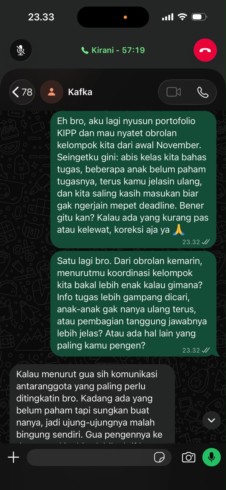
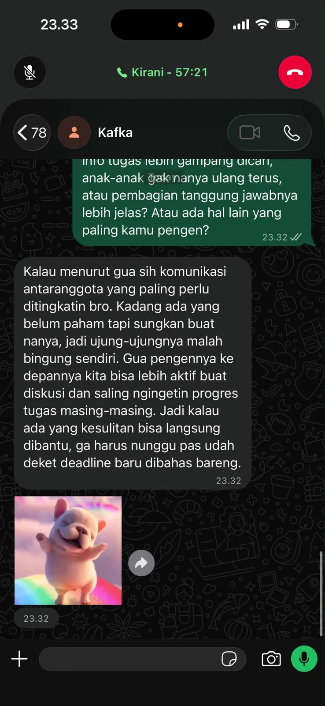
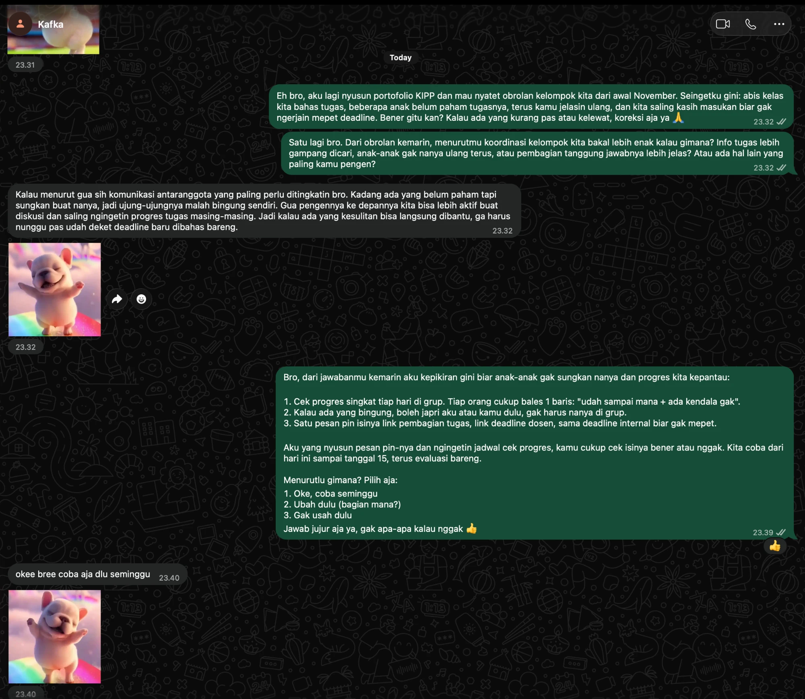
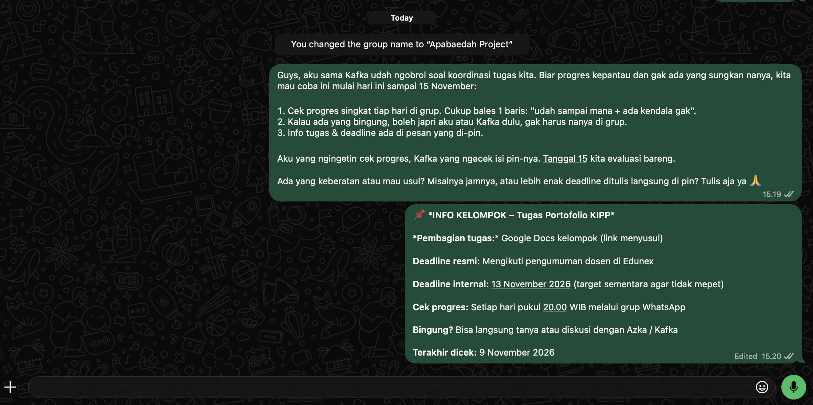
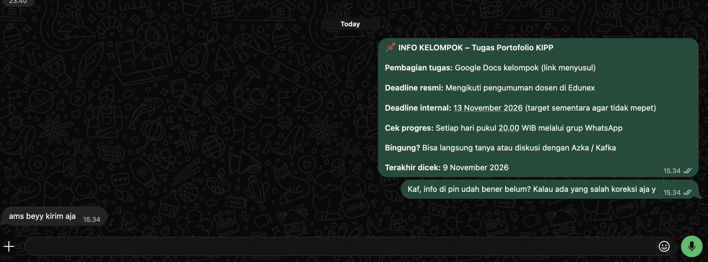
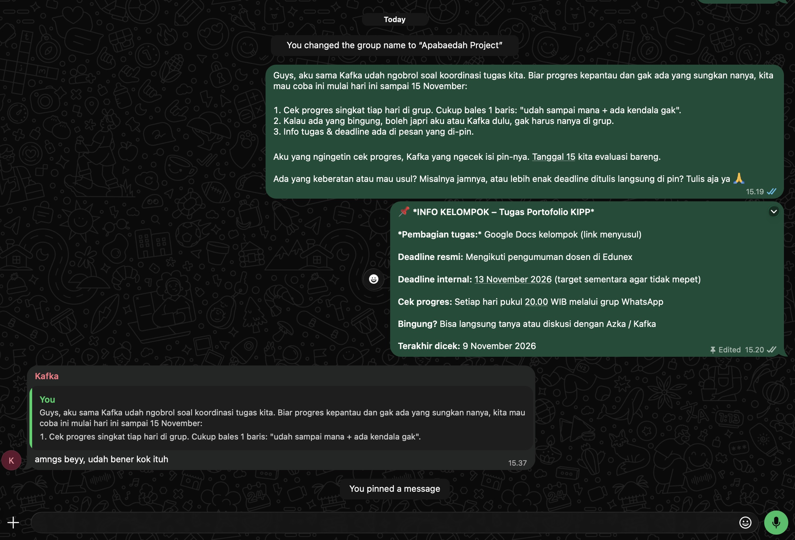
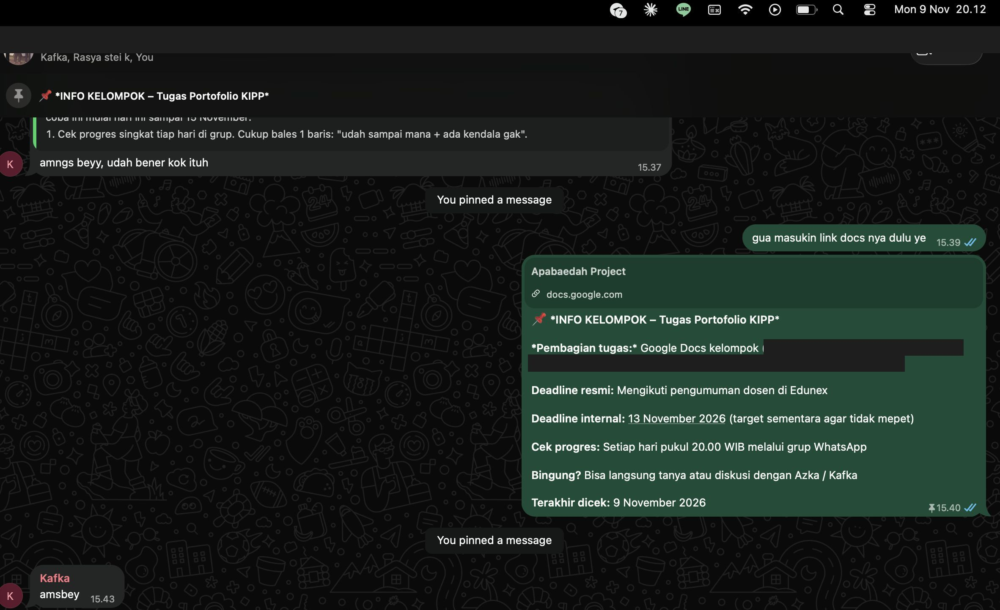
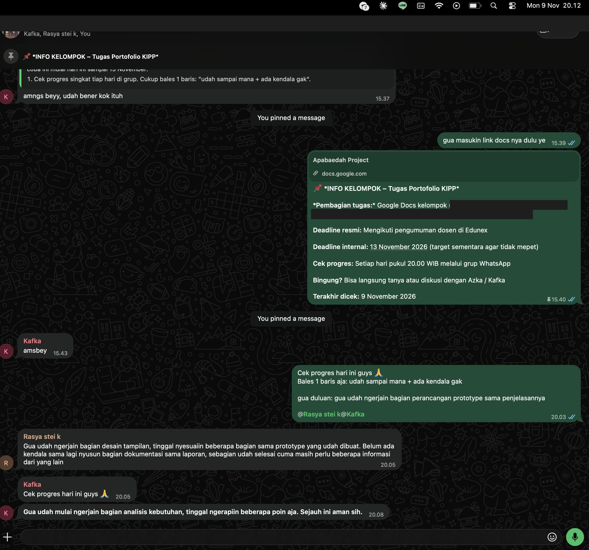
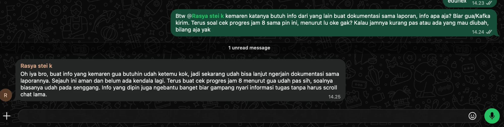

## Kompetensi Target

Kompetensi yang ingin saya kembangkan adalah kemampuan mengidentifikasi hambatan antara keinginan dan tindakan (*desire–action gap*), memahami kewenangan pihak yang terlibat, serta membangun kesepakatan yang realistis dan dapat dilaksanakan.

Saya juga ingin melatih kemampuan bernegosiasi, mempertimbangkan beberapa alternatif solusi, serta menentukan pembagian tanggung jawab dan waktu pelaksanaan yang jelas.

Melalui kegiatan ini, saya belajar bahwa keberhasilan komunikasi tidak hanya ditentukan oleh persetujuan secara lisan, tetapi juga oleh adanya tindakan nyata yang dapat dipertanggungjawabkan.

## Konteks Performance

**Tanggal dan setting:** 5 November 2026, penyusunan skenario simulasi komunikasi dengan konteks diskusi kelompok mahasiswa melalui WhatsApp.

**Persons dan relationship:**

Saya berperan sebagai anggota kelompok yang mengusulkan perbaikan mekanisme koordinasi informasi. Target komunikasi adalah ketua kelompok yang bertanggung jawab terhadap pengaturan jadwal diskusi, pembagian tugas, dan penyampaian informasi kepada anggota lainnya.

Hubungan kami bersifat setara sebagai sesama mahasiswa. Namun, ketua kelompok memiliki kewenangan dalam menentukan mekanisme koordinasi internal.

Dalam komunikasi ini, saya berusaha menghargai tanggung jawab ketua kelompok dengan menawarkan bantuan secara langsung, bukan hanya memberikan usulan yang harus dikerjakan oleh orang lain.

### Objective dan Initial State

Pada Week 6, saya mengangkat permasalahan informasi kelompok yang tersebar dalam percakapan WhatsApp.

Pada Week 7, saya mengembangkan solusi berupa rangkuman informasi yang disematkan dalam grup.

Kemudian pada Week 9, solusi tersebut disempurnakan menjadi pusat navigasi informasi yang tetap mengacu pada sumber utama agar tidak menimbulkan pekerjaan tambahan.

**Objective:**

Tujuan komunikasi pada Week 10 adalah memperoleh kesepakatan yang jelas untuk memeriksa dan menguji solusi secara terbatas, termasuk menentukan penanggung jawab, waktu pelaksanaan, dan indikator keberhasilan.

Saya tidak menargetkan persetujuan penerapan permanen, melainkan komitmen terhadap langkah awal yang realistis dan sesuai dengan kewenangan masing-masing pihak.

**Initial State:**

State awal yang digunakan adalah **Desire with Action Barrier**.

Target dalam skenario telah memahami manfaat solusi dan menginginkan koordinasi yang lebih efektif, tetapi belum mengambil tindakan karena masih terdapat kekhawatiran mengenai tambahan pekerjaan, keakuratan informasi, dan kesiapan anggota kelompok.

Kondisi tersebut menunjukkan adanya kesenjangan antara keinginan untuk memperbaiki koordinasi dan keputusan untuk mulai bertindak.

## Desire–Action Gap

### Identifikasi Hambatan

Berdasarkan rancangan komunikasi sebelumnya, solusi pusat informasi kelompok memiliki manfaat yang relevan dengan kebutuhan target.

Namun, ketertarikan dan keinginan untuk memperbaiki koordinasi belum secara otomatis menghasilkan tindakan.

Terdapat beberapa hambatan yang perlu dipertimbangkan sebelum solusi dapat dijalankan.

### Barrier Map

| Barrier | Dampak terhadap Action | Tingkat Prioritas | Strategi Penanganan |
|---|---|---|---|
| Keterbatasan waktu ketua kelompok | Penerapan dianggap menambah pekerjaan | Tinggi | Saya menawarkan bantuan menyiapkan format dan melakukan pemeriksaan awal |
| Kekhawatiran informasi tidak akurat | Target ragu menggunakan solusi | Tinggi | Sumber resmi tetap menjadi acuan dan setiap informasi diperiksa sebelum digunakan |
| Belum ada pembagian tanggung jawab | Tidak jelas siapa yang menjalankan dan memperbarui mekanisme | Tinggi | Menentukan owner untuk setiap tindakan |
| Anggota belum terbiasa dengan mekanisme baru | Solusi berpotensi tidak digunakan | Sedang | Memberikan penjelasan singkat dan melakukan uji coba terbatas |
| Belum tersedia hasil evaluasi | Target belum yakin solusi memberikan manfaat | Sedang | Melakukan percobaan satu minggu dengan indikator sederhana |

### Analisis Desire–Action Gap

Hambatan utama yang ingin saya selesaikan bukanlah kurangnya ketertarikan terhadap solusi, melainkan belum adanya mekanisme pelaksanaan yang dianggap cukup sederhana dan aman.

Saya memahami bahwa meminta ketua kelompok langsung menerapkan sistem baru dapat menimbulkan keberatan karena keputusan tersebut membawa tanggung jawab tambahan.

Oleh karena itu, pendekatan yang saya gunakan adalah memperkecil cakupan tindakan awal, membagi tanggung jawab, dan memberikan kesempatan untuk melakukan evaluasi sebelum membuat komitmen jangka panjang.

## Authority Map

Sebelum meminta kesepakatan, saya perlu memahami pihak yang memiliki kewenangan untuk mengambil keputusan.

| Person | Authority | Batas Kewenangan | Peran dalam Action |
|---|---|---|---|
| Ketua kelompok | Mengatur koordinasi internal kelompok | Tidak dapat mengubah ketentuan akademik resmi | Menyetujui mekanisme uji coba dan memeriksa informasi |
| Saya sebagai anggota | Mengusulkan solusi dan membantu pelaksanaan | Tidak dapat memaksakan penggunaan mekanisme kepada anggota lain | Menyiapkan format, melakukan pengujian, dan mengumpulkan feedback |
| Anggota kelompok | Menggunakan mekanisme dan memberikan masukan | Tidak menentukan kebijakan akademik | Menguji kemudahan akses dan memberikan feedback |
| Dosen pengampu | Menetapkan ketentuan akademik dan deadline resmi | Tidak harus terlibat dalam koordinasi internal | Menjadi sumber otoritatif informasi akademik |

### Analisis Authority

Saya memilih ketua kelompok sebagai target utama karena keputusan yang diminta berkaitan dengan proses koordinasi internal.

Namun, saya juga memahami bahwa persetujuan ketua kelompok tidak berarti seluruh anggota otomatis menerima perubahan tersebut.

Oleh karena itu, penerapan tetap membutuhkan komunikasi kepada anggota dan kesempatan untuk memberikan masukan.

Saya tidak meminta persetujuan untuk mengubah deadline atau ketentuan perkuliahan karena hal tersebut berada di luar kewenangan kelompok.

Dengan memahami batas authority, saya dapat menyusun permintaan tindakan yang lebih realistis dan tidak melebihi kewenangan target.

## Options dan Trade-Off

Sebelum mengajukan kesepakatan, saya menyiapkan beberapa alternatif tindakan yang dapat dipertimbangkan bersama target.

### Alternatif Solusi

| Option | Keuntungan | Kekurangan | Tingkat Komitmen |
|---|---|---|---|
| A. Langsung menggunakan mekanisme secara permanen | Solusi dapat segera diterapkan | Risiko belum teridentifikasi dan anggota belum tentu siap | Tinggi |
| B. Melakukan uji coba selama satu minggu | Risiko terbatas dan manfaat dapat dievaluasi | Memerlukan sedikit waktu untuk pengujian | Sedang |
| C. Memeriksa prototype bersama sebelum uji coba | Risiko awal lebih kecil dan kesiapan dapat diperiksa | Manfaat nyata belum dapat diukur | Rendah |
| D. Mempertahankan mekanisme lama | Tidak memerlukan perubahan kebiasaan | Permasalahan koordinasi berpotensi tetap terjadi | Tidak ada |

### Analisis Trade-Off

**Option A** memberikan perubahan paling cepat, tetapi memiliki risiko lebih besar karena belum tersedia hasil pengujian.

**Option B** memberikan kesempatan untuk mengamati manfaat solusi dengan komitmen yang terbatas.

**Option C** merupakan langkah awal dengan risiko paling kecil karena hanya membutuhkan pemeriksaan prototype dan sumber informasi.

**Option D** tidak membutuhkan usaha tambahan, tetapi juga tidak memberikan kesempatan untuk memperbaiki permasalahan yang telah diidentifikasi.

Saya menilai bahwa pendekatan paling realistis adalah memulai dari **Option C**, kemudian melanjutkan ke **Option B** apabila pemeriksaan awal menunjukkan bahwa solusi layak digunakan.

Dengan demikian, saya tidak memaksakan penerapan secara langsung dan tetap memberikan kesempatan kepada target untuk mempertimbangkan kesiapan kelompok.

## Negotiation dan Response

### Action Pitch

Berikut merupakan pitch yang disiapkan untuk mengubah ketertarikan target menjadi tindakan yang lebih konkret.

> "Dari pembahasan sebelumnya, menurut saya konsep pusat informasi kelompok sudah cukup sesuai dengan kebutuhan kita. Tapi sebelum digunakan, mungkin lebih baik kalau kita periksa dulu apakah sumber informasinya sudah jelas dan tidak menambah pekerjaan. Saya bisa menyiapkan formatnya, lalu kita cek bersama. Kalau semuanya sudah sesuai, bagaimana kalau kita coba selama satu minggu dan evaluasi hasilnya?"

Pitch tersebut menekankan tiga hal utama:

1. Tindakan yang diminta memiliki cakupan terbatas.
2. Saya menawarkan kontribusi langsung untuk mengurangi beban target.
3. Keputusan penerapan lebih lanjut didasarkan pada hasil pemeriksaan dan evaluasi.

### Skenario Percakapan Negosiasi

Berikut merupakan contoh dialog untuk role-play.

> **Saya:** "Menurut saya, kita sudah punya konsep yang cukup jelas. Bagaimana kalau kita mulai mencoba pusat informasi kelompok minggu depan?"
>
> **Ketua kelompok:** "Sebenarnya saya setuju dengan idenya, tapi minggu depan tugas kita juga cukup banyak. Saya takut tidak sempat mengurusnya."
>
> **Saya:** "Kalau begitu, bagaimana kalau saya yang menyiapkan format dan daftar sumber informasinya? Kamu cukup membantu memeriksa apakah isinya sudah sesuai. Jadi tidak perlu membuat semuanya dari awal."
>
> **Ketua kelompok:** "Kalau cuma memeriksa mungkin masih bisa. Tapi saya belum yakin semua anggota langsung mau menggunakannya."
>
> **Saya:** "Kita tidak perlu langsung mewajibkan semua anggota. Bagaimana kalau kita coba dulu selama satu minggu? Nanti kita minta feedback apakah cara ini memang mempermudah mereka."
>
> **Ketua kelompok:** "Kalau begitu boleh. Tapi sebelum dicoba, kita pastikan dulu sumber informasinya sudah benar."
>
> **Saya:** "Setuju. Saya siapkan format dan sumber informasinya terlebih dahulu. Setelah itu kita periksa bersama, baru menentukan apakah sudah siap diuji."

### Analisis Response

Dalam skenario tersebut, target tidak menolak solusi secara langsung.

Keberatan yang muncul berkaitan dengan dua hambatan utama:

- Keterbatasan waktu untuk mengelola mekanisme baru.
- Ketidakpastian mengenai kesiapan anggota dalam menggunakan solusi.

Saya tidak merespons keberatan tersebut dengan mengulang manfaat solusi secara berlebihan.

Sebaliknya, saya menyesuaikan permintaan tindakan agar lebih mudah diterima.

Saya juga membedakan antara persetujuan untuk memeriksa prototype dan persetujuan untuk melaksanakan uji coba.

Persetujuan terhadap pemeriksaan awal belum berarti target telah menyetujui implementasi permanen.

## Response dan Adaptation

### Adaptation terhadap Hambatan

Pada awalnya, saya ingin meminta target langsung mencoba mekanisme selama satu minggu.

Namun, skenario respons menunjukkan bahwa permintaan tersebut masih dianggap cukup membebani karena target memiliki tanggung jawab akademik lainnya.

Oleh karena itu, saya melakukan adaptation dengan mengubah permintaan awal menjadi langkah yang lebih kecil.

### Perubahan Pendekatan

| Aspek | Sebelum Adaptation | Setelah Adaptation |
|---|---|---|
| Permintaan utama | Langsung menjalankan uji coba satu minggu | Memeriksa kelayakan prototype terlebih dahulu |
| Tanggung jawab | Belum dibagi secara jelas | Saya menyiapkan format, ketua kelompok memeriksa |
| Keterlibatan anggota | Langsung menggunakan mekanisme | Diberikan penjelasan dan kesempatan mencoba |
| Risiko | Penerapan sebelum kesiapan diperiksa | Risiko ditinjau sebelum penerapan |
| Keputusan lanjutan | Berfokus pada persetujuan penggunaan | Berdasarkan hasil pemeriksaan dan feedback |

### Hasil Adaptation

Adaptation ini bertujuan memperkecil hambatan tindakan tanpa menghilangkan tujuan utama komunikasi.

Saya tetap berusaha membawa target menuju tahap Action, tetapi melalui langkah yang lebih realistis.

Dalam skenario role-play, respons target berubah dari keraguan terhadap beban pelaksanaan menjadi kesediaan untuk meninjau prototype bersama.

Perubahan tersebut menunjukkan bahwa negosiasi tidak selalu harus menghasilkan persetujuan terhadap seluruh rencana awal.

Kesepakatan terhadap langkah kecil yang dapat dilaksanakan juga dapat menjadi hasil komunikasi yang bermakna.

## Agreement dan Action Plan

### Rumusan Agreement

Kesepakatan yang menjadi target dalam skenario ini adalah melakukan pemeriksaan awal terhadap prototype pusat informasi kelompok sebelum memutuskan pelaksanaan uji coba.

Kesepakatan tersebut memiliki ruang lingkup sebagai berikut:

1. Saya menyiapkan format pusat informasi beserta sumber informasi utama.
2. Ketua kelompok memeriksa kelengkapan dan keakuratan informasi.
3. Hasil pemeriksaan digunakan untuk menentukan kesiapan uji coba.
4. Jika masih terdapat kekurangan, prototype diperbaiki terlebih dahulu.
5. Jika sudah layak, kelompok dapat mempertimbangkan uji coba selama satu minggu.
6. Pelaksanaan lebih lanjut tetap memerlukan persetujuan dan komunikasi kepada anggota yang terlibat.

### Agreement Record

| Elemen | Rancangan Kesepakatan |
|---|---|
| **What** | Pemeriksaan prototype pusat informasi kelompok |
| **Why** | Memastikan mekanisme mudah digunakan, akurat, dan tidak menambah pekerjaan berlebihan |
| **Owner utama** | Saya sebagai penyusun prototype |
| **Reviewer** | Ketua kelompok |
| **Deadline persiapan** | Jumat, 6 November 2026 |
| **Deadline review** | Senin, 9 November 2026 |
| **Output** | Prototype yang telah diperiksa beserta daftar perbaikan |
| **Next decision** | Menentukan kelayakan uji coba setelah review |
| **Status** | Rancangan agreement untuk dikonfirmasi melalui komunikasi nyata |

Penetapan owner, deadline, dan output bertujuan membuat kesepakatan lebih jelas dan dapat diperiksa pelaksanaannya.

### Action Plan

| Action | Owner | Deadline | Evidence yang Diharapkan |
|---|---|---|---|
| Menyiapkan format pusat informasi | Saya | 6 November 2026 | Prototype tersedia |
| Menyusun daftar sumber informasi | Saya | 6 November 2026 | Daftar sumber utama |
| Memeriksa keakuratan dan kelengkapan | Ketua kelompok | 9 November 2026 | Catatan hasil review |
| Melakukan revisi jika diperlukan | Saya | 10 November 2026 | Prototype hasil perbaikan |
| Memutuskan kelayakan uji coba | Saya dan ketua kelompok | 10 November 2026 | Keputusan dan alasan |
| Menguji bersama anggota jika disetujui | Anggota yang bersedia | 11–17 November 2026 | Feedback dan catatan pengujian |

Tanggal tersebut merupakan jadwal usulan dalam rancangan skenario, bukan bukti bahwa kegiatan telah dilaksanakan.

### Kriteria Penyelesaian Action

Pemeriksaan awal dianggap selesai apabila:

- Prototype pusat informasi sudah tersedia.
- Sumber utama setiap informasi telah diidentifikasi.
- Tidak ditemukan informasi akademik yang bertentangan dengan sumber resmi.
- Tanggung jawab pembaruan sudah jelas.
- Ketua kelompok telah memberikan keputusan mengenai kelayakan uji coba.

Jika persyaratan tersebut belum terpenuhi, langkah berikutnya adalah melakukan perbaikan sebelum memulai percobaan.

### Mekanisme Review

Review dilakukan dengan membandingkan prototype terhadap kebutuhan yang dirumuskan pada Week 9.

Aspek yang diperiksa meliputi kemudahan akses, keakuratan informasi, potensi tambahan pekerjaan, dan kesiapan anggota.

Hasil review akan menjadi dasar untuk memilih salah satu keputusan:

1. Melanjutkan ke uji coba terbatas.
2. Memperbaiki prototype sebelum uji coba.
3. Menunda atau menghentikan rencana apabila manfaatnya belum sebanding dengan usaha yang diperlukan.

Dengan demikian, kesepakatan tidak hanya berisi janji tindakan, tetapi juga memiliki mekanisme evaluasi yang jelas.

## Relationship Outcome

Dalam negosiasi ini, saya berusaha mempertahankan hubungan kerja sama dengan ketua kelompok.

Saya memahami bahwa target memiliki tanggung jawab lain sehingga tidak semua usulan dapat langsung diterima.

Oleh karena itu, saya menghindari pendekatan yang menekan target untuk segera menyetujui solusi.

Saya lebih memilih menawarkan pembagian tanggung jawab dan memberikan beberapa alternatif tindakan.

Pendekatan tersebut diharapkan membangun kepercayaan karena saya tidak hanya mengusulkan perubahan, tetapi juga bersedia membantu pelaksanaannya.

Selain itu, saya tetap menghargai kewenangan ketua kelompok dalam menentukan apakah mekanisme baru layak dicoba.

## Evidence

::: {.callout-note title="Status Evidence"}
Evidence berikut merupakan artefak rancangan Action & Agreement Challenge. Dialog negosiasi adalah skenario role-play, sedangkan agreement dan jadwal merupakan usulan yang perlu dikonfirmasi. Bukti tindakan aktual ditambahkan setelah pelaksanaan.
:::

::: {.evidence-block}

**Evidence 1 — Barrier Map**

Tabel Barrier Map menunjukkan hambatan antara keinginan memperbaiki koordinasi dan keputusan untuk mulai bertindak.

**Kontribusi saya:** Mengidentifikasi hambatan, menentukan prioritas, dan menyusun strategi penanganannya.

**Evidence 2 — Authority Map**

Tabel Authority Map menunjukkan kewenangan masing-masing pihak dan batas keputusan yang dapat diambil.

**Kontribusi saya:** Menentukan target komunikasi yang sesuai dan membatasi permintaan tindakan pada kewenangan internal kelompok.

**Evidence 3 — Options dan Trade-Off**

Tabel alternatif solusi menunjukkan beberapa pilihan yang dibandingkan berdasarkan manfaat, risiko, dan tingkat komitmen.

**Kontribusi saya:** Menyusun alternatif dan memilih pendekatan bertahap berdasarkan risiko serta kesiapan target.

**Evidence 4 — Negotiation Transcript**

Skenario percakapan menunjukkan pendekatan negosiasi ketika target mengkhawatirkan keterbatasan waktu dan kesiapan anggota.

**Kontribusi saya:** Menyusun pitch, mempersiapkan respons, serta merancang adaptation yang mengurangi hambatan pelaksanaan.

**Evidence 5 — Agreement Record dan Action Plan**

Tabel agreement dan action plan memuat tindakan, penanggung jawab, deadline, output, dan mekanisme evaluasi.

**Kontribusi saya:** Menyusun rencana tindak lanjut yang spesifik dan dapat diperiksa.

**Evidence 6 — Action/Review Evidence**

Bukti yang perlu dikumpulkan setelah kegiatan:

- Screenshot prototype pusat informasi kelompok.
- Catatan hasil pemeriksaan bersama ketua kelompok.
- Konfirmasi kesepakatan beserta tanggal dan tanggung jawab.
- Daftar revisi prototype.
- Feedback anggota apabila uji coba dilaksanakan.

Bukti tersebut digunakan untuk memeriksa apakah tindakan yang direncanakan benar-benar terlaksana.

:::

## Analisis Komunikasi

| Elemen | Evidence dan Analisis |
|---|---|
| **Person & Character** | Target merupakan ketua kelompok yang memiliki tanggung jawab terhadap koordinasi internal. Pendekatan mempertimbangkan keterbatasan waktu dan kewenangan target serta menawarkan kontribusi untuk mengurangi beban pekerjaan. |
| **Objective & State** | Objective adalah mengubah Desire menjadi Action melalui kesepakatan yang jelas. Initial state berupa Desire with Action Barrier, sedangkan state yang dituju adalah komitmen melakukan pemeriksaan awal prototype. |
| **Repertoire & Language** | Komunikasi menggunakan negosiasi kolaboratif, pertanyaan terbuka, penawaran alternatif, serta pembagian tanggung jawab. Bahasa dibuat sederhana dan tidak memaksakan persetujuan. |
| **Response & Adaptation** | Kekhawatiran mengenai waktu dan kesiapan anggota mengubah permintaan dari uji coba langsung menjadi pemeriksaan prototype terlebih dahulu. |
| **Agreement/Action** | Agreement record memuat owner, reviewer, deadline, output, dan keputusan lanjutan. Action plan menjelaskan langkah yang dapat ditindaklanjuti. |
| **Relationship Outcome** | Pendekatan berfokus pada kerja sama, menghargai keputusan target, serta menunjukkan kesediaan untuk ikut bertanggung jawab terhadap solusi. |

## Penggunaan AI

Dalam penyusunan tugas ini, saya menggunakan **ChatGPT** untuk membantu mengembangkan struktur komunikasi, mengidentifikasi hambatan, dan merancang strategi negosiasi yang realistis.

### Alat dan Peran AI

AI digunakan untuk:

1. Membantu mengidentifikasi kemungkinan desire–action gap.
2. Menyusun barrier map dan authority map.
3. Membandingkan beberapa alternatif tindakan berdasarkan trade-off.
4. Mengembangkan contoh respons dan adaptation dalam negosiasi.
5. Membantu menyusun agreement yang memiliki owner, deadline, dan indikator evaluasi.

### Prompt Penting

> "Bantu saya mengembangkan Action & Agreement Challenge dari kasus koordinasi informasi kelompok mahasiswa. Identifikasi hambatan antara keinginan dan tindakan, buat authority map, alternatif negosiasi beserta trade-off, dan rumuskan agreement dengan owner, deadline, serta mekanisme review. Gunakan bahasa yang natural dan jangan menganggap rencana sebagai tindakan yang sudah terjadi."

### Output AI yang Digunakan dan Diubah

Saya menggunakan AI sebagai alat bantu untuk menyusun alternatif tindakan dan mengevaluasi kelengkapan agreement.

Dari beberapa alternatif yang dikembangkan, saya memilih pendekatan bertahap karena lebih realistis dibandingkan meminta penerapan permanen secara langsung.

Saya juga menggunakan bantuan AI untuk memastikan bahwa setiap tindakan memiliki penanggung jawab dan output yang jelas.

Namun, keputusan mengenai tindakan yang tepat tetap harus mempertimbangkan kesiapan dan persetujuan pihak yang terlibat.

### Pemeriksaan Accuracy, Privacy, dan Authority

**Accuracy:**

Saya membedakan antara rancangan agreement, respons dalam skenario, dan tindakan yang benar-benar terlaksana.

Saya tidak menganggap persetujuan dalam role-play sebagai bukti pelaksanaan nyata.

**Privacy:**

Informasi pribadi anggota dan percakapan kelompok tidak dimasukkan ke dalam laporan tanpa kebutuhan yang jelas.

Apabila menggunakan screenshot sebagai evidence, informasi pribadi yang tidak relevan perlu disamarkan.

**Authority:**

Saya memastikan bahwa permintaan tindakan hanya berkaitan dengan koordinasi internal kelompok.

Ketentuan akademik resmi tetap mengikuti dosen atau platform perkuliahan.

### Pembelajaran Pribadi

Saya memahami bahwa AI dapat membantu menyusun alternatif negosiasi dan action plan, tetapi tidak dapat menggantikan keputusan serta persetujuan manusia.

Saya juga belajar bahwa agreement yang baik tidak cukup hanya berupa pernyataan setuju.

Kesepakatan perlu menjelaskan siapa yang bertanggung jawab, apa yang harus dilakukan, kapan diselesaikan, dan bagaimana hasilnya diperiksa.

## Feedback dan Tindak Lanjut

### Feedback yang Diterima

Berikut merupakan contoh feedback yang digunakan dalam skenario role-play.

> "Solusinya cukup menarik, tetapi sebaiknya jangan langsung diterapkan ke semua anggota. Kita periksa dulu apakah informasinya sudah benar dan apakah mekanismenya mudah digunakan."

Feedback tersebut menunjukkan bahwa hambatan utama bukanlah penolakan terhadap solusi, melainkan kekhawatiran terhadap kesiapan pelaksanaannya.

Saya memahami bahwa keputusan yang terlalu cepat dapat menciptakan risiko baru apabila mekanisme belum diperiksa.

### Adaptation/Replay

Pada pitch awal, saya mengusulkan agar kelompok langsung melakukan uji coba selama satu minggu.

Setelah mempertimbangkan keberatan target, saya melakukan tiga perubahan:

1. Mengurangi permintaan awal menjadi pemeriksaan prototype.
2. Menawarkan diri sebagai penanggung jawab persiapan.
3. Menjadikan hasil review sebagai dasar keputusan untuk melanjutkan uji coba.

Melalui adaptation ini, saya belajar bahwa negosiasi yang efektif tidak harus menghasilkan persetujuan terhadap seluruh usulan.

Kesepakatan terhadap tindakan kecil yang jelas dan dapat dilaksanakan merupakan langkah yang lebih baik dibandingkan persetujuan besar yang belum memiliki kesiapan.

### Next Practice

Pada latihan berikutnya, saya akan berfokus pada kemampuan **menutup percakapan dengan mengonfirmasi agreement secara eksplisit**.

Saya akan membiasakan diri mengajukan pertanyaan seperti:

> "Jadi, untuk memastikan kita punya pemahaman yang sama, saya menyiapkan formatnya paling lambat Jumat, lalu kita periksa bersama pada Senin. Apakah pembagian tugas dan waktunya sudah sesuai?"

Dengan cara tersebut, saya dapat memastikan bahwa pihak yang terlibat memiliki pemahaman yang sama mengenai tindakan, tanggung jawab, dan deadline.

## Revisi atas Feedback

::: {.callout-warning title="Feedback tiket 1056 — Perlu revisi (total rubrik 16)"}
Pemetaan hambatan, kewenangan, dan negosiasi adaptif sudah baik, tetapi bukti agreement dan tindakan aktual masih berupa rancangan tanpa artefak verifikasi eksternal.
:::

::: {.callout-important title="Status revisi"}
Bagian sebelumnya berisi rancangan dan dialog latihan yang saya susun untuk menganalisis dan mengembangkan solusi. Diskusi nyata dengan kelompok berlangsung sejak awal November 2026 ketika kami mulai membahas tugas ini, dan saya catat terpisah di bawah ini apa adanya. Agreement dan action yang belum terkonfirmasi tetap saya tandai sebagai rencana, sehingga status halaman ini masih **Perlu revisi**.
:::

### Percakapan Nyata yang Sudah Terjadi

::: {.callout-note title="Catatan percakapan langsung (rekonstruksi dari ingatan, tidak direkam)"}
**Waktu dan tempat:** Sejak awal November 2026, ketika kelompok mulai membahas tugas ini. Obrolan dilakukan langsung di kelas setelah perkuliahan. Tanggal pastinya tidak saya catat.

**Yang terlibat:** Saya, ketua kelompok, dan beberapa anggota kelompok lain.

**Yang terjadi:**

- Kami membicarakan tugas kelompok yang sedang dikerjakan.
- Beberapa anggota menyampaikan bahwa mereka belum terlalu paham tugasnya.
- Ketua kelompok menjelaskan ulang tugas tersebut dengan lebih jelas kepada anggota yang belum paham.
- Setelah itu, beberapa dari kami, termasuk saya, saling memberi masukan. Salah satu masukan yang muncul adalah agar setiap anggota tidak mengerjakan bagian tugasnya terlalu mepet dengan deadline.

**Yang tidak terjadi dalam percakapan ini:** Belum ada pembahasan atau persetujuan tentang pesan rangkuman yang disematkan, prototype, maupun uji coba satu minggu. Bagian tersebut tetap saya anggap rencana.
:::

**Kaitan dengan minggu ini:** Masukan agar tidak mengerjakan tugas mepet deadline adalah kesepakatan informal yang nyata, tetapi belum memiliki owner, tanggal, dan definisi selesai. Ini menunjukkan *desire–action gap* yang dibahas minggu ini: niat baik sudah ada, tetapi belum menjadi agreement yang bisa diperiksa. Langkah berikutnya adalah mengubah masukan itu menjadi deadline internal per anggota yang tertulis.

### Balasan Ketua Kelompok (8 November 2026)

Pada 8 November 2026 pukul 23.32, saya mengirim dua pesan kepada ketua kelompok (Kafka) lewat WhatsApp: pesan konfirmasi catatan percakapan dan pertanyaan tentang kondisi koordinasi yang ia harapkan. Ketua membalas pada menit yang sama.

::: {layout-ncol=2}

:::

**Balasan ketua (dikutip apa adanya):**

> "Kalau menurut gua sih komunikasi antaranggota yang paling perlu ditingkatin bro. Kadang ada yang belum paham tapi sungkan buat nanya, jadi ujung-ujungnya malah bingung sendiri. Gua pengennya ke depannya kita bisa lebih aktif buat diskusi dan saling ngingetin progres tugas masing-masing. Jadi kalau ada yang kesulitan bisa langsung dibantu, ga harus nunggu pas udah deket deadline baru dibahas bareng."

**Yang bisa dan tidak bisa saya simpulkan:**

- Ketua tidak mengoreksi catatan percakapan yang saya kirim, dan jawabannya menyinggung hal yang sama: anggota yang belum paham dan pembahasan yang menumpuk menjelang deadline. Namun, ia tidak secara eksplisit menulis "benar". Karena itu saya menyebutnya **tidak dikoreksi**, bukan **dikonfirmasi penuh**.
- Belum ada persetujuan tentang pesan rangkuman yang disematkan, prototype, atau uji coba satu minggu.

**Kaitan dengan minggu ini:** Jawaban ketua memperjelas *desire–action gap*: keinginannya sudah ada (saling mengingatkan progres, tidak menunggu deadline), tetapi belum ada tindakan yang disepakati. Agreement berikutnya yang paling relevan bukan sekadar memasang pesan pin, melainkan menyepakati **cek progres rutin** dengan owner, jadwal, dan definisi selesai yang jelas.

### Agreement dengan Ketua Kelompok (8 November 2026)

Setelah membaca jawaban ketua tentang anggota yang sungkan bertanya dan kebutuhan saling mengingatkan progres, saya mengubah usulan saya. Usulan yang saya kirim pukul 23.39 tidak lagi hanya berisi pesan pin, tetapi juga cek progres harian dan jalur bertanya lewat japri. Ketua menjawab pukul 23.40.

**Isi usulan yang disetujui:**

1. Cek progres singkat setiap hari di grup. Setiap anggota cukup membalas satu baris: "udah sampai mana + ada kendala gak".
2. Anggota yang bingung boleh bertanya lewat japri ke saya atau ketua, tidak harus di grup.
3. Satu pesan pin berisi tautan pembagian tugas, tautan deadline dosen, dan deadline internal.

**Pembagian tanggung jawab:** saya menyusun pesan pin dan mengingatkan jadwal cek progres; ketua memeriksa kebenaran isi pesan pin.

**Periode uji coba:** 8–15 November 2026, lalu dievaluasi bersama.

**Jawaban ketua (dikutip apa adanya):** "okee bree coba aja dlu seminggu", disertai reaksi 👍 pada pesan usulan.

**Catatan:** Tanggal uji coba yang benar-benar disepakati adalah **8–15 November 2026**. Tanggal pada action plan di bagian sebelumnya merupakan rencana awal dan digantikan oleh kesepakatan ini. Persetujuan ini baru dari ketua; anggota lain belum dimintai pendapat.

**Kaitan dengan minggu ini:** Desire–action gap mulai tertutup: keinginan ketua kini menjadi tindakan dengan owner (saya menyusun dan mengingatkan, ketua memeriksa), periode (8–15 November 2026), dan titik evaluasi. Bukti pelaksanaannya, yaitu pesan pin di grup, catatan pemeriksaan ketua, dan hasil evaluasi 15 November, masih perlu dikumpulkan.

### Pengumuman ke Grup Kelompok (9 November 2026)

Pada 9 November 2026 pukul 15.19, saya menyampaikan usulan yang sudah disetujui ketua ke grup WhatsApp kelompok. Satu menit kemudian (15.20), saya mengirim pesan info kelompok yang akan dipakai sebagai pesan pin.

**Isi pengumuman:** tiga mekanisme yang disepakati dengan ketua (cek progres harian, boleh japri kalau bingung, info tugas dan deadline di pesan pin), pembagian peran (saya mengingatkan cek progres, Kafka memeriksa isi pin), evaluasi bersama tanggal 15, serta ajakan terbuka: *"Ada yang keberatan atau mau usul? Misalnya jamnya, atau lebih enak deadline ditulis langsung di pin? Tulis aja ya."*

**Isi pesan info kelompok:** pembagian tugas (Google Docs kelompok, tautan menyusul), deadline resmi mengikuti pengumuman dosen di Edunex, deadline internal 13 November 2026, cek progres setiap hari pukul 20.00 WIB, kontak jika bingung (Azka/Kafka), dan tanggal terakhir dicek (9 November 2026).

**Yang bisa dan tidak bisa saya simpulkan dari screenshot ini:**

- Usulan sudah benar-benar disampaikan ke seluruh anggota, bukan hanya ke ketua.
- Belum ada tanggapan anggota lain pada saat screenshot diambil.
- Screenshot ini belum memperlihatkan penanda pin. Pin baru dipasang setelah ketua menanggapi (lihat bagian *Pin dan Konfirmasi Ketua di Grup*).
- Tautan pembagian tugas masih "menyusul" (dilengkapi pukul 15.40), sehingga isi pin belum sepenuhnya sesuai poin 3 agreement.
- Pengumuman ke grup baru dilakukan 9 November, satu hari setelah agreement dengan ketua. Uji coba di grup praktis berjalan 9–15 November 2026.
- Pemeriksaan isi pesan info oleh ketua dilakukan lewat japri pukul 15.34, setelah pesan sudah dikirim ke grup (lihat bagian berikutnya).

**Kaitan dengan minggu ini:** Ini bukti pertama bahwa agreement berubah menjadi *action*: usulan diumumkan, pesan info dibuat, dan jadwal cek progres ditetapkan (20.00 WIB). Masih perlu dibuktikan: pesan benar-benar disematkan, ketua memeriksa isinya, cek progres harian berjalan, dan hasil evaluasi 15 November.

### Pemeriksaan Isi Pin oleh Ketua (9 November 2026, 15.34)

Sesuai pembagian tanggung jawab, saya mengirim isi pesan info kelompok kepada ketua lewat japri dan meminta ia memeriksanya. Ketua membalas pada menit yang sama.

**Pesan saya:** "Kaf, info di pin udah bener belum? Kalau ada yang salah koreksi aja y"

**Balasan ketua (dikutip apa adanya):** "ams beyy kirim aja", yang saya pahami sebagai "aman, kirim saja".

**Yang bisa dan tidak bisa saya simpulkan:**

- Ketua sudah memeriksa isi pesan info dan tidak meminta perubahan. Ini bukti bahwa ia menjalankan perannya dalam agreement.
- Pemeriksaan ini terjadi pukul 15.34, setelah pesan info sudah saya kirim ke grup pukul 15.20. Urutan yang benar menurut action plan adalah diperiksa dulu, baru dipublikasikan. Pesan baru disematkan setelah pemeriksaan ini. Ke depannya, pembaruan pin akan saya kirim ke ketua lebih dulu.
- Tautan pembagian tugas di pesan tersebut masih "menyusul" (dilengkapi pukul 15.40).

**Kaitan dengan minggu ini:** Ini bukti action dari owner kedua dalam agreement: ketua menjalankan tugas pemeriksaan. Sekaligus terlihat satu penyimpangan dari action plan, yaitu urutan periksa–publikasi yang terbalik, yang kini saya perbaiki.

### Pin dan Konfirmasi Ketua di Grup (9 November 2026, 15.37)

Ketua juga membalas pengumuman langsung di grup pukul 15.37. Setelah itu saya menyematkan pesan info kelompok. Ikon pin pada pesan pukul 15.20 dan notifikasi "You pinned a message" terlihat pada screenshot.

**Balasan ketua di grup (dikutip apa adanya, membalas pengumuman):** "amngs beyy, udah bener kok ituh", yang saya pahami sebagai "aman, sudah benar kok itu".

**Yang bisa dan tidak bisa saya simpulkan:**

- Pesan info kelompok sudah benar-benar disematkan, dan baru disematkan setelah ketua memeriksa isinya.
- Ketua menyatakan persetujuannya secara terbuka di depan anggota lain, bukan hanya lewat japri.
- Tanda centang biru menunjukkan pengumuman sudah dibaca, tetapi belum ada anggota selain ketua yang menanggapi.
- Tautan pembagian tugas masih "menyusul" (dilengkapi pukul 15.40).

**Kaitan dengan minggu ini:** Dua action dari agreement sudah terbukti terlaksana: pesan info disematkan dan ketua memeriksa isinya. Pesan baru disematkan setelah pemeriksaan, sehingga untuk pin urutan periksa–publikasi sudah sesuai action plan.

### Pembaruan Pin: Tautan Google Docs (9 November 2026, 15.39–15.40)

Pukul 15.39 saya memberi tahu grup bahwa saya akan memasukkan tautan Google Docs. Pukul 15.40 saya mengirim versi baru pesan info yang sudah berisi tautan pembagian tugas, lalu menyematkannya. Banner pin di bagian atas grup kini menampilkan pesan tersebut. Tautan pada screenshot saya sensor karena halaman portofolio ini dapat diakses publik.

**Yang bisa dan tidak bisa saya simpulkan:**

- Poin 3 agreement kini terpenuhi: pesan pin berisi tautan pembagian tugas, rujukan deadline resmi dosen, dan deadline internal.
- Header grup menunjukkan anggota grup adalah Kafka (ketua), Rasya, dan saya. Artinya "anggota lain" dalam uji coba ini adalah Rasya.
- Rasya tidak menanggapi pengumuman maupun pesan info secara langsung.
- Versi baru ini disematkan sebelum diperiksa ulang oleh ketua. Ketua membalas "amsbey" pukul 15.43, setelah pin dipasang, tanpa mengutip pesan tertentu, sehingga saya anggap sebagai tanggapan umum, bukan pemeriksaan eksplisit. Perubahannya hanya penambahan tautan, tetapi urutan ini tetap tidak sesuai dengan komitmen saya untuk mengirim pembaruan pin ke ketua lebih dulu.

**Kaitan dengan minggu ini:** Action "menyusun pesan pin" kini selesai sesuai isi agreement. Namun, pemeriksaan oleh ketua untuk versi ini terlewat, dan ini saya catat sebagai penyimpangan kedua dari action plan.

### Cek Progres Pertama (9 November 2026, 20.03–20.08)

Pada malam hari yang sama, saya mengirim pengingat cek progres pertama ke grup pukul 20.03. Saya menuliskan progres saya lebih dulu sebagai contoh, lalu menandai Rasya dan Kafka. Jam pada menu bar laptop di screenshot menunjukkan "Mon 9 Nov 20.12".

**Pesan saya (20.03):** "Cek progres hari ini guys 🙏 Bales 1 baris aja: udah sampai mana + ada kendala gak. gua duluan: gua udah ngerjain bagian perancangan prototype sama penjelasannya. @Rasya stei k @Kafka"

**Balasan Rasya (20.05, dikutip apa adanya):** "Gua udah ngerjain bagian desain tampilan, tinggal nyesuaiin beberapa bagian sama prototype yang udah dibuat. Belum ada kendala sama lagi nyusun bagian dokumentasi sama laporan, sebagian udah selesai cuma masih perlu beberapa informasi dari yang lain"

**Balasan Kafka (20.05 dan 20.08, dikutip apa adanya):** "Cek progres hari ini guys 🙏" lalu "Gua udah mulai ngerjain bagian analisis kebutuhan, tinggal ngerapiin beberapa poin aja. Sejauh ini aman sih."

**Yang bisa dan tidak bisa saya simpulkan:**

- Cek progres hari pertama berjalan: ketiga anggota melaporkan progres dalam lima menit setelah pengingat.
- Tidak ada yang melaporkan kendala. Namun, Rasya menyebut masih perlu informasi dari anggota lain. Ini belum disebut "kendala", tetapi perlu saya tindak lanjuti sebelum menjadi hambatan.
- Rasya ikut menjalankan mekanisme, tetapi belum menyampaikan pendapat tentang mekanisme itu sendiri (setuju, usul, atau keberatan).
- Screenshot ini juga memperlihatkan balasan Kafka "amsbey" pukul 15.43, setelah pesan info versi bertautan disematkan.
- Antara pukul 15.43 dan 20.03 ada beberapa pesan obrolan di luar topik tugas yang tidak tampak pada screenshot ini.

**Kaitan dengan minggu ini:** Ini bukti action saya sebagai owner pengingat cek progres, sekaligus bukti bahwa anggota benar-benar menjalankannya. Hari 1 dari 7 sudah terdokumentasi; hari berikutnya dan hasil evaluasi masih perlu dikumpulkan.

### Tindak Lanjut ke Rasya (10 November 2026, 14.24–14.25)

Pada cek progres hari pertama, Rasya menyebut masih membutuhkan informasi dari anggota lain. Keesokan harinya saya menindaklanjutinya di grup sekaligus menanyakan pendapatnya tentang jam cek progres dan pesan pin. Tanggal tidak tampak pada screenshot; screenshot diambil dan disimpan pada 10 November 2026 pukul 14.25.

**Pesan saya (14.24):** "Btw @Rasya stei k kemaren katanya butuh info dari yang lain buat dokumentasi sama laporan, info apa aja? Biar gua/Kafka kirim. Terus soal cek progres jam 8 sama pin ini, menurut lu oke gak? Kalau jamnya kurang pas atau ada yang mau diubah, bilang aja yak"

**Balasan Rasya (14.25, dikutip apa adanya):** "Oh iya bro, buat info yang kemaren gua butuhin udah ketemu kok, jadi sekarang udah bisa lanjut ngerjain dokumentasi sama laporannya. Sejauh ini aman dan belum ada kendala lagi. Terus buat cek progres jam 8 menurut gua udah pas sih, soalnya biasanya udah pada senggang. Info yang dipin juga ngebantu banget biar gampang nyari informasi tugas tanpa harus scroll chat lama."

**Yang bisa dan tidak bisa saya simpulkan:**

- Hal yang dilaporkan pada cek progres hari pertama sudah ditindaklanjuti keesokan harinya. Ini bagian dari tujuan mekanisme: kesulitan dibahas sebelum mendekati deadline.
- Kebutuhan Rasya sudah selesai sebelum saya bertanya. Ia menemukan informasinya sendiri, sehingga tindak lanjut ini tidak bisa diklaim sebagai penyebab masalahnya selesai.
- Rasya menilai pesan pin membantu ("gampang nyari informasi tugas tanpa harus scroll chat lama"). Ini review pertama dari pengguna pin selain ketua, dan sesuai dengan objective pusat informasi kelompok.
- Rasya menyatakan jam 20.00 sudah pas, sehingga jadwal cek progres tidak perlu diubah.
- Ini baru pendapat satu pengguna pada hari kedua uji coba. Belum ada data apakah pertanyaan berulang di grup benar-benar berkurang.

**Kaitan dengan minggu ini:** Bukti ini menunjukkan action berlanjut setelah hari pertama: pengingat menghasilkan laporan, dan laporan itu ditindaklanjuti. Review pin dari Rasya melengkapi pemeriksaan isi oleh ketua (9 November), sehingga mekanisme kini sudah dinilai oleh dua anggota selain saya. Hasil akhir action baru dapat dinilai saat evaluasi bersama pada 15 November 2026.

### Perubahan yang Saya Lakukan

| Bagian yang dikritik | Perubahan | Status |
|---|---|---|
| Action plan belum terbukti terlaksana | Setiap baris action plan diberi kolom status dan tautan bukti, diisi setelah tindakan benar-benar terjadi | Sebagian: agreement dengan ketua sudah ada (8 November 2026); cek progres hari 1 berjalan dan laporan Rasya ditindaklanjuti (9–10 November 2026); hasil uji coba menunggu evaluasi 15 November 2026 |
| Belum ada hasil review bersama ketua | Hasil pemeriksaan prototype oleh ketua didokumentasikan lewat chat atau catatan review bertanggal | Sebagian: ketua memeriksa isi pin lewat japri (9 November 2026), tidak ada koreksi; Rasya menilai pin membantu (10 November 2026) |
| Deadline belum dikonfirmasi terpenuhi | Tanggal penyelesaian aktual dicatat di samping tanggal rencana, termasuk jika ada keterlambatan | Menunggu bukti |

### Pesan untuk Memperoleh Konfirmasi Target

Pesan berikut saya kirim apa adanya kepada target. Apa pun jawabannya, termasuk penolakan atau permintaan perubahan, akan saya catat sebagai evidence.

> "Prototype pusat info kelompok udah aku kirim ya. Bisa tolong cek apakah tiap bagian (jadwal, tugas, deadline) udah nunjuk ke sumber yang bener? Balas aja 'sesuai' atau tulis bagian yang perlu diperbaiki. Abis itu kita putusin bareng: lanjut uji coba seminggu, perbaiki dulu, atau tunda."

Untuk mengonfirmasi catatan percakapan setelah kelas, saya mengirim pesan berikut kepada ketua kelompok:

> "Aku lagi nyatet obrolan kita abis kelas dari awal ngerjain tugas ini buat portofolio: beberapa anggota belum paham tugasnya, kamu jelasin ulang, terus kita saling kasih masukan biar gak ngerjain mepet deadline. Bener gitu kan? Kalau ada yang kurang pas, koreksi aja ya."

### Evidence Pelaksanaan Nyata

| Artefak | Status | File |
|---|---|---|
| Catatan percakapan langsung setelah kelas (di atas) | Sudah ditulis dan dikirim ke ketua; tidak dikoreksi | Halaman ini |
| Screenshot balasan ketua atas catatan percakapan dan pertanyaan desired state | **Sudah dikumpulkan (8 November 2026).** Catatan tidak dikoreksi, belum dikonfirmasi eksplisit | `images/evidence/chat-ketua-2026-11-08-1.webp`, `-2.webp` |
| Screenshot pengumuman uji coba dan pesan info kelompok di grup | **Sudah dikumpulkan (9 November 2026)** | `images/evidence/grup-2026-11-09-pengumuman.jpg` |
| Screenshot pesan info yang disematkan dan konfirmasi ketua di grup | **Sudah dikumpulkan (9 November 2026)** | `images/evidence/grup-2026-11-09-pin-konfirmasi.jpg` |
| Screenshot banner pin dengan tautan Google Docs | **Sudah dikumpulkan (9 November 2026)**; tautan disensor; dipasang sebelum diperiksa ulang ketua | `images/evidence/grup-2026-11-09-pin-link-docs.jpg` |
| Screenshot cek progres harian | **Hari 1 sudah dikumpulkan (9 November 2026)**: ketiga anggota melapor | `images/evidence/grup-2026-11-09-cek-progres.jpg` |
| Screenshot tindak lanjut laporan cek progres dan review pin dari Rasya | **Sudah dikumpulkan (10 November 2026)**: kebutuhan info sudah terpenuhi, jam 20.00 dan pin dinilai membantu | `images/evidence/grup-2026-11-10-tanggapan-rasya.webp` |
| Screenshot prototype pusat informasi kelompok | Belum dikumpulkan | `images/evidence/w10-prototype.png` (rencana nama file) |
| Screenshot catatan review dari ketua | **Sudah dikumpulkan (9 November 2026)**: isi pin diperiksa, tidak ada koreksi | `images/evidence/japri-ketua-2026-11-09-cek-pin.jpg` |
| Screenshot catatan review prototype lengkap dari ketua | Belum dikumpulkan | `images/evidence/w10-review-ketua.png` (rencana nama file) |
| Screenshot keputusan lanjut / perbaiki / tunda | **Sudah dikumpulkan (8 November 2026)**: lanjut uji coba, diputuskan lewat japri dengan ketua | `images/evidence/chat-ketua-2026-11-08-agreement.webp` |

Setelah bukti terkumpul, file disimpan di folder `portfolio/images/evidence/` dan ditampilkan di bagian ini. Respons asli target akan menggantikan respons role-play sebagai dasar penilaian agreement dan action.

## Self-Assessment

Penilaian berikut didasarkan pada rancangan komunikasi dan bukti nyata yang sudah terkumpul (agreement 8 November, pengumuman dan cek progres hari 1 pada 9 November, serta tindak lanjut dan review pin dari Rasya 10 November). Hasil evaluasi bersama belum tersedia.

| Dimensi | Skor 1–4 | Evidence Singkat |
|---|---:|---|
| Person & Character | 4 | Target dipilih berdasarkan relevance dan authority, serta pendekatan mempertimbangkan keterbatasan waktu dan tanggung jawab ketua kelompok. |
| Objective & State | 4 | Desire–action gap, hambatan, initial state, dan objective dirumuskan secara spesifik. |
| Repertoire, Language & AI | 3 | Negosiasi menggunakan alternatif, trade-off, dan bahasa kolaboratif. AI digunakan secara transparan, tetapi efektivitas pendekatan masih perlu diuji melalui praktik. |
| Response & Adaptation | 4 | Keberatan target menjadi dasar perubahan strategi dari implementasi langsung menjadi pemeriksaan prototype yang lebih realistis. |
| Agreement, Action & Relationship | 3 | Agreement memiliki owner, deadline, output, dan review, sudah dikonfirmasi ketua (8 November), dijalankan di grup (9 November), dan ditindaklanjuti serta dinilai membantu oleh Rasya (10 November). Hasil evaluasi akhir belum terdokumentasi. |

### Refleksi Akhir

Melalui kegiatan Action & Agreement Challenge ini, saya memahami bahwa ketertarikan terhadap sebuah solusi belum tentu langsung menghasilkan tindakan.

Seseorang dapat menganggap suatu ide bermanfaat, tetapi tetap memiliki hambatan untuk menerapkannya, seperti keterbatasan waktu, tanggung jawab tambahan, atau ketidakpastian mengenai hasilnya.

Saya belajar bahwa komunikasi yang efektif pada tahap Action membutuhkan kemampuan memahami hambatan tersebut dan mencari kesepakatan yang realistis.

Dalam kasus ini, saya tidak hanya berusaha memperoleh persetujuan dari ketua kelompok, tetapi juga menawarkan kontribusi langsung, memberikan alternatif tindakan, dan menyusun pembagian tanggung jawab yang jelas.

Hal penting yang saya pelajari adalah bahwa negosiasi tidak selalu harus menghasilkan persetujuan terhadap rencana awal. Terkadang, langkah yang lebih kecil tetapi dapat dilaksanakan justru lebih bermanfaat.

Saya juga memahami bahwa agreement harus memiliki tindakan, penanggung jawab, deadline, dan mekanisme evaluasi agar tidak berhenti sebagai kesepakatan lisan.

Ke depannya, saya ingin meningkatkan kemampuan menutup percakapan dengan memastikan seluruh pihak memahami tindakan yang telah disepakati dan bersedia menjalankan tanggung jawabnya.

Dengan demikian, komunikasi yang saya lakukan dapat menghasilkan perubahan nyata, bukan hanya pemahaman atau ketertarikan terhadap suatu ide.

**Total:** 18/20

::: {.assessor-only}

### Assessment Dosen
**Skor:** — / 20
**Evidence yang mendukung:** —
**Prioritas perbaikan:** —
**Keputusan:** Belum dinilai / Perlu revisi / Tercapai
:::
