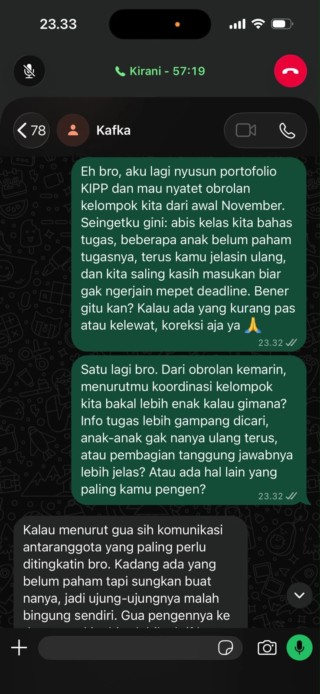
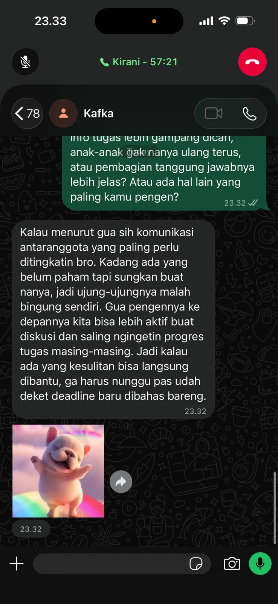
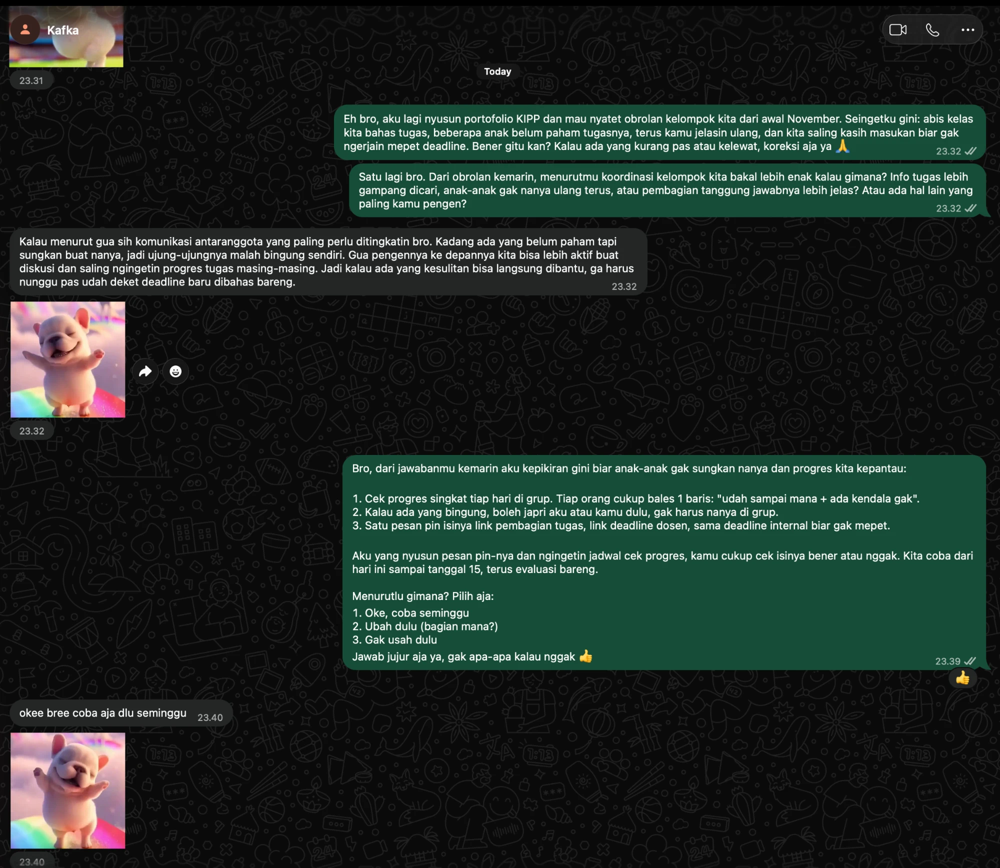
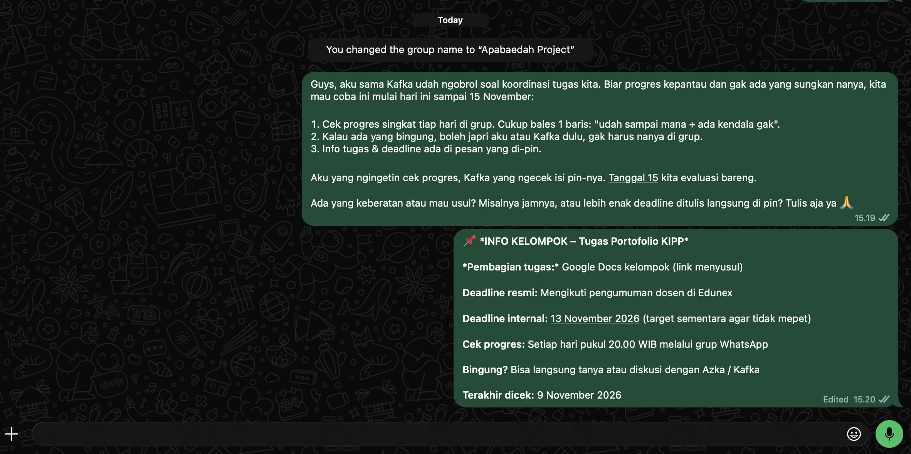

## Kompetensi Target

Kompetensi yang ingin saya kembangkan adalah kemampuan memfasilitasi komunikasi dan negosiasi yang melibatkan beberapa pihak dengan kepentingan, tanggung jawab, kewenangan, serta tingkat kesiapan yang berbeda.

Melalui kegiatan ini, saya berlatih memahami posisi setiap stakeholder, mencari kepentingan bersama, mengelola perbedaan pendapat, dan membangun kesepakatan yang dapat dijalankan tanpa mengabaikan keberatan dari pihak tertentu.

Saya juga ingin meningkatkan kemampuan mendengarkan secara aktif dan memastikan setiap pihak memiliki kesempatan menyampaikan pendapat sebelum keputusan dibuat.

## Konteks Performance

**Tanggal dan setting:** 5 November 2026, penyusunan skenario multi-person negotiation untuk persiapan diskusi koordinasi kelompok mahasiswa.

**Persons dan relationship:**

Dalam kegiatan ini, saya berperan sebagai pengusul solusi sekaligus fasilitator diskusi. Pihak yang terlibat dalam skenario adalah ketua kelompok, penanggung jawab pembagian tugas, dan perwakilan anggota kelompok.

Hubungan antaranggota bersifat setara sebagai sesama mahasiswa. Namun, setiap pihak memiliki tanggung jawab dan kewenangan yang berbeda dalam kegiatan kelompok.

### Latar Belakang

Pada Week 6, saya mengidentifikasi permasalahan informasi kelompok yang tersebar dalam percakapan WhatsApp.

Pada Week 7, saya mengembangkan solusi rangkuman informasi yang disematkan dalam grup.

Pada Week 9, solusi tersebut disesuaikan menjadi pusat navigasi informasi agar tidak menciptakan sumber data tambahan.

Pada Week 10, saya menyusun pendekatan untuk mengatasi hambatan penerapan melalui pembagian tanggung jawab dan pemeriksaan prototype sebelum uji coba.

Pada Week 11, tantangan berkembang karena keputusan tidak hanya mempertimbangkan kebutuhan ketua kelompok, tetapi juga kebutuhan pihak yang mengelola tugas dan anggota yang akan menggunakan solusi.

### Objective

Tujuan komunikasi adalah mencapai kesepahaman mengenai mekanisme koordinasi yang dapat diterima oleh beberapa stakeholder dengan kepentingan berbeda.

Secara lebih spesifik, saya ingin:

1. Memahami posisi, kepentingan, dan kewenangan setiap stakeholder.
2. Mengidentifikasi kesamaan tujuan serta perbedaan kebutuhan.
3. Membandingkan beberapa alternatif mekanisme koordinasi.
4. Mengelola keberatan tanpa memaksakan kesepakatan.
5. Menghasilkan rancangan agreement dengan tanggung jawab, deadline, dan evaluasi yang jelas.

### Initial State

Setiap stakeholder memiliki initial state yang berbeda.

Ketua kelompok berada pada tahap **Desire**, karena sudah memahami manfaat koordinasi yang lebih baik tetapi masih mempertimbangkan pelaksanaan.

Penanggung jawab tugas berada pada tahap **Interest**, karena melihat manfaat solusi tetapi belum memahami pengaruhnya terhadap pekerjaan yang sudah berjalan.

Perwakilan anggota berada pada tahap **Attention**, karena mengetahui masalah komunikasi tetapi belum yakin solusi yang ditawarkan akan mempermudah akses informasi.

Saya berada pada tahap **Action**, karena telah mengembangkan prototype dan menyiapkan langkah penerapan.

Perbedaan state tersebut menjadi alasan mengapa pendekatan komunikasi tidak dapat disamakan untuk seluruh stakeholder.

## Stakeholder Map dan Multi-State TAIDA

### Stakeholder Person Map

| Person | Position | Interest / Constraint | Authority | Initial State |
|---|---|---|---|---|
| Ketua kelompok | Menginginkan koordinasi lebih terstruktur | Efisiensi dan keakuratan informasi, tanpa tambahan pekerjaan berlebihan | Menyetujui mekanisme koordinasi internal | Desire |
| Saya sebagai pengusul | Mengusulkan pusat informasi kelompok | Solusi dapat diuji dengan tanggung jawab yang jelas | Menyiapkan prototype dan membantu evaluasi | Action |
| Penanggung jawab tugas | Menginginkan pembagian tugas mudah dipantau | Tidak ingin memperbarui daftar tugas di beberapa tempat | Mengelola informasi progres tugas | Interest |
| Perwakilan anggota | Menginginkan informasi cepat dan praktis | Tidak ingin membuka terlalu banyak tautan untuk mencari informasi | Memberikan feedback serta menentukan kesediaan berpartisipasi | Attention |

### Analisis Stakeholder

**Ketua kelompok**

Memiliki peran penting dalam pengambilan keputusan mengenai koordinasi. Pendekatan komunikasi perlu menekankan manfaat, pembagian tanggung jawab, dan risiko yang dapat dikendalikan.

**Penanggung jawab tugas**

Lebih memperhatikan mekanisme pengelolaan informasi. Solusi harus memastikan bahwa pembagian tugas tidak perlu diperbarui di dua tempat berbeda.

**Perwakilan anggota**

Mengutamakan kemudahan penggunaan. Walaupun solusi terlihat lebih terstruktur, terlalu banyak langkah untuk mencari informasi dapat mengurangi manfaatnya.

**Saya sebagai fasilitator**

Bertanggung jawab menjaga diskusi tetap berfokus pada permasalahan, memberikan kesempatan setiap pihak berbicara, serta membantu merumuskan pilihan berdasarkan kepentingan bersama.

### Multi-State Map

| Stakeholder | Initial State | Pendekatan Komunikasi | Target State |
|---|---|---|---|
| Ketua kelompok | Desire | Menjelaskan mekanisme pengujian dan batas risiko | Action |
| Penanggung jawab tugas | Interest | Menunjukkan bahwa solusi tidak membutuhkan pembaruan ganda | Desire |
| Perwakilan anggota | Attention | Mendemonstrasikan kemudahan akses informasi | Interest |
| Saya | Action | Memfasilitasi negosiasi dan menyiapkan tindak lanjut | Action yang terkoordinasi |

Target state di atas merupakan tujuan komunikasi, bukan klaim perubahan yang sudah terjadi.

Saya memahami bahwa tidak semua stakeholder harus mencapai state yang sama pada waktu yang sama.

Keputusan dapat dikembangkan secara bertahap selama seluruh pihak memahami ruang lingkup dan konsekuensinya.

## Position–Interest Analysis

Dalam negosiasi, saya membedakan antara **position**, yaitu apa yang diminta seseorang, dan **interest**, yaitu kebutuhan atau alasan di balik permintaan tersebut.

| Stakeholder | Position | Underlying Interest |
|---|---|---|
| Ketua kelompok | "Jangan membuat sistem yang terlalu rumit." | Menjaga koordinasi tetap efektif tanpa menambah beban |
| Penanggung jawab tugas | "Daftar tugas cukup dikelola di satu tempat." | Menghindari duplikasi pekerjaan dan informasi yang tidak konsisten |
| Perwakilan anggota | "Informasi penting sebaiknya langsung terlihat di WhatsApp." | Mendapatkan informasi dengan cepat dan praktis |
| Saya | "Kita perlu mencoba mekanisme pusat informasi." | Menguji apakah solusi dapat memperbaiki koordinasi secara nyata |

### Common Ground

Meskipun memiliki pendapat berbeda, seluruh stakeholder dalam skenario memiliki kepentingan utama yang sama, yaitu:

- Informasi penting mudah ditemukan.
- Jadwal dan pembagian tugas tetap akurat.
- Koordinasi tidak menimbulkan pekerjaan tambahan yang berlebihan.
- Mekanisme sederhana dan mudah digunakan.
- Perubahan dapat dievaluasi sebelum diterapkan lebih lanjut.

Saya menggunakan common ground tersebut sebagai dasar untuk mencari solusi yang tidak hanya menguntungkan satu pihak.

### Potensi Konflik Kepentingan

Konflik utama muncul antara kebutuhan **kemudahan akses** dan **efisiensi pengelolaan informasi**.

Perwakilan anggota menginginkan informasi tersedia langsung di WhatsApp agar mudah dibaca.

Sebaliknya, penanggung jawab tugas tidak ingin informasi yang sama disalin ke beberapa tempat karena dapat menyebabkan perbedaan versi.

Kedua pihak sebenarnya sama-sama menginginkan informasi yang dapat dipercaya, tetapi memiliki preferensi berbeda mengenai cara mengaksesnya.

## Options dan Trade-Off

Sebelum menentukan kesepakatan, saya menyiapkan beberapa alternatif untuk dibahas bersama.

| Option | Mechanism | Keuntungan | Trade-Off |
|---|---|---|---|
| A. Rangkuman lengkap | Semua jadwal, deadline, dan tugas ditulis ulang dalam satu pesan | Informasi langsung terlihat | Risiko pembaruan ganda dan perbedaan versi |
| B. Pusat tautan | Pesan yang disematkan hanya berisi tautan sumber informasi | Lebih sedikit duplikasi | Anggota perlu membuka sumber lain |
| C. Hybrid sederhana | Pesan memuat informasi singkat dan tautan ke sumber utama | Menyeimbangkan kemudahan akses dan konsistensi | Perlu membatasi informasi yang disalin |
| D. Mekanisme lama | Seluruh informasi tetap disampaikan melalui percakapan biasa | Tidak membutuhkan adaptasi | Masalah pencarian informasi berpotensi tetap terjadi |

### Analisis Trade-Off

**Option A** memberikan kemudahan terbesar bagi anggota untuk membaca informasi secara langsung, tetapi bertentangan dengan keinginan penanggung jawab tugas untuk menghindari pekerjaan berulang.

**Option B** lebih mudah dikelola karena sumber informasi tetap terpusat, tetapi dapat dianggap kurang praktis oleh sebagian anggota.

**Option C** menawarkan kompromi dengan menggabungkan rangkuman singkat dan tautan ke sumber utama.

**Option D** tidak memerlukan perubahan, tetapi juga tidak memberikan kesempatan untuk menguji perbaikan koordinasi.

Berdasarkan pertimbangan tersebut, saya menyiapkan **Option C sebagai alternatif kompromi**, tanpa menganggapnya sebagai keputusan final sebelum didiskusikan bersama.

## Negotiation Evidence

### Skenario Percakapan Multi-Person

Berikut merupakan skenario role-play yang dirancang untuk melatih kemampuan negosiasi.

> **Saya:** "Dari pembahasan sebelumnya, kita sudah punya konsep pusat informasi kelompok. Tapi sebelum dicoba, saya ingin mendengar pendapat semuanya supaya mekanismenya tidak malah menyulitkan."
>
> **Ketua kelompok:** "Saya setuju kalau informasinya lebih rapi. Tapi jangan sampai kita justru membuat pekerjaan baru yang harus terus diurus."
>
> **Penanggung jawab tugas:** "Saya juga tidak mau harus memperbarui pembagian tugas di dokumen dan WhatsApp sekaligus. Kalau salah satunya lupa diperbarui, nanti informasinya berbeda."
>
> **Perwakilan anggota:** "Tapi kalau semua informasi cuma berupa link, menurut saya malah kurang praktis. Kita tetap harus membuka dokumen lain."
>
> **Saya:** "Berarti ada dua kebutuhan yang harus kita pertimbangkan. Informasi harus mudah ditemukan, tetapi juga tidak boleh membuat kita mengelola data yang sama berkali-kali."
>
> **Ketua kelompok:** "Iya, keduanya penting. Tapi memang sulit kalau semua keinginan harus dipenuhi."
>
> **Saya:** "Bagaimana kalau kita menggunakan format hybrid? Pesan yang di-pin cukup berisi jadwal diskusi berikutnya, informasi singkat, dan tautan ke dokumen pembagian tugas. Untuk deadline resmi, kita tetap mengacu pada pengumuman dosen."
>
> **Penanggung jawab tugas:** "Kalau daftar tugas tidak perlu disalin ulang, menurut saya itu lebih masuk akal."
>
> **Perwakilan anggota:** "Saya masih merasa lebih praktis kalau semua deadline juga langsung ditulis di pesan."
>
> **Saya:** "Saya paham. Menurut kamu, bagian apa yang paling menyulitkan kalau deadline resmi tetap dilihat dari sumber utamanya?"
>
> **Perwakilan anggota:** "Kadang kita hanya mau cek cepat. Kalau harus buka banyak tempat, takutnya orang malah malas mengecek."
>
> **Saya:** "Berarti yang menjadi masalah bukan hanya jumlah tautan, tetapi juga jumlah langkah untuk menemukan informasi. Kita bisa membatasi tautan yang ditampilkan dan mengujinya dengan anggota. Kalau ternyata masih sulit, kita evaluasi lagi."
>
> **Ketua kelompok:** "Menurut saya kita bisa coba format hybrid dulu. Tapi sebelum digunakan, pastikan semua sumber informasinya benar."
>
> **Saya:** "Baik. Jadi untuk tahap awal, saya menyiapkan format hybrid dan penanggung jawab tugas tetap mengelola dokumen utamanya. Setelah diperiksa, kita bisa mencoba mekanisme ini selama satu minggu. Apakah ada keberatan lain yang perlu dicatat?"
>
> **Perwakilan anggota:** "Saya setuju untuk mencoba, tapi tetap ingin ada evaluasi tentang kemudahan mencari deadline."
>
> **Saya:** "Setuju, masukan itu kita catat sebagai salah satu indikator evaluasi."

### Analisis Negosiasi

Dalam skenario tersebut, saya menghadapi dua kepentingan yang tidak sepenuhnya sejalan.

Penanggung jawab tugas ingin menghindari duplikasi informasi, sedangkan perwakilan anggota menginginkan kemudahan akses tanpa harus membuka terlalu banyak halaman.

Saya tidak langsung menentukan pihak yang benar atau salah.

Sebaliknya, saya merangkum kedua kepentingan tersebut dan mencoba mengidentifikasi tujuan yang sebenarnya sama, yaitu memperoleh informasi secara cepat dan akurat.

Saya kemudian menawarkan alternatif yang memperkecil perbedaan kebutuhan melalui format hybrid.

Pendekatan ini merupakan bentuk *interest-based negotiation*, karena penyelesaian didasarkan pada kepentingan di balik permintaan, bukan hanya mempertahankan posisi awal.

## Response, Adaptation, dan Multi-State Assessment

### Response Assessment

| Stakeholder | Respons dalam Skenario | Interpretasi | Target Perubahan State |
|---|---|---|---|
| Ketua kelompok | Bersedia mempertimbangkan uji coba setelah pemeriksaan informasi | Mulai melihat langkah tindakan yang realistis | Desire → Action |
| Penanggung jawab tugas | Menerima solusi apabila tidak ada pembaruan ganda | Kekhawatiran mengenai workload mulai terjawab | Interest → Desire |
| Perwakilan anggota | Bersedia mencoba tetapi masih mempertanyakan kemudahan akses | Ada ketertarikan disertai keberatan yang spesifik | Attention → Interest |
| Saya | Mengubah opsi berdasarkan kebutuhan beberapa pihak | Berusaha memfasilitasi keputusan bersama | Action → Coordinated Action |

### Adaptation

Sebelum negosiasi, solusi pada Week 9 lebih berfokus pada pusat navigasi yang mengarahkan anggota menuju sumber utama.

Namun, kebutuhan perwakilan anggota menunjukkan bahwa terlalu banyak tautan dapat mengurangi kepraktisan.

Saya kemudian menyesuaikan rancangan menjadi format hybrid yang menampilkan informasi singkat, tanpa menyalin seluruh informasi resmi.

### Prototype V4 — Hybrid Information Center

::: {.callout-tip title="Prototype V4 — Pusat Informasi Kelompok"}

**PUSAT INFORMASI KELOMPOK**

**Jadwal Diskusi Berikutnya**

Jadwal: Jumat, 19.00 WIB  
Media: Online

**Pembagian Tugas**

Informasi tugas dan progres dapat dilihat melalui dokumen kerja kelompok yang telah disepakati.

**Deadline Akademik**

Deadline resmi mengikuti pengumuman dosen pada platform perkuliahan.

**Informasi Penting**

- Jadwal diskusi diperbarui berdasarkan kesepakatan kelompok.
- Dokumen pembagian tugas menjadi sumber utama progres pekerjaan.
- Pengumuman dosen tetap menjadi acuan deadline resmi.
- Perubahan informasi penting akan dikonfirmasi sebelum diumumkan.

**Status:** Prototype untuk uji coba terbatas.

:::

### Perubahan Mekanisme

| Aspek | Prototype V3 | Prototype V4 |
|---|---|---|
| Informasi utama | Berfokus pada navigasi menuju sumber | Menampilkan informasi singkat yang paling sering dibutuhkan |
| Akses dokumen | Mengandalkan sumber utama | Sumber utama tetap digunakan, tetapi akses dibuat lebih ringkas |
| Pembagian tugas | Mengacu pada dokumen utama | Tetap tidak disalin ulang |
| Deadline resmi | Mengacu pada pengumuman dosen | Tetap mengacu pada sumber resmi |
| Kemudahan pengguna | Belum menjadi fokus pengujian | Menjadi indikator evaluasi utama |

Perubahan tersebut menunjukkan bahwa saya tidak hanya menyesuaikan bahasa komunikasi, tetapi juga melakukan perubahan pada desain solusi berdasarkan kebutuhan stakeholder.

## Agreement, Dissent, dan Decision Record

### Rancangan Agreement

Berdasarkan negosiasi dalam skenario, kesepakatan yang dituju adalah melakukan uji coba terbatas menggunakan format hybrid setelah pemeriksaan awal selesai.

Kesepakatan tersebut mencakup:

1. Saya menyiapkan prototype hybrid dan daftar sumber informasi utama.
2. Ketua kelompok melakukan pemeriksaan akhir terhadap format dan informasi.
3. Penanggung jawab tugas tetap mengelola dokumen pembagian tugas sebagai sumber utama.
4. Perwakilan anggota membantu menguji kemudahan pencarian informasi.
5. Uji coba dilakukan selama satu minggu apabila pemeriksaan awal telah disetujui.
6. Hasil pengujian digunakan untuk menentukan apakah mekanisme dipertahankan, diperbaiki, atau dihentikan.

### Specific Disagreement

Meskipun terdapat alternatif kompromi, tidak semua perbedaan pendapat langsung terselesaikan.

Perwakilan anggota masih menginginkan deadline resmi ditampilkan langsung dalam pesan WhatsApp.

Sementara itu, penanggung jawab tugas lebih memilih agar informasi tersebut tetap mengacu pada sumber utama untuk mengurangi risiko perbedaan versi.

**Dissent yang dicatat:**

> "Format hybrid boleh dicoba, tetapi kemudahan menemukan deadline harus dievaluasi. Kalau anggota masih kesulitan, formatnya perlu diperbaiki."

Saya mempertahankan keberatan tersebut sebagai bagian dari catatan keputusan.

Hal ini penting karena kesepakatan untuk mencoba suatu solusi tidak berarti semua stakeholder memiliki pendapat yang sepenuhnya sama.

### Decision Record

| Elemen | Rancangan Keputusan |
|---|---|
| **Decision** | Menguji prototype pusat informasi dengan format hybrid |
| **Scope** | Satu kelompok mahasiswa |
| **Owner** | Saya sebagai penyusun dan fasilitator |
| **Approver internal** | Ketua kelompok |
| **Task information owner** | Penanggung jawab pembagian tugas |
| **User representative** | Perwakilan anggota |
| **Preparation deadline** | 10 November 2026 |
| **Pilot period** | 11–17 November 2026 |
| **Review date** | 17 November 2026 |
| **Remaining dissent** | Kemudahan mencari deadline resmi masih perlu diuji |
| **Status** | Usulan keputusan untuk dikonfirmasi bersama stakeholder |

## Action Plan dan Evidence Threshold

### Action Plan

| Action | Owner | Deadline | Output |
|---|---|---|---|
| Menyiapkan prototype hybrid | Saya | 10 November 2026 | Format V4 |
| Memeriksa informasi dan sumber | Ketua kelompok | 10 November 2026 | Hasil pemeriksaan |
| Memastikan dokumen tugas tetap menjadi sumber utama | Penanggung jawab tugas | 10 November 2026 | Dokumen tervalidasi |
| Menguji kemudahan akses | Perwakilan dan anggota yang bersedia | 11–17 November 2026 | Catatan pengujian |
| Mengumpulkan feedback | Saya | 17 November 2026 | Ringkasan evaluasi |
| Menentukan kelanjutan | Ketua kelompok bersama stakeholder | 17 November 2026 | Keputusan tindak lanjut |

Tanggal tersebut merupakan jadwal rencana, bukan bukti bahwa kegiatan telah selesai.

### Evidence Threshold

Untuk menentukan apakah solusi layak dipertahankan, saya menetapkan indikator berikut:

| Indikator | Target Evaluasi |
|---|---|
| Kemudahan akses | Minimal 4 dari 5 peserta uji dapat menemukan informasi utama dalam 60 detik |
| Keakuratan | Tidak ada deadline resmi yang bertentangan dengan sumber resmi |
| Duplikasi pekerjaan | Penanggung jawab tugas tidak perlu memperbarui daftar tugas di dua tempat |
| Kemudahan penggunaan | Mayoritas peserta uji menyatakan format cukup mudah digunakan |
| Beban pembaruan | Pembaruan rutin tetap sederhana dan tidak mengganggu pekerjaan utama |
| Penyelesaian dissent | Keberatan mengenai kemudahan pencarian deadline dievaluasi secara khusus |

Jika indikator utama tidak terpenuhi, solusi perlu diperbaiki sebelum dilanjutkan.

Saya tidak menetapkan bahwa uji coba pasti berhasil karena hasilnya masih memerlukan pengamatan.

## Relationship Review

Dalam multi-person negotiation, saya memahami bahwa keberhasilan diskusi tidak hanya diukur berdasarkan keputusan akhir.

Cara setiap stakeholder diperlakukan juga memengaruhi hubungan kerja sama.

### Potensi Relationship Issue

Salah satu risiko dalam skenario negosiasi adalah terlalu cepat menawarkan kompromi sebelum seluruh pihak selesai menjelaskan kebutuhannya.

Hal tersebut dapat membuat stakeholder merasa pendapatnya tidak dipahami secara menyeluruh.

### Relationship Repair

Apabila saya menyadari telah memotong penjelasan stakeholder, respons yang perlu saya lakukan adalah:

> "Maaf, tadi saya terlalu cepat menyimpulkan. Silakan lanjutkan dulu pendapatnya. Saya ingin memastikan semua pertimbangan sudah dipahami sebelum kita menentukan pilihan."

Pendekatan tersebut bertujuan menunjukkan bahwa saya menghargai perspektif setiap pihak.

Saya juga menutup diskusi dengan merangkum keputusan serta keberatan yang masih ada.

### Relationship Outcome

Hasil hubungan yang ingin dicapai adalah kondisi ketika setiap stakeholder merasa pendapatnya didengar dan dicatat secara adil, meskipun tidak seluruh usulannya digunakan.

Saya tidak menganggap kesepakatan sebagai kemenangan satu pihak atas pihak lain.

Sebaliknya, saya memandangnya sebagai hasil proses untuk menemukan pilihan yang dapat dijalankan bersama dengan mempertimbangkan kebutuhan dan keterbatasan masing-masing.

## Evidence

::: {.callout-note title="Status Evidence"}
Bagian ini berisi artefak rancangan dan skenario role-play. Dialog, persetujuan, dissent, serta relationship review perlu disesuaikan dengan hasil interaksi nyata setelah kegiatan dilakukan.
:::

::: {.evidence-block}

**Evidence 1 — Stakeholder Person Map**

Tabel stakeholder menunjukkan position, interest, constraint, authority, serta initial state setiap pihak.

**Kontribusi saya:** Mengidentifikasi stakeholder dan memetakan kebutuhan serta tingkat kesiapan masing-masing.

**Evidence 2 — Multi-State TAIDA Map**

Tabel multi-state menunjukkan bahwa setiap stakeholder memerlukan pendekatan komunikasi yang berbeda.

**Kontribusi saya:** Menentukan objective dan pendekatan yang sesuai untuk setiap pihak.

**Evidence 3 — Position–Interest Analysis**

Tabel analisis membedakan permintaan stakeholder dari kebutuhan yang mendasarinya.

**Kontribusi saya:** Menentukan common ground dan mengidentifikasi konflik kepentingan utama.

**Evidence 4 — Options dan Trade-Off**

Empat alternatif dibandingkan berdasarkan manfaat, risiko, dan konsekuensi pengelolaan.

**Kontribusi saya:** Menyiapkan opsi kompromi tanpa langsung memaksakan satu keputusan.

**Evidence 5 — Negotiation Transcript**

Skenario dialog menunjukkan cara merangkum kepentingan, mengelola keberatan, dan menawarkan alternatif.

**Kontribusi saya:** Menyiapkan strategi fasilitasi serta respons terhadap kepentingan yang berbeda.

**Evidence 6 — Prototype V4**

Prototype hybrid menunjukkan perubahan solusi berdasarkan kebutuhan beberapa stakeholder.

**Kontribusi saya:** Mengembangkan rancangan baru yang menyeimbangkan kepraktisan dan keakuratan informasi.

**Evidence 7 — Agreement dan Dissent Record**

Tabel keputusan menjelaskan ruang lingkup, owner, deadline, dan keberatan yang belum sepenuhnya terselesaikan.

**Kontribusi saya:** Menyusun rancangan kesepakatan yang dapat diverifikasi.

**Evidence tambahan setelah praktik:**

- Transkrip atau rekaman negosiasi.
- Catatan observer mengenai partisipasi stakeholder.
- Konfirmasi keputusan dari pihak yang terlibat.
- Screenshot prototype yang digunakan.
- Feedback dan hasil review pelaksanaan.

:::

## Analisis Komunikasi

| Elemen | Evidence dan Analisis |
|---|---|
| **Person & Character** | Stakeholder memiliki peran, kebutuhan, dan authority berbeda. Pendekatan komunikasi mempertimbangkan tanggung jawab ketua kelompok, kebutuhan pengelola tugas, serta kemudahan bagi anggota. |
| **Objective & State** | Setiap stakeholder memiliki initial state berbeda. Objective komunikasi tidak hanya menghasilkan persetujuan, tetapi juga membangun pemahaman dan kesiapan untuk mengambil tindakan sesuai kewenangan. |
| **Repertoire & Language** | Strategi komunikasi menggunakan active listening, reframing, pertanyaan terbuka, perbandingan opsi, dan perumusan common ground. Bahasa dibuat sederhana serta tidak menyalahkan pihak tertentu. |
| **Response & Adaptation** | Perbedaan kebutuhan mengenai kemudahan akses dan duplikasi informasi menghasilkan perubahan dari prototype V3 menjadi V4 yang menggunakan mekanisme hybrid. |
| **Agreement/Action** | Rancangan agreement mencakup owner, deadline, ruang lingkup, indikator evaluasi, serta dissent yang tetap dicatat. |
| **Relationship Outcome** | Proses negosiasi diarahkan untuk menjaga hubungan kerja sama, menghargai perbedaan pendapat, dan memastikan seluruh stakeholder memiliki kesempatan menyampaikan kebutuhan. |

## Penggunaan AI

Dalam penyusunan tugas ini, saya menggunakan **ChatGPT** sebagai alat bantu untuk mengembangkan skenario multi-person negotiation dan mengevaluasi beberapa alternatif penyelesaian masalah.

### Alat dan Peran AI

AI digunakan untuk:

1. Membantu mengidentifikasi kepentingan serta batas kewenangan stakeholder.
2. Menyusun position–interest analysis dan common ground.
3. Mengembangkan alternatif negosiasi beserta trade-off.
4. Membantu mengidentifikasi potensi konflik dan relationship issue.
5. Meninjau kelengkapan agreement, dissent, dan action plan.

### Prompt Penting

> "Bantu saya menyusun Multi-Person Negotiation Challenge mengenai perbaikan koordinasi informasi kelompok mahasiswa. Libatkan beberapa stakeholder dengan posisi, kepentingan, authority, dan state TAIDA berbeda. Buat opsi negosiasi, trade-off, contoh dialog, adaptation, agreement, dan dissent. Pastikan keputusan tidak memaksakan consensus serta bedakan skenario dari evidence aktual."

### Output AI yang Digunakan dan Diubah

Saya menggunakan AI untuk membantu menyusun struktur analisis dan mengeksplorasi kemungkinan perbedaan kepentingan.

AI memberikan beberapa alternatif pendekatan, sedangkan rancangan akhir difokuskan pada mekanisme hybrid yang sederhana dan sesuai dengan kebutuhan kelompok.

Saya tidak menggunakan usulan yang membutuhkan sistem tambahan terlalu kompleks karena dapat menimbulkan pekerjaan baru.

Saya juga tidak menganggap dialog yang dihasilkan AI sebagai bukti percakapan nyata.

### Accuracy, Privacy, dan Authority

**Accuracy:**

Informasi mengenai kondisi, respons, dan keputusan stakeholder dalam skenario tidak dinyatakan sebagai hasil observasi nyata.

Kesepakatan hanya dapat dianggap tercapai setelah dikonfirmasi oleh pihak terkait.

**Privacy:**

Identitas stakeholder ditulis berdasarkan peran tanpa mencantumkan informasi pribadi yang tidak diperlukan.

**Authority:**

Keputusan mengenai mekanisme koordinasi internal berada pada ketua kelompok dan anggota yang terlibat.

Informasi akademik resmi tetap mengikuti pengumuman dosen atau platform perkuliahan.

### Pembelajaran Pribadi

Saya memahami bahwa AI dapat membantu menyiapkan alternatif negosiasi, tetapi tidak dapat menggantikan proses memahami kepentingan seseorang secara langsung.

Saya juga belajar bahwa keputusan yang terlihat paling efisien belum tentu dapat diterima seluruh pihak.

Oleh karena itu, kemampuan mendengarkan dan mengelola perbedaan kepentingan tetap menjadi tanggung jawab saya sebagai fasilitator.

## Feedback dan Tindak Lanjut

### Feedback yang Diterima

Berikut merupakan contoh feedback yang dapat digunakan sebagai acuan evaluasi dalam role-play:

> "Diskusi sudah mencoba mempertimbangkan kebutuhan setiap pihak. Namun, fasilitator perlu memastikan bahwa semua stakeholder selesai menjelaskan pendapatnya sebelum menawarkan kompromi."

Feedback tersebut menunjukkan bahwa kemampuan merangkum kepentingan perlu diimbangi dengan kesabaran mendengarkan.

### Adaptation/Replay

Pada awal skenario, saya cenderung ingin segera menemukan solusi yang dapat diterima bersama.

Namun, pendekatan tersebut berisiko membuat beberapa keberatan tidak dibahas secara menyeluruh.

Saya kemudian mengubah strategi dengan:

1. Memberikan kesempatan setiap stakeholder menjelaskan kepentingannya.
2. Mengonfirmasi kembali pemahaman sebelum menawarkan solusi.
3. Membandingkan alternatif berdasarkan kebutuhan seluruh pihak.
4. Mencatat disagreement yang belum dapat diselesaikan.
5. Memastikan keputusan memiliki tanggung jawab dan mekanisme evaluasi.

Dalam replay yang dirancang, saya berusaha lebih banyak mendengarkan sebelum menyimpulkan.

### Next Practice

Pada latihan berikutnya, saya ingin meningkatkan kemampuan **memfasilitasi diskusi tanpa terlalu cepat mengarahkan peserta menuju satu solusi**.

Perilaku spesifik yang akan saya latih adalah meminta setiap stakeholder menyampaikan satu kebutuhan utama dan satu kekhawatiran sebelum membahas alternatif.

Saya juga akan menggunakan pertanyaan:

> "Sebelum kita menentukan keputusan, apakah masih ada kebutuhan atau keberatan dari salah satu pihak yang belum terakomodasi?"

Dengan cara tersebut, saya berharap proses negosiasi dapat menjadi lebih inklusif dan menghasilkan kesepakatan yang lebih kuat.

## Revisi atas Feedback

::: {.callout-warning title="Feedback tiket 1057 — Perlu revisi (total rubrik 15)"}
Pemetaan stakeholder, analisis kepentingan, dan adaptasi solusi menjadi Prototype V4 sudah mendalam, tetapi negosiasi masih berupa skenario role-play yang belum dikonfirmasi pihak eksternal.
:::

::: {.callout-important title="Status revisi"}
Bagian sebelumnya berisi rancangan dan dialog latihan yang saya susun untuk menganalisis dan mengembangkan solusi. Diskusi nyata dengan kelompok berlangsung sejak awal November 2026 ketika kami mulai membahas tugas ini, dan saya catat terpisah di bawah ini apa adanya. Agreement dan action yang belum terkonfirmasi tetap saya tandai sebagai rencana, sehingga status halaman ini masih **Perlu revisi**.
:::

### Percakapan Nyata yang Sudah Terjadi

::: {.callout-note title="Catatan percakapan langsung (rekonstruksi dari ingatan, tidak direkam)"}
**Waktu dan tempat:** Sejak awal November 2026, ketika kelompok mulai membahas tugas ini. Obrolan dilakukan langsung di kelas setelah perkuliahan. Tanggal pastinya tidak saya catat.

**Yang terlibat:** Saya, ketua kelompok, dan beberapa anggota kelompok lain.

**Yang terjadi:**

- Kami membicarakan tugas kelompok yang sedang dikerjakan.
- Beberapa anggota menyampaikan bahwa mereka belum terlalu paham tugasnya.
- Ketua kelompok menjelaskan ulang tugas tersebut dengan lebih jelas kepada anggota yang belum paham.
- Setelah itu, beberapa dari kami, termasuk saya, saling memberi masukan. Salah satu masukan yang muncul adalah agar setiap anggota tidak mengerjakan bagian tugasnya terlalu mepet dengan deadline.

**Yang tidak terjadi dalam percakapan ini:** Belum ada pembahasan atau persetujuan tentang pesan rangkuman yang disematkan, prototype, maupun uji coba satu minggu. Bagian tersebut tetap saya anggap rencana.
:::

**Kaitan dengan minggu ini:** Ini adalah diskusi nyata yang melibatkan lebih dari dua pihak. Ketua berperan menjelaskan ulang, anggota yang belum paham menyampaikan kebutuhannya, dan beberapa anggota saling memberi masukan. Kepentingan bersama yang terlihat adalah tugas dipahami dengan jelas dan tidak dikerjakan terburu-buru. Diskusi ini belum menghasilkan decision record atau dissent tertulis, sehingga keduanya masih perlu saya konfirmasikan kepada pihak yang terlibat.

### Balasan Ketua Kelompok (8 November 2026)

Pada 8 November 2026 pukul 23.32, saya mengirim dua pesan kepada ketua kelompok (Kafka) lewat WhatsApp: pesan konfirmasi catatan percakapan dan pertanyaan tentang kondisi koordinasi yang ia harapkan. Ketua membalas pada menit yang sama.

::: {layout-ncol=2}

:::

**Balasan ketua (dikutip apa adanya):**

> "Kalau menurut gua sih komunikasi antaranggota yang paling perlu ditingkatin bro. Kadang ada yang belum paham tapi sungkan buat nanya, jadi ujung-ujungnya malah bingung sendiri. Gua pengennya ke depannya kita bisa lebih aktif buat diskusi dan saling ngingetin progres tugas masing-masing. Jadi kalau ada yang kesulitan bisa langsung dibantu, ga harus nunggu pas udah deket deadline baru dibahas bareng."

**Yang bisa dan tidak bisa saya simpulkan:**

- Ketua tidak mengoreksi catatan percakapan yang saya kirim, dan jawabannya menyinggung hal yang sama: anggota yang belum paham dan pembahasan yang menumpuk menjelang deadline. Namun, ia tidak secara eksplisit menulis "benar". Karena itu saya menyebutnya **tidak dikoreksi**, bukan **dikonfirmasi penuh**.
- Belum ada persetujuan tentang pesan rangkuman yang disematkan, prototype, atau uji coba satu minggu.

**Kaitan dengan minggu ini:** Jawaban ketua menambah satu kepentingan yang sebelumnya belum ada di stakeholder map: anggota yang **belum paham tetapi sungkan bertanya**. Kelompok ini mirip dengan pihak "anggota yang jarang aktif" yang perlu diberi ruang aman untuk bersuara. Usulan format hybrid perlu dibahas ulang bersama kelompok dengan memasukkan kebutuhan tersebut, dan hasilnya harus dicatat sebagai decision record yang dikonfirmasi para pihak.

### Agreement dengan Ketua Kelompok (8 November 2026)

Setelah membaca jawaban ketua tentang anggota yang sungkan bertanya dan kebutuhan saling mengingatkan progres, saya mengubah usulan saya. Usulan yang saya kirim pukul 23.39 tidak lagi hanya berisi pesan pin, tetapi juga cek progres harian dan jalur bertanya lewat japri. Ketua menjawab pukul 23.40.

**Isi usulan yang disetujui:**

1. Cek progres singkat setiap hari di grup. Setiap anggota cukup membalas satu baris: "udah sampai mana + ada kendala gak".
2. Anggota yang bingung boleh bertanya lewat japri ke saya atau ketua, tidak harus di grup.
3. Satu pesan pin berisi tautan pembagian tugas, tautan deadline dosen, dan deadline internal.

**Pembagian tanggung jawab:** saya menyusun pesan pin dan mengingatkan jadwal cek progres; ketua memeriksa kebenaran isi pesan pin.

**Periode uji coba:** 8–15 November 2026, lalu dievaluasi bersama.

**Jawaban ketua (dikutip apa adanya):** "okee bree coba aja dlu seminggu", disertai reaksi 👍 pada pesan usulan.

**Catatan:** Tanggal uji coba yang benar-benar disepakati adalah **8–15 November 2026**. Tanggal pada action plan di bagian sebelumnya merupakan rencana awal dan digantikan oleh kesepakatan ini. Persetujuan ini baru dari ketua; anggota lain belum dimintai pendapat.

**Kaitan dengan minggu ini:** Agreement ini baru melibatkan satu stakeholder, yaitu ketua. Untuk negosiasi banyak pihak, usulan ini masih perlu disampaikan ke grup agar anggota lain, termasuk yang sungkan bertanya, bisa menyetujui, mengusulkan perubahan, atau menyampaikan keberatan yang kemudian dicatat sebagai dissent.

### Pengumuman ke Grup Kelompok (9 November 2026)

Pada 9 November 2026 pukul 15.19, saya menyampaikan usulan yang sudah disetujui ketua ke grup WhatsApp kelompok. Satu menit kemudian (15.20), saya mengirim pesan info kelompok yang akan dipakai sebagai pesan pin.

**Isi pengumuman:** tiga mekanisme yang disepakati dengan ketua (cek progres harian, boleh japri kalau bingung, info tugas dan deadline di pesan pin), pembagian peran (saya mengingatkan cek progres, Kafka memeriksa isi pin), evaluasi bersama tanggal 15, serta ajakan terbuka: *"Ada yang keberatan atau mau usul? Misalnya jamnya, atau lebih enak deadline ditulis langsung di pin? Tulis aja ya."*

**Isi pesan info kelompok:** pembagian tugas (Google Docs kelompok, tautan menyusul), deadline resmi mengikuti pengumuman dosen di Edunex, deadline internal 13 November 2026, cek progres setiap hari pukul 20.00 WIB, kontak jika bingung (Azka/Kafka), dan tanggal terakhir dicek (9 November 2026).

**Yang bisa dan tidak bisa saya simpulkan dari screenshot ini:**

- Usulan sudah benar-benar disampaikan ke seluruh anggota, bukan hanya ke ketua.
- Belum ada tanggapan anggota lain pada saat screenshot diambil.
- Screenshot ini belum memperlihatkan penanda bahwa pesan sudah disematkan (*pinned*). Bukti pin perlu screenshot terpisah.
- Tautan pembagian tugas masih "menyusul", sehingga isi pin belum sepenuhnya sesuai poin 3 agreement.
- Pengumuman ke grup baru dilakukan 9 November, satu hari setelah agreement dengan ketua. Uji coba di grup praktis berjalan 9–15 November 2026.
- Belum ada bukti tertulis bahwa ketua sudah memeriksa isi pesan info.

**Kaitan dengan minggu ini:** Ini langkah pertama dari ketua sebagai satu-satunya stakeholder menuju negosiasi banyak pihak. Usulan dibuka ke seluruh anggota dengan ajakan menyampaikan keberatan atau usul. Namun, belum ada anggota yang menanggapi, sehingga negosiasi multi-pihak dan dissent belum terjadi. Tanggapan anggota dan diskusi evaluasi 15 November akan menjadi bukti utama minggu ini.

### Perubahan yang Saya Lakukan

| Bagian yang dikritik | Perubahan | Status |
|---|---|---|
| Negosiasi multi-pihak hanya berupa skenario | Saya memfasilitasi diskusi nyata dengan ketua, penanggung jawab tugas, dan perwakilan anggota (atau teman sekelas sebagai pihak eksternal) | Dimulai (9 November 2026): usulan dibuka ke grup dengan ajakan menyampaikan keberatan atau usul; belum ada tanggapan anggota |
| Dissent belum divalidasi oleh pihak yang menyampaikannya | Catatan dissent dikirim ke pihak terkait untuk dikonfirmasi apakah rumusannya sudah sesuai | Menunggu bukti |
| Decision record belum disetujui stakeholder | Decision record dibagikan ke grup dan konfirmasi tiap pihak didokumentasikan | Sebagian: ketua sudah setuju (8 November 2026); anggota lain belum |

### Pesan untuk Memperoleh Konfirmasi Target

Pesan berikut saya kirim apa adanya kepada target. Apa pun jawabannya, termasuk penolakan atau permintaan perubahan, akan saya catat sebagai evidence.

> "Dari diskusi tadi, aku catat kesepakatannya: kita uji format hybrid seminggu, daftar tugas tetap di dokumen, dan deadline resmi tetap ngacu ke pengumuman dosen. Aku juga catat keberatan: kemudahan nyari deadline harus dievaluasi. Bener begitu rumusannya? Kalau ada yang kurang pas, koreksi aja ya."

Untuk mengonfirmasi catatan percakapan setelah kelas, saya mengirim pesan berikut kepada ketua kelompok:

> "Aku lagi nyatet obrolan kita abis kelas dari awal ngerjain tugas ini buat portofolio: beberapa anggota belum paham tugasnya, kamu jelasin ulang, terus kita saling kasih masukan biar gak ngerjain mepet deadline. Bener gitu kan? Kalau ada yang kurang pas, koreksi aja ya."

### Evidence Pelaksanaan Nyata

| Artefak | Status | File |
|---|---|---|
| Catatan percakapan langsung setelah kelas (di atas) | Sudah ditulis dan dikirim ke ketua; tidak dikoreksi | Halaman ini |
| Screenshot balasan ketua atas catatan percakapan dan pertanyaan desired state | **Sudah dikumpulkan (8 November 2026).** Catatan tidak dikoreksi, belum dikonfirmasi eksplisit | `images/evidence/chat-ketua-2026-11-08-1.webp`, `-2.webp` |
| Screenshot usulan yang dibuka ke seluruh anggota grup | **Sudah dikumpulkan (9 November 2026)**; belum ada tanggapan anggota | `images/evidence/grup-2026-11-09-pengumuman.jpg` |
| Transkrip atau rekaman diskusi multi-pihak (dengan izin) | Belum dikumpulkan | `images/evidence/w11-transkrip-diskusi.png` (rencana nama file) |
| Screenshot konfirmasi decision record dari tiap pihak | Belum dikumpulkan | `images/evidence/w11-konfirmasi-keputusan.png` (rencana nama file) |
| Screenshot konfirmasi rumusan dissent dari perwakilan anggota | Belum dikumpulkan | `images/evidence/w11-konfirmasi-dissent.png` (rencana nama file) |

Setelah bukti terkumpul, file disimpan di folder `portfolio/images/evidence/` dan ditampilkan di bagian ini. Respons asli target akan menggantikan respons role-play sebagai dasar penilaian agreement dan action.

## Self-Assessment

Penilaian berikut didasarkan pada rancangan komunikasi dan bukti nyata yang sudah terkumpul (agreement dengan ketua 8 November dan usulan yang dibuka ke grup 9 November). Negosiasi dengan anggota lain belum terjadi.

| Dimensi | Skor 1–4 | Evidence Singkat |
|---|---:|---|
| Person & Character | 4 | Stakeholder dipetakan berdasarkan posisi, kepentingan, kewenangan, dan state TAIDA yang berbeda. |
| Objective & State | 4 | Objective setiap stakeholder dan perubahan state yang dituju dirumuskan secara spesifik. |
| Repertoire, Language & AI | 4 | Negosiasi menggunakan active listening, reframing, common ground, options, trade-off, serta penggunaan AI yang transparan. |
| Response & Adaptation | 4 | Konflik kepentingan mengenai kemudahan akses dan duplikasi informasi menghasilkan perubahan solusi dari V3 menjadi V4. |
| Agreement, Action & Relationship | 3 | Agreement, owner, deadline, dissent, dan relationship review telah dirancang, tetapi konfirmasi keputusan serta pelaksanaan nyata masih perlu dibuktikan. |

### Refleksi Akhir

Melalui Multi-Person Negotiation Challenge ini, saya memahami bahwa komunikasi dengan beberapa pihak jauh lebih kompleks dibandingkan komunikasi dengan satu target.

Setiap stakeholder memiliki kepentingan, tanggung jawab, dan sudut pandang yang berbeda. Oleh karena itu, solusi yang terlihat baik bagi satu pihak belum tentu memberikan manfaat yang sama bagi pihak lainnya.

Hal penting yang saya pelajari adalah membedakan antara posisi yang disampaikan seseorang dan kebutuhan yang sebenarnya ingin dipenuhi.

Dalam kasus ini, kebutuhan untuk memperoleh informasi dengan cepat dan keinginan menghindari duplikasi pekerjaan terlihat berbeda, tetapi keduanya memiliki tujuan yang sama, yaitu menciptakan koordinasi yang lebih efektif.

Saya juga memahami bahwa negosiasi yang berhasil tidak selalu menghasilkan kesepakatan penuh dari seluruh pihak.

Perbedaan pendapat yang belum terselesaikan tetap perlu dicatat agar dapat menjadi bahan evaluasi dan tidak menimbulkan masalah di kemudian hari.

Selain itu, saya belajar bahwa sebagai fasilitator, saya harus memberikan kesempatan yang seimbang kepada seluruh stakeholder untuk menyampaikan pendapat.

Ke depannya, saya ingin meningkatkan kemampuan mendengarkan secara aktif, mengelola konflik kepentingan, dan merumuskan kesepakatan yang dapat dijalankan tanpa mengabaikan hubungan kerja sama antaranggota.

Dengan demikian, komunikasi tidak hanya menghasilkan keputusan, tetapi juga membangun kepercayaan serta tanggung jawab bersama dalam mencapai tujuan kelompok.

**Total:** 19/20

::: {.assessor-only}

### Assessment Dosen
**Skor:** — / 20
**Evidence yang mendukung:** —
**Prioritas perbaikan:** —
**Keputusan:** Belum dinilai / Perlu revisi / Tercapai

:::
